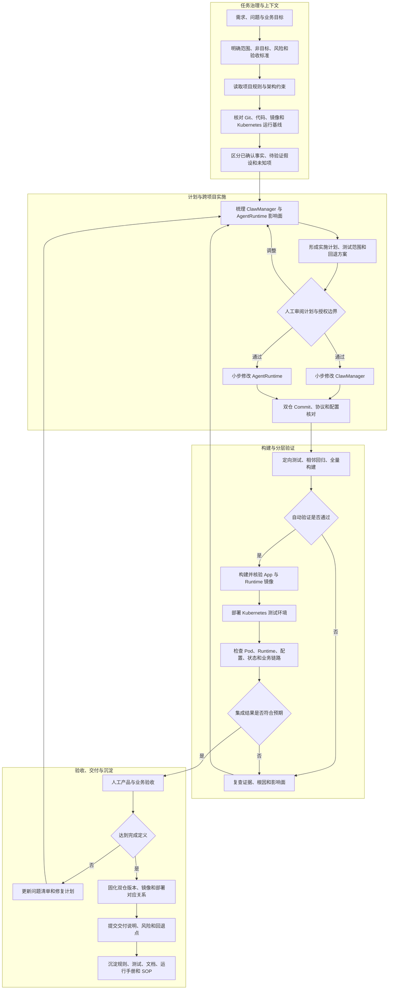
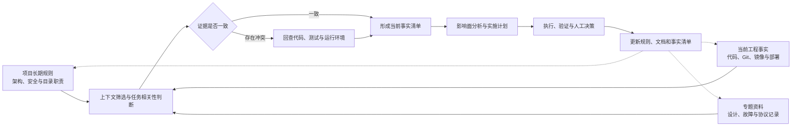
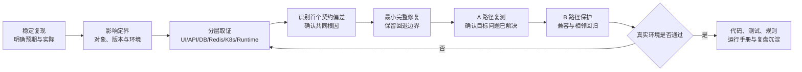

# AI Coding 辅助研发实践经验总结

> 基于 ClawManager、AgentRuntime 与 Kubernetes 持续集成的研发实践  
> 整理日期：2026-08-19

## 📌 写在前面

本文以 ClawManager 和 AgentRuntime 两个项目的协同研发为基础，结合 Kubernetes 环境中的镜像构建、部署联调和运行验证，总结 AI Coding 工具参与复杂软件工程的方法、成效与适用场景。

ClawManager 是 Multi-Agent Team Runtime 的控制面，涵盖 Go 后端、React 前端、数据库、Redis、实例与 Team 管理，以及 Kubernetes 资源编排；AgentRuntime 承担 OpenClaw、Hermes 等运行时的镜像、Agent、插件、gateway 进程、workspace 和配置管理。两个项目通过协议、环境变量、镜像和运行状态共同形成业务闭环，任何跨项目改动都需要继续进入 Kubernetes 环境完成集成验证。

在这一实践基础上，AI Coding 工具已经参与代码理解、方案设计、功能实现、测试验证、Runtime 联调、集群排障、版本管理和技术文档等研发活动。

> 🎯 **核心分工：**研发人员负责目标、架构边界、风险等级和验收口径；AI Coding 工具负责代码搜索、影响面分析、实现、测试、环境检查和结果整理；最终通过人工判断和工程证据确认交付结果。

本报告关注的重点，是如何把 AI Coding 纳入现有研发管理体系，并使其输出具备工程可用性。实践中评价 AI Coding 工具的依据包括问题是否得到完整解决、相邻能力是否保持稳定、代码与部署版本是否一致、交付过程是否可追溯，以及形成的经验能否被团队继续复用。代码生成速度是过程能力之一，最终价值仍然体现在研发质量、交付效率和组织知识积累上。

从管理视角看，这套方法延续了既有的软件工程原则，同时提升了事实收集、影响面分析、重复性执行和知识整理的效率。它要求任务边界更加清晰，项目规则更加显式，测试与验收证据更加完整，也要求研发人员将更多精力投入业务判断、架构治理、风险控制和最终决策。

围绕实际研发过程，人机协作责任可以概括为以下分工。该分工以任务风险和工程阶段为依据，AI Coding 工具承担大范围信息处理和标准化执行，研发人员把握业务方向并对交付结果负责。

| 研发环节 | AI Coding 工具主要职责 | 研发人员主要职责 | 共同产出 |
| --- | --- | --- | --- |
| 需求与现状 | 搜索代码、整理现状、识别信息缺口 | 明确目标、范围、优先级和非目标 | 可验证的任务定义 |
| 方案与计划 | 分析影响面、拆解步骤、提出测试与回退建议 | 审核架构边界、兼容策略和风险 | 可执行的实施计划 |
| 编码与验证 | 实施修改、补充测试、执行构建和环境检查 | 审查关键设计、处理业务歧义 | 代码、测试和验证证据 |
| 集成与验收 | 关联镜像与部署、收集链路状态、整理问题 | 确认环境边界和产品效果 | 集成结果与验收结论 |
| 交付与沉淀 | 汇总变更、版本、风险和文档 | 接受交付、决策发布并组织复盘 | 可追溯的团队工程资产 |

## 🧭 一、方法与心得

### 1. 将 AI Coding 工具纳入完整研发闭环

AI Coding 工具的使用范围需要与软件工程流程结合。需求和问题进入研发后，先完成目标、范围和验收标准的确认，再由 AI Coding 工具核对项目规则、代码基线和运行环境；影响面清晰后进入计划与实施，随后完成自动化测试、镜像构建、Kubernetes 联调和人工验收。结果达到预期后，更新版本记录、项目文档和可复用经验。

这套协作方式给 AI Coding 工具提供了充分的执行空间，同时在关键环节设置了人工质量门。研发人员在需求边界、架构取舍、高风险操作和产品验收上保留决策责任；AI Coding 工具在跨文件搜索、重复性修改、测试执行、证据整理等环节提高效率。

在任务启动阶段，研发人员需要给出能够被验证的目标。例如，功能类任务需要明确用户入口、预期行为、状态变化和异常反馈；问题类任务需要描述现象、影响范围、已知条件和恢复目标；集成类任务需要明确参与系统、版本组合、环境边界和成功信号。目标表达越清晰，AI Coding 工具越容易把自然语言要求转换为代码、测试和部署层面的完成定义。

计划阶段的重点是把一个宽泛目标拆成可检查的工程动作。AI Coding 工具先给出现状判断和证据来源，再列出受影响模块、修改顺序、测试范围、部署动作、风险和回退点。研发人员审阅的核心包括方案是否遵循控制面与 Runtime 解耦原则、状态权威是否保持在 ClawManager DB、Redis 与共享存储是否仍处于合理职责范围，以及修改是否超出本轮需求。计划通过后再进入实施，可以显著减少方向性返工。

实施阶段保持小步推进，每完成一组关联修改就执行针对性验证，并及时检查工作区差异。出现失败时，回到最近一个已确认事实点，更新假设和影响面，再决定继续修复或调整方案。该方式让长链路任务始终保有清晰的中间状态，也使人工能够在任意阶段理解当前进展、风险和剩余工作。

项目采用的完整研发闭环如下：

这套流程强调三个管理结论：任务进入实现前要有清晰边界，代码进入环境前要有自动验证，功能完成前要有真实集成证据和人工验收。围绕这三个质量门，还需要形成统一的完成定义：实现、测试、镜像、部署、业务效果、文档和回退信息均达到约定状态，任务才具备交付条件。

### 2. 通过 Context Engineering 保持工程事实一致

AI Coding 的质量与上下文质量直接相关。实际研发中的上下文包括项目规则、架构约束、当前代码、工作区状态、镜像版本、Kubernetes 部署、错误日志和验收标准。信息准确、相关且可以核验时，AI Coding 工具才能做出符合项目现状的判断。

项目将上下文分为三层。长期规则记录项目定位、目录职责、状态权威、安全边界和最低验证要求；当前事实记录分支、工作区、已完成修改、当前问题、镜像和部署状态；设计文档、故障记录、协议说明和历史决策作为按需资料，根据任务选择性读取。`AGENTS.md` 承担长期规则入口，具体任务仍需重新检查 Git、代码和运行环境。

分层管理能够控制上下文规模，也能减少历史信息对当前判断的干扰。会话切换或任务持续时间较长时，AI Coding 工具先核对项目事实，再继承已有结论。历史摘要提供调查线索，当前代码和实际部署决定本轮研发基线。

上下文管理还需要建立信息优先级。当前代码、数据库结构、运行配置和集群状态属于直接证据；测试输出、日志和接口响应属于行为证据；设计说明、历史报告和会话结论属于辅助证据。当不同信息发生冲突时，应优先检查直接证据和实际运行结果，并将冲突原因记录下来。这样可以避免沿用过期设计、旧镜像状态或尚未验证的历史判断。

对于跨项目任务，上下文应覆盖双方的接口契约和版本关系。ClawManager 侧需要说明实例、Team、任务、成员和状态的管理方式；AgentRuntime 侧需要说明启动参数、配置读取、workspace、Agent、插件、gateway 和状态上报方式；Kubernetes 侧需要说明镜像、环境变量、Secret、PVC、Service、探针和资源约束。三侧信息共同构成完整任务上下文，缺少其中一层，都可能导致局部实现正确而系统联调失败。

在持续时间较长的任务中，建议维护简洁的“事实清单”。清单记录当前目标、已确认事实、待验证假设、关键版本、已完成验证和剩余风险。每次重要修改、环境切换或会话切换后更新一次。事实清单既是 AI Coding 工具的工作基线，也是人工评审和任务交接的入口，可以减少重复调查并限制错误结论继续扩散。

形成的主要经验包括：

- 项目规则保持稳定、简洁并持续更新。
- 当前状态需要包含代码、镜像和部署三个层面。
- 专题资料按任务读取，历史内容及时归档。
- 已确认事实、待验证假设和未知项分别记录。
- 结论标明证据来源、适用版本和有效范围。
- 任务交接先复核事实，再延续计划和执行动作。

上下文从原始信息进入研发决策，需要经过筛选、核验和更新。项目采用以下治理路径，确保会话信息、历史记录和运行事实最终归并为当前可执行基线：

### 3. 先完成影响面调查，再开展小步实施

ClawManager 与 AgentRuntime 的功能经常横跨数据库、后端服务、API、前端页面、Runtime 配置、镜像和 Kubernetes 资源。AI Coding 工具开始修改前，需要先搜索已有 model、repository、service、handler、migration、UI 和测试，说明当前数据流、状态流和配置流，并标记跨项目协议影响。

影响面调查完成后，研发人员确认本次目标、非目标、兼容要求和验收条件。实施按照 migration、model/repository、service、handler、UI、Runtime、测试和文档拆分，每一步保持独立验证和清晰回退边界。这种方式能够控制补丁规模，也便于在发现错误假设时及时调整。

影响面调查需要沿数据流、控制流和配置流同时展开。数据流关注请求字段如何进入数据库、如何形成任务和状态、如何返回前端；控制流关注 handler、service、repository、Kubernetes 编排和 Runtime 启动之间的调用关系；配置流关注模型参数、Team token、Redis、workspace、Secret 和环境变量由谁生成、如何注入、由谁消费。三条链路对齐后，才能判断修改应落在控制面、Runtime、部署配置或界面层。

项目的职责边界是影响面分析中的重要检查项。Team、成员、任务、通信策略、状态和审计以 ClawManager DB 为权威来源；Redis 承担消息、事件、presence 和短期缓存；共享 PVC 保存上下文、产物和快照；AgentRuntime 负责运行时进程、Agent、插件和 workspace 的实际执行。AI Coding 工具在给出方案时需要明确每项数据的生成方、持有方和消费方，避免为了局部便利形成新的状态源或组件耦合。

小步实施强调“每一步都能解释、能验证、能回退”。数据库迁移保持向前兼容，业务逻辑集中在 service 层，handler 保持稳定接口，Kubernetes 资源编排检查命名、Secret、挂载和清理逻辑，前端补齐校验、加载态、失败态和重试入口。跨项目协议优先通过结构化 schema、环境变量或 adapter 扩展，减少把特定 Runtime 实现写入控制面。

跨项目修改还需要建立版本配对，确保源代码、生成物和实际部署保持一致：

| 配对对象 | 需要记录的内容 | 主要目的 |
| --- | --- | --- |
| ClawManager | 分支、Commit、工作区和测试结果 | 确认控制面代码基线 |
| AgentRuntime | 分支、Commit、受影响的 Runtime 和插件 | 确认运行时实现基线 |
| 镜像 | App、OpenClaw、Hermes 等标签、摘要和构建结果 | 确认镜像内容对应源代码 |
| Kubernetes | Deployment、Pod、当前镜像和运行状态 | 确认集群实际使用的版本组合 |

版本配对可以发现代码已经修改但镜像未更新、协议只部署一侧、镜像标签与内容不一致、本地结论与集群版本不匹配等问题，并为故障追溯和版本回退提供检查点。

版本配对还应进入任务验收和交付说明。每次跨项目验证都记录 ClawManager 与 AgentRuntime 的 Commit、镜像标签或摘要、部署对象和验证时间；当同一个标签可能被重复构建时，进一步核对镜像摘要和容器实际使用内容。通过明确的版本坐标，团队可以重现实验环境、比较两轮结果，也可以在出现回归时快速缩小变更范围。

### 4. 以证据闭环控制研发质量

AI Coding 工具给出的分析和总结属于研发过程信息，交付结论需要由测试和运行证据支持。项目形成了三层验证方式：第一层是定向单元测试、契约测试、相邻回归、全量构建和静态检查；第二层是镜像内容检查、Kubernetes 部署、Pod 与 Runtime 健康状态、配置注入和真实链路联调；第三层是页面体验、业务流程、任务状态、异常提示和结果可访问性的人工验收。

三层验证承担不同职责。自动化测试确认代码行为和相邻路径，Kubernetes 联调确认 ClawManager、AgentRuntime、镜像和基础设施的集成结果，人工验收确认最终效果符合业务目标。关键数据缺失时补充采集，单一样本通过时扩大验证范围，结果偏离预期时返回事实核对和影响面分析环节。

第一层验证遵循由近及远的顺序。修改完成后先运行与变更直接相关的单元测试或组件测试，快速判断基本逻辑；随后覆盖共用 service、协议、状态枚举和相邻 Runtime 的回归路径；最后运行项目构建、静态检查和适当范围的全量测试。测试失败时保留命令、版本、失败位置和关键输出，先判断是产品缺陷、测试假设、环境差异还是历史问题，再决定处置方式。

第二层验证关注“构建产物能否在真实环境中正确协同”。镜像构建完成后检查标签、摘要、关键文件和启动入口，部署后核对 Deployment、Pod、容器镜像、环境变量来源、Secret、PVC、Service、探针和事件。业务链路继续检查 ClawManager 创建或更新资源、AgentRuntime 启动与注册、配置加载、状态上报、任务执行和结果返回，确保代码层的正确性能够延伸到运行层。

第三层验证以使用者和运维者视角检查最终效果。页面信息是否准确、加载与错误状态是否清晰、重复操作是否安全、刷新后状态是否一致、异常是否能够定位、任务结果是否可访问，都需要人工确认。对于高风险变更，还应安排回退演练或至少核对回退条件，确保出现问题时能够恢复到已知稳定版本。

证据闭环要求每项结论都能回答四个问题：验证对象是什么，使用了哪个版本，在什么环境执行，结果依据是什么。任务交付时保留必要的测试摘要、镜像与部署坐标、关键状态和人工验收结论。证据应足以支持评审和追溯，同时对 token、凭据、用户数据和内部地址进行脱敏。

三层验证既有先后关系，也有明确的质量门。前一层通过后再扩大验证范围，后一层发现问题时返回影响面与根因分析，并补充前序测试资产。

| 验证层级 | 核心验证内容 | 典型证据 | 进入下一阶段的条件 |
| --- | --- | --- | --- |
| 自动化验证 | 参数、逻辑、协议、状态转换、相邻回归和项目构建 | 测试报告、构建结果、静态检查与差异记录 | 目标路径通过，失败项已解释，相邻能力无明显退化 |
| Kubernetes 集成验证 | 镜像内容、资源编排、配置注入、Pod/Runtime 状态和端到端链路 | 镜像摘要、Deployment/Pod 状态、事件、日志与接口结果 | 版本一致，资源健康，真实链路达到预期 |
| 人工产品验收 | 页面体验、业务流程、异常提示、数据一致性和结果可访问性 | 验收记录、关键界面与业务状态、风险清单 | 完成定义满足，剩余风险被接受，回退点清晰 |

验证环节重点关注：

- 修改前后的行为差异能够通过证据解释。
- 目标问题、同类变体、正常路径和失败路径均有覆盖。
- 新旧 Runtime、Lite/Pro、OpenClaw/Hermes 等相邻组合没有明显退化。
- 测试使用的代码、镜像和 Kubernetes 部署版本能够相互对应。
- 失败结果得到分类和解释，未验证项明确列入剩余风险。
- 人工验收与自动测试使用同一组完成定义。

### 5. 建立面向根因的 Bug 修复方法

复杂系统中的表面现象可能出现在前端、后端状态、Redis 事件、Runtime 进程或 Kubernetes 资源层。Bug 修复需要沿完整链路定位被破坏的契约、状态边界、身份传递或配置来源。页面现象、单条日志和单个实例可以作为调查入口，修复位置由根因决定。

根因明确后，继续搜索相同字段、协议、状态和共享逻辑的其他入口，形成同类问题影响面。目标修复记为 A，同时列出必须保护的 B 路径，例如 Lite 与 Pro、OpenClaw 与 Hermes、新旧 Runtime、正常任务与异常恢复。回归验证同时证明 A 已修复、B 无退化，并覆盖必要的版本兼容组合。

实际定位过程通常从建立故障模型开始。先明确期望状态、实际状态和最早出现偏差的位置，再沿前端展示、API 响应、数据库记录、Redis 事件、Kubernetes 资源和 Runtime 日志逐层核对。每一层都区分输入是否正确、处理是否正确、输出是否被下一层正确消费。通过寻找第一处契约偏差，可以降低被后续连锁现象误导的概率。

对于状态类问题，要特别检查状态的权威来源、更新顺序和恢复逻辑；对于配置类问题，要检查默认值、覆盖优先级、Secret 与环境变量注入、启动时机和热更新边界；对于通信类问题，要检查 messageId 幂等、taskId 关联、权限策略、超时、重试和 DLQ；对于资源类问题，要检查名称生成、owner reference、namespace、PVC 挂载、资源限制和清理路径。将问题归入清晰的故障类别，有助于 AI Coding 工具选择更准确的搜索和验证路径。

修复方案需要区分应急恢复和长期治理。应急动作服务于尽快恢复测试或业务链路，必须记录适用条件和有效期；长期修复进入代码、迁移、配置或部署模板，并补充自动化测试、告警或运行手册。一次问题处理完成后，团队还应判断缺少的是代码防护、测试覆盖、可观测性、发布控制还是项目规则，再把对应改进纳入后续工作。

问题处理过程可以归纳为“复现—定界—定位—修复—保护—沉淀”的闭环。该流程要求每一步都有事实输入和明确输出，修复失败或相邻路径退化时及时回到根因调查环节。

这套 Bug 方法形成了四项原则：

- 沿完整链路追根溯源，事实不足时保留未知状态。
- 在共同源头处理同类问题，控制修复范围。
- 明确“不要修 A 坏 B”的保护清单和回归范围。
- 将临时恢复经验沉淀为代码、测试、规范或运行手册。

最小修复以完整解决根因为标准。故障复现、同类变体、相邻功能和真实环境结果共同构成完成证据。

这一方法提高了 Bug 修复的可解释性。评审人员能够看到现象与根因之间的证据链、修改为何落在当前层、哪些相邻能力被保护、哪些组合已经验证，以及仍有哪些条件尚未覆盖。问题处理因此从个人经验转化为可审阅、可复现和可积累的工程过程。

### 6. 管理长任务、权限和敏感信息

Runtime 联调、性能测试和 Kubernetes 排障可能持续较长时间。每个阶段结束时记录当前事实、已完成动作、剩余风险和下一步验收目标，可以降低上下文增长带来的信息失真。新会话接手任务时，重新核对两个项目的分支与 HEAD、工作区、镜像和实际部署，再确定继续执行的位置。

长任务需要设置阶段性完成点。影响面分析、代码实现、自动测试、镜像构建、环境部署和业务验收分别形成可独立检查的中间结果。每个完成点记录输入版本、执行动作、输出证据和下一步条件；一旦中途暂停，后续可以从最后一个可靠状态继续，而无需依赖完整会话历史。对于运行时间较长的构建和测试，AI Coding 工具持续读取输出、判断是否仍有进展，并在异常、超时或指标偏离时及时调整。

权限管理根据操作风险分级。代码搜索、只读检查、测试和文档整理可以由 AI Coding 工具自主推进；业务代码修改、镜像构建和测试环境更新需要明确范围并在执行后审查；资源删除、历史数据修改、生产部署和主分支发布需要提前确认目标、影响、备份与回滚方式。

授权边界应与任务同时说明。授权内容包括允许修改的项目和目录、允许使用的环境、允许操作的 namespace 与资源、是否可以构建镜像、是否可以更新测试部署，以及哪些动作必须再次确认。范围越清晰，AI Coding 工具越能连续完成安全的工程动作，也越容易在接近风险边界时主动停止并报告。

安全管理贯穿整个流程。密钥、token、kubeconfig 和模型凭据保存在 Secret 或本地受控配置中，报告、日志、示例和普通前端响应保持脱敏。外部环境操作限定目标 namespace、资源对象和授权范围，并保留操作前后的状态证据。

涉及删除、覆盖、迁移和批量修改时，应先完成只读核对，解析出明确的绝对目标，说明影响范围和恢复方式，再按授权执行。数据库迁移保持数据兼容，Kubernetes 资源变更关注 owner reference 与清理逻辑，Git 操作保留用户已有修改。通过这些控制，AI 的高执行效率可以被约束在可审查、可恢复的工程边界内。

## 📈 二、实际成效

### 1. 提升复杂系统的理解和定位效率

ClawManager 与 AgentRuntime 涉及前端、后端、数据库、Redis、Runtime 进程和 Kubernetes。AI Coding 工具可以跨两个项目搜索代码，快速关联入口、状态源、配置流向和部署方式，帮助研发人员建立端到端认知。

在故障诊断中，日志、Pod 状态、代码和协议可以在同一任务中交叉分析，减少人工在多个模块之间反复查找和转述信息的时间。研发人员在此基础上集中判断业务语义、架构边界和处置优先级。

这种效率提升首先来自更大的信息处理范围。面对陌生模块时，AI Coding 工具可以同时检索接口定义、调用方、数据模型、数据库迁移、测试和部署配置，并通过引用具体文件与运行证据说明判断依据。研发人员获得的是经过组织的系统视图，可以更快识别真正需要决策的环节。

其次，AI Coding 工具能够持续维护同一问题在代码、镜像和运行环境中的关联。传统排查中，代码阅读、日志查询、集群检查和文档整理往往分散进行，信息容易在切换工具和人员时损失。统一任务上下文后，各类证据可以相互校验，错误假设也能更早暴露。

从管理角度看，这种能力缩短了问题从“现象描述”进入“可执行方案”的距离。研发过程中的等待和转述减少，专家可以把时间投入关键判断和复杂设计，同时保留对事实来源、修改范围和验证结果的审查能力。

主要成效体现在：

- 缩短陌生模块和复杂调用链的理解时间。
- 更快区分控制面、Runtime、网络、存储和界面问题。
- 减少跨项目沟通中的上下文损失。
- 提高方案评审前的事实完整度和问题结构化程度。

### 2. 提高跨项目研发闭环能力

一个完整功能通常需要同时处理数据库、后端服务、前端页面、AgentRuntime 和部署配置。AI Coding 工具能够检查各层字段和状态是否贯通，完成配套修改、测试扩展和交付整理，降低单侧实现或遗漏相邻模块的概率。

持续集成进一步将代码改动延伸到镜像和 Kubernetes 环境。项目可以明确记录当前验证的源代码、镜像和部署组合，及时发现构建与部署错位。研发结果由“代码修改完成”推进到“真实链路通过验证”。

在 ClawManager 与 AgentRuntime 的协同研发中，控制面新增或调整能力时，AI Coding 工具可以同步检查 Runtime 是否具备对应的配置读取、启动行为和状态上报机制；Runtime 行为变化时，也可以反向检查控制面的资源编排、API、页面展示和兼容策略。双向核对降低了接口已经定义但消费方未实现、字段含义不一致、默认值冲突和版本组合失配等风险。

闭环能力还体现在交付信息的完整性上。实现完成后，AI Coding 工具可以汇总代码变更、测试结果、镜像版本、Kubernetes 部署状态、人工验收、剩余风险和回退点，使一次研发任务形成完整交付包。该交付包既服务当前上线与评审，也为后续问题追溯、版本比较和任务交接提供依据。

对团队而言，跨项目闭环减少了“各模块分别完成、整体仍不可用”的交付落差。研发管理可以围绕端到端完成定义跟踪进展，将数据库、服务、Runtime、镜像和环境视为一个连续价值链，阶段状态也更容易被准确表达。

### 3. 扩大测试、兼容和安全检查范围

AI Coding 工具适合根据一个成功路径扩展参数校验、重复请求、资源不足、服务重启、历史版本和异常恢复等场景。研发人员明确完成定义后，可以让 AI Coding 工具批量补充测试、执行回归并整理失败证据。

Bug 修复中的 A/B 保护方法，也使评审关注点从当前问题扩展到相邻能力和版本组合。安全边界、租户隔离、Secret、路径和外部操作权限可以作为固定检查项进入每轮验证。

测试覆盖的扩大并非简单增加用例数量，重点是把业务规则和历史经验转化为稳定的验证资产。参数边界、状态转换、幂等行为、失败重试、权限隔离、配置优先级和资源清理都可以形成可重复执行的测试。后续功能变更再次触及同一路径时，这些测试会提前暴露回归风险。

兼容性检查可以围绕产品形态、Runtime 类型、部署版本和基础设施差异建立组合视角。Lite/Pro、OpenClaw/Hermes、新旧 Runtime、不同镜像与配置组合均有各自的保护要求。AI Coding 工具适合从共享代码和协议出发生成检查清单，研发人员根据风险选择本轮必须执行的组合，兼顾验证充分性与研发成本。

安全方面，AI Coding 工具可以在代码、配置、日志、文档和外部操作中持续执行一致的检查规则。例如，确认敏感信息进入 Secret、API 错误不泄露凭据、Redis URL 保持脱敏、租户与 namespace 边界得到校验、资源删除存在明确目标。安全检查因而更容易融入日常研发过程，而非集中到交付末期处理。

### 4. 促进经验沉淀和团队复用

AI Coding 工具能够把排障过程、测试方法、架构结论和版本兼容经验整理为项目规则、验收清单、运行手册和交付报告。后续任务可以读取这些高价值信息，并结合当前事实继续工作。

经验沉淀提高了问题处理的可重复性和可追溯性。团队能够了解某项决策的依据、某组代码与镜像的对应关系、某类问题的检查顺序以及可用的回退点，减少依赖个人记忆。

沉淀内容应根据生命周期进入不同载体。长期稳定的架构与安全原则写入项目规则，具体功能和协议进入设计文档，常见故障与恢复方式进入运行手册，重复验证步骤转化为测试或脚本，阶段性状态记录在进度与交付说明中。AI Coding 工具可以协助识别信息类型、整理结构并检查文档与当前实现是否一致。

复用效果还体现在新任务启动和人员协作上。新成员可以先通过规则、架构说明和运行手册建立系统认知；相似任务可以直接使用已有的影响面清单、验证组合和交付模板；跨团队沟通可以围绕统一的版本坐标和证据口径展开。知识由分散的个人经验逐步转化为团队可访问的工程资产。

持续积累后，项目会形成正向循环：一次研发任务产生代码和测试，也完善规则、工具与文档；后续 AI Coding 工具使用更完整的上下文开展工作，输出质量随之提高；团队再通过评审和复盘更新资产。AI Coding 的能力因此与项目工程成熟度共同增长。

## 🛠️ 三、主要研发场景

### 1. 代码理解与跨项目功能研发

面对 Lite/Pro 实例模式、Runtime 调度、模型配置注入、Team Redis 协作和共享 workspace 等能力，AI Coding 工具可以搜索现有实现，梳理 ClawManager 与 AgentRuntime 的职责、接口和状态流，再支持后续设计与修改。

功能开发中，AI Coding 工具负责检查跨层影响、实施重复性改动和扩展测试；研发人员负责业务语义、架构取舍和兼容边界。该场景适合链路长、文件多、配套修改容易遗漏的需求。

在需求分析阶段，AI Coding 工具可以从用户入口反向追踪前端组件、HTTP API、业务 service、repository、数据库表和 Kubernetes 编排，再继续核对 AgentRuntime 的启动入口、配置消费和状态上报。通过端到端梳理，可以提前发现需求描述中尚未明确的数据归属、状态定义、错误处理和兼容要求，并将其转化为设计问题供研发人员决策。

在实现阶段，AI Coding 工具适合完成结构一致、规则明确的跨层修改。例如，在确定字段语义和状态机后，同步更新 migration、model、repository、service、handler、前端类型、表单校验和测试；在确定 Runtime 接口后，同步核对环境变量、结构化配置、镜像内容和部署模板。人工评审聚焦关键抽象和风险点，机械性较强的配套工作交由 AI Coding 工具连续完成。

该场景的管理价值是提高跨模块变更的一致性。任务计划能够明确各层交付物，代码评审能够围绕数据流和契约开展，测试能够覆盖端到端状态变化。对于尚处于演进阶段的能力，AI Coding 工具还可以协助比较当前实现与目标设计，明确本轮最小闭环和后续扩展边界，控制需求范围。

### 2. Runtime 与 Kubernetes 持续集成

Runtime 研发需要关注镜像、Agent、子进程、端口、workspace、环境变量和健康状态。代码修改后，通过镜像构建、内容检查、Kubernetes 部署和实际链路联调确认结果。

AI Coding 工具可以持续关联源代码、构建产物和集群状态，辅助检查 Pod 启动、Runtime 注册、配置注入和状态上报。研发人员负责确认测试环境边界、资源风险和产品效果。

持续集成的起点是构建可识别、可追溯的镜像。构建前核对代码基线、Dockerfile、依赖和目标架构，构建后检查镜像标签、摘要、关键文件、启动命令和必要的版本信息。若 ClawManager 与 AgentRuntime 同时变化，需要生成明确的配对关系，并避免仅依赖可重复覆盖的标签判断镜像内容。

进入 Kubernetes 环境后，先检查资源编排是否符合设计：Pod 的环境变量是否来自正确配置，Secret 是否按受控方式注入，PVC 与共享 workspace 是否挂载到预期路径，Service、端口和健康探针是否匹配 Runtime 行为，资源命名、owner reference 和清理策略是否一致。随后检查 Pod 事件、容器日志、进程、端口、Runtime 注册和控制面状态，逐步确认基础设施与应用行为。

业务联调需要覆盖从 ClawManager 发起操作到 AgentRuntime 执行并返回状态和结果的完整链路。Team 场景还要关注成员 Pod 创建、Redis Team Bus 配置注入、共享存储、成员状态和任务事件流；实例场景需要关注不同产品形态与 Runtime 类型的配置差异。AI Coding 工具可以执行检查、收集证据和对比版本，研发人员依据业务完成定义做最终验收。

持续集成的经验表明，镜像构建成功、Pod 处于 Running、健康检查通过和业务可用分别代表不同层级的结果。交付口径需要覆盖实际业务链路，并保留源代码、镜像和部署对象之间的对应关系。这样才能让 Kubernetes 环境真正成为集成质量门，而非单一的部署状态检查。

### 3. 故障诊断、兼容与性能验证

在前端显示、后端状态、Redis 事件、Runtime 执行、PVC、NFS 和网络等场景中，AI Coding 工具用于收集证据、区分事实和假设、定位共同根因，并检查同类问题和相邻路径。

容量与性能问题需要结合真实创建逻辑设计阶梯测试，区分最大创建数量、稳定运行数量、空载容量和任务并发能力。AI Coding 工具承担测试执行、指标整理和结果对比，研发人员判断测试口径和结论的适用范围。

故障诊断适合采用分层排查顺序。首先确认问题是否可以稳定复现以及影响哪些对象，其次核对前端和 API 看到的状态，再检查数据库权威记录、Redis 消息或事件、Kubernetes 资源与 Runtime 行为。每一层都记录正常信号和异常信号，逐步找到最早偏离预期的位置。AI Coding 工具能够并行检索代码和现有测试，为运行现象寻找对应实现，帮助缩短从日志到根因的距离。

兼容性验证应建立与变更风险匹配的组合矩阵。共享协议、状态字段、配置默认值和公共 service 发生变化时，需要扩大到不同 Runtime、产品形态和版本组合；局部界面调整则重点覆盖目标页面、错误态和刷新一致性。AI Coding 工具可以根据影响面提出候选组合、自动执行其中可重复的部分，并把未覆盖组合列为明确风险，研发人员据此确定交付范围。

性能与容量验证应先统一指标含义。创建成功数量反映控制面与编排能力，稳定运行数量受集群资源和 Runtime 基线开销影响，任务并发还会受到模型调用、网络、Redis、存储和业务负载影响。测试采用阶梯加压、稳定观察和恢复验证，记录集群资源、Pod 状态、错误率、启动时间和任务响应等指标。结论注明硬件、配置、镜像、持续时间和负载模型，避免将特定环境结果直接泛化。

这类场景中，AI Coding 工具的优势在于持续执行标准化检查并整理大量证据，人工的核心职责是定义有效指标、识别业务影响和判断风险是否可接受。二者结合可以提高故障处理的系统性，也能使兼容和性能结论具备更清晰的适用边界。

### 4. Git、评审和交付收口

AI Coding 工具可以检查工作区改动、分析分支关系、协助处理冲突、总结影响范围并生成提交说明。涉及产品语义的冲突由研发人员决策，合并后继续执行构建和功能回归。

交付阶段同步记录双仓 Commit、镜像、部署状态、验证结果、遗留风险和回退方式，并更新必要的项目文档。这一过程保证研发成果具备可审查、可追溯和可交接的基础。

在代码收口前，AI Coding 工具先区分本任务修改与工作区已有内容，检查 diff 是否符合目标、是否混入调试代码或敏感信息、是否存在遗漏测试和文档。提交可以按照 migration、后端、前端、Runtime、部署和测试等可回退边界组织，提交说明准确表达行为变化和验证情况。用户已有改动始终受到保护，任何覆盖、删除或重写历史的动作都需要明确授权。

评审材料应从“改了哪些文件”提升到“解决了什么问题、为何采用当前设计、影响哪些链路、如何证明结果”。AI Coding 工具可以生成结构化变更摘要，列出架构约束、协议变化、兼容范围、测试证据和剩余风险。评审人员由此能够更快进入关键判断，同时仍可通过代码、测试和运行证据核验结论。

交付完成后，还需要更新与行为变化直接相关的项目规则、进度记录、功能说明和运行手册。若任务形成了新的故障模式、验证方法或版本约束，应同步沉淀为清单、测试或脚本。研发成果由代码扩展为完整的工程资产，也为后续发布、运维和相似任务提供可靠入口。

## 🚀 四、团队推广建议

### 1. 建立统一的项目规则和任务模板

团队推广首先需要统一工程输入。项目规则应说明项目定位、目录职责、架构原则、数据与状态权威、安全边界和最低验证要求；任务模板应包含目标、现状、范围、非目标、验收标准、风险和授权范围。

规则和模板提供最低质量基线，研发人员可以继续保留自己的提问和协作习惯。推荐的任务表达如下：

> 请先核对当前代码和运行基线，说明真实实现、影响范围和待确认事项；在边界与验收标准明确后给出最小完整方案。实施过程分步验证，最终汇总代码、版本、测试、部署结果和剩余风险。

项目规则需要由团队共同维护，并与代码演进同步。规则内容以长期稳定、能够指导决策的信息为主，例如控制面与 Runtime 的职责、数据库与 Redis 的状态边界、Secret 管理原则、目录职责、风险操作要求和最低测试口径。具体任务状态、临时环境信息和一次性结论进入独立记录，避免长期规则快速膨胀。

任务模板可以根据工作类型形成少量变体。功能研发模板强调业务目标、数据与状态变化、接口和验收；Bug 模板强调复现条件、预期与实际、影响范围和 A/B 保护项；Kubernetes 集成模板强调代码、镜像、部署版本、namespace、资源风险和回退；文档与调研模板强调事实来源、适用范围和交付形式。模板统一关键信息，不限制研发人员对具体任务的表达方式。

团队还需要建立上下文入口清单，明确新任务优先读取哪些规则、架构说明、测试命令和运行手册。AI Coding 工具启动任务时先核对这些入口，再通过代码和环境更新当前事实。这样可以降低不同人员使用时的质量波动，也能减少每次重新解释项目基础知识的成本。

规则和模板的效果应通过实际任务持续校正。若同类错误反复出现，说明规则、测试或工具仍有缺口；若大量任务需要绕过某项规则，说明规则可能已与工程现实脱节。团队定期清理过期内容、合并重复要求，并将高频人工提醒转化为自动检查。

### 2. 建立团队 AI Coding SOP

团队 SOP 应覆盖需求与边界、上下文核验、计划审阅、实现与版本配对、分层验证、人工验收和知识沉淀。每个阶段设置进入下一阶段的质量门，并为失败结果保留返回事实调查和计划调整的路径。

SOP 的目标是统一工程控制方式和高风险操作边界。具体工具、提示方式和实施节奏可以根据人员与任务特点调整。推广后应确保以下结果：

- 需求和范围能够被确认。
- 上下文和版本能够被核验。
- 计划、代码和变更能够被审阅。
- 问题能够复现，修复能够解释。
- 结果能够验收，版本能够回退。
- 经验能够进入团队知识体系。

SOP 落地时，可以把任务按风险和复杂度分级。低风险任务允许 AI Coding 工具在明确边界内连续完成搜索、修改和定向验证；中风险任务在方案、关键实现和环境更新前设置人工审阅点；高风险任务进一步要求双人评审、备份、回退方案和受控发布。分级机制使管理成本与实际风险匹配，也为研发人员提供清楚的自主执行范围。

| 任务等级 | 典型任务 | AI Coding 工具执行范围 | 人工控制要求 |
| --- | --- | --- | --- |
| 低风险 | 代码检索、测试补充、文档更新、只读环境检查 | 可在项目规则和任务范围内连续执行 | 完成后检查结果和差异 |
| 中风险 | 业务代码修改、数据库向前兼容迁移、镜像构建、测试环境更新 | 按审阅后的计划分步执行并保留验证证据 | 审阅方案、关键代码、环境变更和验收结果 |
| 高风险 | 资源删除、历史数据修改、生产部署、主分支发布和权限变更 | 仅执行已明确授权的具体动作 | 事前确认目标、备份和回退，必要时双人复核 |

各阶段应定义可交付物。需求阶段形成目标、范围和完成定义；上下文阶段形成事实清单与版本基线；计划阶段形成影响面、步骤、验证和回退；实施阶段形成可审查代码与测试；集成阶段形成镜像、部署和业务链路证据；交付阶段形成变更摘要、风险、版本坐标与文档更新。SOP 由这些可核验产物连接起来，方便任务跟踪和质量审计。

在人机协作上，团队应明确责任归属。AI Coding 工具可以提出方案、修改代码和执行验证，但业务目标、架构决策、风险接受、生产授权和最终验收由研发人员负责。对于 AI Coding 工具无法获得的事实、无法验证的环境和存在冲突的证据，需要显式标记并提交人工处理。明确责任能够避免将工具输出直接等同于工程结论。

推广可以从跨文件理解、测试补充、文档整理和测试环境排障等低风险高收益场景开始，逐步扩展到跨项目功能研发、镜像构建和 Kubernetes 持续集成。每次扩展前确认项目规则、权限、验证资产和回退能力已经具备，使自主执行范围随工程成熟度稳步扩大。

### 3. 建立质量指标和复盘机制

AI Coding 的效果可以从交付效率、问题处理、代码质量、验证能力和知识复用五个方面观察。建议持续记录需求到计划的时间、需求到验收的周期、问题定位与恢复时间、一次评审通过率、回归缺陷、人工修正量、真实环境通过率以及沉淀的规则和工具数量。

指标用于识别流程瓶颈和判断推广效果，代码生成量不作为核心评价依据。定期复盘成功与失败任务，关注 AI Coding 工具在哪些环节产生价值、哪些环节需要人工纠偏、哪些经验可以固化为规则、测试、脚本或 SOP。

效率指标需要结合任务复杂度解读。简单修改的交付周期、复杂跨项目需求的闭环周期、故障定位时间和环境恢复时间具有不同基线，适合分类观察趋势。质量指标重点关注回归缺陷、评审发现的问题、重复返工、真实环境失败和回退情况；知识指标关注规则、测试、脚本和手册的使用次数与有效性。通过多维指标可以避免单纯追求速度带来的质量偏差。

复盘应覆盖成功任务和失败任务。成功任务总结哪些上下文、计划方式和验证资产支持了高效交付，判断能否形成模板；失败任务还原错误假设从何产生、为何未被及时发现、哪个质量门失效，以及需要补充哪类工程控制。复盘结论尽量进入代码、测试、规则、工具或流程，减少仅停留在会议记录中的经验。

团队可以按成熟度分阶段推进。起步阶段关注安全使用、事实核验和基本验证；稳定阶段关注跨项目闭环、版本配对和 SOP 执行；深化阶段关注测试资产、自动化质量门、知识复用和指标优化。每一阶段都以实际交付质量为依据调整 AI Coding 工具的使用范围，逐步形成与项目特点匹配的协作模式。

管理层在推广中需要关注三项基础投入：可读取且持续更新的工程规则，可重复执行的测试与环境，清晰的权限和责任体系。这些基础能力同时服务人工研发和 AI Coding。随着工程资产完善，AI Coding 工具的输出会更稳定，研发过程也会更透明、更易审查。

## ✅ 五、总结

ClawManager 与 AgentRuntime 的协同研发，以及 Kubernetes 中持续构建、部署、联调和验证的实践，形成了覆盖 Context Engineering、影响面调查、小步实施、版本配对、分层验证、根因修复和知识沉淀的 AI Coding 方法。

该方法的管理重点包括：用可核验的工程事实维护上下文，用清晰边界和完成定义控制实施，用双仓与镜像版本配对保证集成一致，用自动测试、Kubernetes 联调和人工验收确认结果，用根因与 A/B 保护原则提高 Bug 修复质量，并将有效实践持续沉淀为团队资产。

实践表明，AI Coding 工具更适合被纳入完整研发过程，由明确的项目规则、真实代码和环境事实驱动，在授权范围内连续完成调查、实现和验证。研发人员通过目标定义、架构决策、风险控制和最终验收保持工程主导权。双方围绕同一完成定义协作，可以兼顾执行效率与交付质量。

对于 ClawManager 和 AgentRuntime 这类跨控制面、运行时与 Kubernetes 的复杂项目，AI Coding 的核心收益体现在系统理解、跨层一致性、验证覆盖和经验复用。其推广基础也十分明确：持续完善 Context Engineering，建设自动化测试与真实集成环境，建立版本和证据管理，规范高风险操作，并通过复盘把有效经验沉淀为工程资产。

在明确的人机分工和工程质量门下，AI Coding 工具可以持续扩大研发人员的系统理解范围和执行效率，为复杂跨项目研发提供可控、可验证、可追溯、可回退的协作能力。
