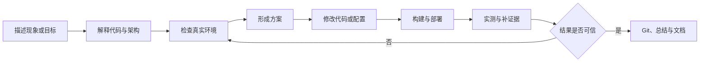

# AI Coding 个人研发经验与真实使用场景总结

## ——基于 ClawManager 项目 Codex 任务记录的复盘

> 整理日期：2026-08-18  
> 说明：本文不是根据 Git 提交反推 AI 的作用，而是直接复盘本人在 ClawManager 项目中使用 Codex 的真实任务记录。涉及的服务器地址、凭据、实例标识和用户数据均已省略或泛化。

## 一、复盘口径

为了避免把这篇总结写成泛泛的“AI 提效经验”，本次直接读取了本机 Codex 的任务索引和会话记录，并按工作目录筛选 ClawManager 项目。

统计范围为 2026-06-01 至 2026-08-18：

| 指标 | 结果 |
| --- | ---: |
| 由本人直接发起的 Codex 主任务 | 111 个 |
| 有任务记录的活跃日期 | 46 天 |
| 6 月任务数 | 39 个 |
| 7 月任务数 | 51 个 |
| 8 月截至 18 日任务数 | 21 个 |
| 元数据标记为 VS Code 工作流 | 109 个 |
| 元数据标记为 CLI 工作流 | 2 个 |
| 标题中手动标记为完成 `✅` | 24 个 |
| 标题中手动标记为未完成或失败 `❌` | 4 个 |

对 111 个任务标题做重叠标签统计，得到的主要使用场景如下。由于一个任务可能同时属于“Runtime”和“K8s 排障”，各分类数量不能相加作为总数。

| 使用场景 | 命中任务数 |
| --- | ---: |
| 架构理解、代码检查与原理解读 | 49 |
| Runtime、实例与 Lite/Pro | 40 |
| 故障诊断与修复 | 37 |
| 功能研发、设计与优化 | 35 |
| K8s 与基础设施 | 25 |
| Git、分支、合并与版本协作 | 10 |
| 文档、汇报与产品表达 | 10 |
| Skill 能力 | 8 |
| 测试、性能与容量 | 7 |
| Team、Redis 与协作机制 | 6 |

从这些数据看，我使用 Codex 的主要方式并不是“让 AI 帮我补几行代码”，而是把它作为一个长期在线的技术协作者，参与代码理解、方案讨论、真实环境排障、功能实现、测试验证、版本管理和技术表达。

## 二、我真实使用 Codex 的方式

### 1. 先把 Codex 当作代码库讲解员

我的高频问题并不是直接要求修改，而是先问：

- Lite 模式是怎么加载的？
- Runtime Pod、桌面页面和代理链路是如何实现的？
- Hermes Lite 镜像的加载和启动逻辑是什么？
- 模型 URL、API Key 和环境变量是如何注入、覆盖和隔离的？
- Team、Redis、channel、共享 workspace 的现有架构是什么？
- PVC、NFS、NodePort、CoreDNS、WebSocket、egress proxy 分别处在什么链路？

这类任务在 111 个任务中占了接近一半。我的实际使用习惯是：先让 Codex 搜索真实代码和调用链，把当前实现解释清楚，再决定要不要改。

这和单纯问通用知识有明显区别。一次 OpenClaw Runtime 容量测试任务中，Codex 最开始给出了通用压测方案，我随即要求它先了解项目里 OpenClaw Runtime 和 Lite 实例的真实创建方式，再重新定义测试。也就是说，我并不接受脱离仓库的“正确答案”，而是要求答案必须建立在当前代码、部署和运行模型上。

### 2. 把真实现象、日志和截图直接交给 Codex

很多任务不是从规范化需求开始，而是从一句“这是什么原因”开始。我会把以下内容直接提供给 Codex：

- `kubectl get pods`、events、容器日志和浏览器报错。
- 某个实例、namespace 或 Runtime Pod 的现状。
- 页面截图、创建页面、黑屏或挂载异常截图。
- 资源规格、Pod 数量、CPU/内存数据和失败点。
- 某次升级、镜像替换、分支合并之后出现的异常。

Codex 需要先从现象中形成假设，再主动检查代码、配置、K8s 资源和 Runtime 进程。我的使用方式更接近“把 Codex 拉进故障现场”，而不是把问题整理完后只让它写一个函数。

真实任务包括 CoreDNS 无法解析、NFS 挂载异常、PVC Pending、Pod ImagePullBackOff、MySQL Pod 异常、Pro 桌面 WebSocket 断连、标准清晰度黑屏、剪贴板内容异常替换、Lite 定时任务失败、Hermes 会话刷新丢失、OpenClaw 升级后实例不可用等。

### 3. 让 Codex 从建议者继续变成实际执行者

当诊断方向明确后，我通常不会停留在“给我几条命令”，而是继续要求：

- 你来检查实际集群。
- 你来操作，但要保证数据不丢。
- 不要只列举数据，去服务器上实测。
- 不要只修这个实例，要修代码并用实例验证。
- 构建镜像、推送、更新部署，再检查结果。
- 全部重新跑一遍，验证结论是否变化。

因此 Codex 在实际工作中同时承担了研发助手、测试执行者和运维协作者三种角色。它会使用仓库内已有的 kubeconfig、部署脚本和测试脚本，检查 Pod、Deployment、PVC、日志和进程状态；在得到授权后执行构建、发布或恢复动作；最后再复查运行结果。

### 4. 持续追问和纠偏，而不是一次性接受结果

从会话记录看，我与 Codex 的协作通常是多轮的，而且会频繁纠偏：

- “你这个结论是不是忽略了 CPU？”
- “未单独采集的数据是否需要重跑？”
- “为什么只修复了一个实例，另一个还不行？”
- “修复代码，而不是临时修复实例。”
- “我指的评估不是列举一个数据，而是去服务器实测。”
- “这个功能是不是漏加了？”
- “Git message 太长了，精简。”

这说明我的使用方式不是把判断权交给 AI，而是把 AI 当作一个执行力很强、但需要持续校准的协作者。人负责识别目标偏差、质疑证据和决定风险边界，Codex 负责快速搜索、执行、验证和整理。

### 5. 用同一个任务持续推进到真正闭环

部分任务会跨越几十轮对话甚至多个日期。一个任务可能经历：

我经常使用“继续任务”“还在执行吗”“重新跑”“补齐证据”等方式维持长任务。这种方式的优点是上下文连续，缺点是会话越长，早期假设、临时环境信息和已失效结论越容易混在一起，因此需要阶段性总结。

### 6. 把 Codex 当作 Git 和交付助手

真实任务中还包括：

- 检查工作区改动并生成中英文 Git message。
- 精简过长的提交说明。
- 创建分支、提交本地代码、添加上游仓库。
- 合并主仓库 main，分析和解决 rebase/merge 冲突。
- 判断哪些冲突应保留当前分支行为，哪些应吸收上游修改。
- 构建并推送镜像，更新远端部署。
- 编写产品介绍、技术汇报、PPT 和测试总结。

这意味着我使用 Codex 的终点通常不是“代码写完”，而是尽量推进到可测试、可提交、可说明的交付状态。

## 三、最能代表我使用方式的真实案例

### 案例一：OpenClaw Runtime 容量测试

这是最典型的一次“Codex 参与完整实验”的任务。任务记录中包含约 40 条去重后的用户侧输入，持续推进了两天左右。

最初目标是判断 2C/4Gi、4C/8Gi 等不同资源配额能创建多少个 Lite 实例，以及容量是否随 CPU、内存线性增长。

实际推进过程不是让 Codex 写一份压测方案就结束，而是：

1. 要求 Codex 先阅读 OpenClaw Runtime 和 Lite 实例创建代码。
2. 把测试重点收敛为：不同资源配额下，Runtime Pod 能稳定拉起多少个 gateway 子进程。
3. 提供真实集群上下文，让 Codex 执行阶梯扩容测试。
4. 测试 2C/4Gi、4C/8Gi、8C/16Gi，以及更高资源规格。
5. 追问 CPU throttling 的含义，要求把指标翻译成容易理解的结论。
6. 对没有单独采集的数据要求重新测试，随后又要求全部重跑验证结论。
7. 从空载启动容量继续扩展到执行真实任务时的并发容量。
8. 质疑高资源规格过于接近节点极限，主动调整测试边界。
9. 要求 Codex 不只给估算，而是到服务器实测不同规格。
10. 最后要求形成完整报告，并写明调用什么命令、如何触发任务。

这次实践让我认识到，AI 在研发测试中的价值不只是生成脚本，而是可以参与“提出假设—设计实验—执行实验—解释指标—接受质疑—重跑验证—形成结论”的全过程。

同时也说明，AI 的第一次方案通常只是起点。真正有价值的数据来自人不断追问：这个结果是否只是空载？CPU 是否真的不是瓶颈？资源比例一定要 1:2 吗？最大创建数和稳定并发数是否应该分开？

### 案例二：Kubernetes 集群异常与实例恢复

一次集群排障任务中，任务记录包含约 20 条用户输入。最初要求是检查大量 Error、Unknown 或 ImagePullBackOff Pod 的原因，并给出恢复方案。

后续我持续追问：

- 为什么 ClawManager App 重启会卡住？
- 错误实例应该如何恢复？
- 能否由 Codex 直接操作，并保证数据不丢？
- 老实例如何升级？
- 不同节点为什么不能直接共享本地镜像？
- 没有 Registry、只有镜像 tar 包时应该怎么处理？
- workspace-store 是否缺失？当前实例最终是否可用？

Codex 在过程中采集了 nodes、pods、events、PV/PVC 的前后快照，并将恢复证据保存在项目 `.codex` 目录。大量异常 Pod 最终恢复到 Running。

这个案例体现了我把 Codex 当作“有操作能力的 SRE 搭档”使用。但它也暴露出最高风险：真实集群操作必须限定 namespace 和资源对象，先做只读采证，再做最小变更；任何删除、重建和迁移都要确认数据卷、owner 和回滚路径。

### 案例三：OpenClaw 5.4 到 7.1 的平滑升级

这个任务包含约 30 条有效用户输入，覆盖 Runtime 差异分析、实例验证、代码修改、镜像构建、集群更新和 Git 收口。

问题起点是：OpenClaw 从旧版本升级到新版本后，部分旧实例无法恢复。我的要求并不是修好一个实例，而是形成可复用的升级路径。

实际协作过程包括：

1. 对比新旧实例 workspace 和外部插件安装布局。
2. 讨论是否通过幂等软链接兼容不同版本的 `node_modules` 查找路径。
3. 在真实旧实例上验证方案，而不是复制一份数据做静态实验。
4. 发现某个实例恢复、另一个仍失败后，继续追查旧 generation、数据库状态和重试逻辑。
5. 明确要求“修复代码，而不是修复实例”。
6. 修改 ClawManager/AgentRuntime 兼容逻辑，重新构建镜像并在集群验证升级和回滚。
7. 最后总结改动、部署命令和向主项目合并的方式。

这是我认为最有代表性的 AI Coding 场景：线上故障只是入口，最终目标是把一次性操作转化为代码中的兼容策略、幂等逻辑和可重复验证流程。

### 案例四：Team 与 AgentRuntime 架构评估

在 Team 设计评估任务中，我没有只说“帮我看看 Team”，而是明确提供：

- Team 基础镜像由另一个 AgentRuntime 项目构建。
- Runtime 中有负责 Redis 协作的插件实现。
- 主要流程是用户给 leader 下发任务，leader 拆分并派发给成员。
- 要求从优势和缺陷两方面做科学、全面的评估。
- 先让 Codex 给出架构评价，再继续补充实际使用中遇到的问题。

这种用法体现了另一个特点：我会把 Codex 当作架构评审对象，先让它基于代码形成独立判断，再用真实使用问题挑战这套判断。后续 Team 的 DB 权威状态、Redis 事件消费、outbox、任务 ledger、review contract 和共享 workspace 等能力，都可以看作从实际问题逐步沉淀出来的工程机制。

### 案例五：截图驱动的前端与产品问题

不少任务直接从页面截图开始，例如 Workbuddy 创建入口不显示、挂载路径不一致、实例创建都显示为 medium、科研看板不够完整等。

我的使用方式通常是：给出截图和一句很直接的问题，让 Codex 自己定位前端组件、后端类型、镜像卡片、环境变量或部署差异。确认原因后，再要求实现、构建和验证。

这种方式适合界面现象明确但不知道代码入口的场景。Codex 的优势是可以从 UI 文案一路追到类型定义、API、数据库和 Runtime 配置；风险是它容易只修展示层，因此验收时仍要确认实际创建出的资源和配置是否正确。

## 四、我在 AI Coding 中形成的个人方法

### 1. 不接受脱离项目的通用答案

如果问题涉及 ClawManager、AgentRuntime 或 K8s，我会要求 Codex 先读代码、部署和实际资源，再给方案。通用知识可以作为假设，但不能直接作为项目结论。

### 2. 先解释清楚，再决定是否修改

我大量使用“怎么实现”“为什么”“帮我解读”“当前逻辑是什么”这类提问。先理解现状可以避免在错误抽象上继续堆代码，也便于判断问题属于控制面、Runtime、镜像、网络、存储还是 UI。

### 3. 用真实环境验证，而不是只依赖 Mock

对于 Runtime 和 K8s 问题，我通常要求 Codex 进入真实环境检查。特别是 Pod 调度、PVC、镜像分发、WebSocket、Runtime 子进程和资源容量，仅靠单元测试无法得出可信结论。

### 4. 区分临时恢复和系统性修复

我会明确追问：这是只修好了一个实例，还是修复了代码？一次性恢复可以用于验证假设，但最终应尽量沉淀为兼容逻辑、迁移、测试和文档。

### 5. 对数据和结论保持怀疑

当数据缺失、样本太少或结论只来自估算时，我会要求补采、重跑或扩大测试。AI 给出的解释再合理，也不能替代真实指标。

### 6. 让 Codex 负责执行，让人保留判断权

Codex 可以高效完成搜索、改动、构建、测试、部署和总结，但范围是否合理、数据是否可信、能否操作真实环境、是否可以合并发布，仍由人决定。

## 五、这种使用方式带来的价值

### 1. 缩短从“不知道入口”到“找到真实链路”的时间

ClawManager 横跨 Go、React、MySQL、Redis、K8s 和多个 Runtime。Codex 可以在一次任务中搜索多个仓库和多层调用链，快速回答“这个现象到底由哪一层负责”。

### 2. 把研发、测试和运维串成同一个闭环

传统协作中，代码修改、镜像构建、集群验证和结果复盘可能由不同角色分段完成。使用 Codex 后，同一任务可以持续贯穿这些环节，减少上下文重新传递。

### 3. 提高实验和排障的可重复性

容量测试脚本、集群快照、临时诊断脚本、构建命令和测试总结都可以被保存。下次出现相似问题时，不必完全依赖个人记忆。

### 4. 帮助把隐性经验写成工程规则

很多规则来自真实问题，例如 Runtime 创建必须异步、端口必须原子预留、状态必须来自真实进程、Redis 不能作为权威状态、升级不能破坏旧 workspace。这些经验可以继续沉淀到 `AGENTS.md`、开发规范和自动化测试中。

## 六、真实使用中暴露的问题

### 1. 容易把敏感环境信息直接放进任务

实际排障中曾直接提供集群连接信息、地址和运行日志。这样虽然方便 Codex 立即操作，但风险较高。更好的方式是：凭据只保存在本地受控 kubeconfig 或 Secret 中，任务里只说明使用哪个已配置连接，不直接粘贴 token、密码或私钥。

### 2. 长会话容易混入过期上下文

容量测试、版本升级等任务会持续几十轮。长上下文有利于连续推进，但容易保留已经失效的端口、镜像、实例和假设。建议每完成一个阶段，让 Codex 输出“当前事实、已完成动作、未解决问题、下一步验收”四项摘要。

### 3. 任务很多，但知识沉淀仍依赖主动整理

两个月内有 111 个主任务，并且曾出现“去所有历史会话里寻找以前修复方式”的需求。这说明 Codex 会话本身已经成为工程记忆库，但仅依赖聊天搜索不够稳定。关键结论应同步进入 issue、设计文档、运行手册或代码测试。

### 4. 直接操作集群需要更明确的变更门槛

“你来操作”能够提高效率，但生产或共享环境中的删除、重建、镜像替换和数据库修改需要更严格的计划。推荐固定采用：只读采证、变更计划、影响范围、回滚方式、执行、前后对比。

### 5. Codex 的第一反应有时过于通用

如果只给一句“怎么测试”或“为什么失败”，Codex 容易先输出通用方法。实践证明，及时补充“先看当前代码”“去真实环境检查”“不要估算，要实测”能够显著提高结果质量。更好的做法是在第一条任务中就写清事实来源和验收方式。

### 6. Git 自动化仍然需要人工确认产品语义

Codex 可以解决文本冲突，但不能仅凭 Git 判断产品语义。例如合并上游时，某个创建入口应该隐藏还是对所有 Runtime 开放，需要由人明确。自动合并完成后仍要做功能回归。

## 七、后续可以固化的使用模板

### 代码理解类

> 先不要修改代码。请搜索当前实现，从入口、数据流、关键配置、状态来源和测试五个方面解释，并指出现有设计的风险和不确定项。

### 故障排查类

> 先只读检查代码和环境，给出证据、根因假设和最小验证方法。未经确认不要删除或重建资源。确认根因后，再区分临时恢复方案和代码级修复方案。

### 功能研发类

> 先确认已有实现和本次边界，再按 migration、model/repository、service、handler、UI、测试拆分。实现后运行针对性测试，并说明未验证的真实环境风险。

### K8s 操作类

> 先采集 nodes、pods、events、Deployment、Service、PV/PVC 和 owner 信息。执行前说明目标 namespace、具体资源、数据风险和回滚方式；执行后提供前后对比。

### 性能测试类

> 先阅读真实创建和运行逻辑，定义成功、稳定和失败口径。区分空载容量与任务并发容量，保存命令、配置、原始指标和失败证据；缺失数据必须补采，关键结论至少复测一次。

### Git 交付类

> 先检查工作区和分支关系，区分用户改动与当前任务改动。合并冲突按产品语义处理，完成后运行测试，再生成精简的中英文提交说明；未得到授权不直接推送或合并主分支。

## 八、个人总结

回看这些真实任务，我对 AI Coding 的使用已经明显超出了“写代码”。我实际把 Codex 用成了六种角色：代码库讲解员、架构评审者、功能开发者、测试执行者、K8s/SRE 协作者和 Git/文档助手。

我认为自己最有效的使用习惯有三个：

1. 不满足于通用回答，要求先理解真实代码和环境。
2. 不轻易接受第一次结论，要求提供证据、补采和复测。
3. 不满足于临时修好，尽量把问题沉淀为代码、测试和规范。

需要继续改进的地方也很明确：减少在任务中直接暴露环境信息；给长任务增加阶段性决策记录；把聊天中的关键结论及时转成项目文档；对真实集群操作建立更严格的确认和回滚门槛。

如果用一句话总结我的 AI Coding 方式，就是：

> **我不是把需求扔给 Codex 等它交付，而是让 Codex 进入真实研发现场，与我一起理解系统、执行实验、修改代码、操作环境和验证结果；我持续负责纠偏、质疑证据和决定边界。**

这也是 ClawManager、AgentRuntime 和 Kubernetes 这类复杂工程中，Codex 最有价值的使用方式。
