# 系统备份与恢复开发流程图

> 更新日期：2026-10-09（北京时间，UTC+08:00；同步 producer MySQL 28 项、历史恢复/撤销管理及 A mTLS 专项、迁移与 capture 双向互斥、页面只读 API 固定数据入口）
>
> 依据：当前工作树（含未提交修改）、[四人分工与开发门禁](system-backup-restore-division-plan.md#16-四人分工和开发门禁)、[A 阶段步骤](system-backup-restore-a-role-steps.md)、[D 阶段步骤](system-backup-restore-d-role-steps.md)、[v12 合同清单](../contracts/system-backup/v12/contract-manifest.json)及下文链接的验收记录。阶段表示开发顺序，不代表日历排期。
>
> **当前仍处于 P0-0a 合同冻结前；P0-0b 已完成若干代码和现场验收子项，五个 P0 阶段均未完整通过。**

## 2026-09-30 主项目合并与备份兼容性收敛

已将 `../ldap/ClawManager` 的 `04ceec8`（用户名全局唯一及 LDAP 用户名登录）按共同基线 `576e4bb` 合并到当前工作树，保留现有未提交的备份开发内容；本次为内容合并，未创建提交。初次检查的 `2e7738a` 与最终 `04ceec8` 代码树相同。

- **迁移与备份互斥：** 新增 `063_unique_usernames.sql`，保留原 SQL 文件名和内容。重名检查接入现有迁移锁连接，在 capture gate 空闲检查后执行；已有较高编号迁移的安装也必须检查 gate。重复用户名、查询失败或 capture 活跃均拒绝迁移，拒绝后释放锁，可在条件恢复后重试，不自动修改历史账号。
- **登录会话：** 按全局用户名查询并由已存储的 provider/DN 决定认证方式，保留 `UpdateLoginState` 并发校验及备份会话登记。原 LDAP 别名不再作为登录入口；真实用户名含 `ldap_` 前缀的本地账号仍走本地认证。回归继续覆盖目录失败、身份/权限并发变更、会话登记失败不返回 token、refresh 和角色同步。
- **当前 catalog：** 94 文件、99 个 inventory 对象；migration catalog hash 为 `0de7fd12672eccc8b51fd38b6e3dd49e6342fe3e52da247267e9cd02ba420d93`。controller 固定值、Go catalog 检查及 schema registry 已同步。合同仍为 draft，schema evidence 仍未获批准。
- **历史升级边界：** 下文 93 文件、95→96 ledger 及旧 fresh/live 回执属于合并前版本。旧 review 的 catalog pin 不能授权新版本；仅改 hash 也不能把缺少 `063_unique_usernames.sql` 的安装放入“仅补 080”入口。该入口继续严格仅允许 080，新增测试确认旧 review、遗漏用户名迁移的 ledger 均拒绝且不执行 DDL。新版 synthetic fixture 的计数随当前 catalog 计算，不代表真实安装已变为 96→97。实际升级需重新收集 ledger、处理重名并评审迁移顺序和新 runner，不改写旧回执或扩大既有授权。
- **本地验证：** 上游 db/repository 测试和认证/用户服务定向测试通过；合并后 db、repository、migrationcatalog、migrationcoord、systembackupcontroller、systembackupsecurity、system-backup-migrate 包测试及认证/会话定向测试通过。合同测试 76/76、inventory/contract 非 strict 检查、五套 init 和 DTO 检查通过；带 `systembackup_integration` 标签的数据库探针编译通过，未运行真实 MySQL 测试。security 首轮两项受 Windows 临时目录规范路径检查影响，使用工作区内规范 TMP/TEMP 后通过，未修改容量业务校验。
- **验证限制：** 全量 services/handlers 包测试受本机缺少 `github.com/klauspost/compress@v1.18.0` 缓存阻断，认证验证使用实际源文件的定向 Go 测试；前端无 `node_modules`，未执行前端构建。未安装依赖，未执行远端升级或配置激活；本轮临时合并目录、测试日志及 Go 构建缓存在收尾时清理，原有其他任务目录不动。

以下阶段说明保留各轮验收的时间与范围；93 文件现场回执、旧 fresh/live schema 比较和镜像封装仍只覆盖原版本。最新 94 文件 fresh 重放已有独立回执，但不自动替代新版全库 schema 采集或实际安装升级。

本轮主要变化：producer 服务 MySQL 最新完整日志逐项为 **28/28**，已覆盖授权域开通/轮转/紧急撤销、独立命令收据和历史原行重建。D 历史恢复、撤销管理/读取/竞争的隔离 MySQL 九项，以及 A mTLS × D 历史恢复专项均已有通过记录；当前部署授权、生产管理/撤销适配和 C 受限 Stat 证明仍未交付。迁移与 capture 双向互斥已获七项数据库探针验收。页面新增显式启用的固定数据只读 API，前端仍未接真实数据与 mutation。94 文件迁移、99 对象、38 项合同（34 draft、4 missing、0 frozen）不变，实际升级、正式迁移和备份恢复闭环仍待完成。本次按归档证据更新，未查询集群。

## 横向开发流程

```mermaid
flowchart LR
    S["01 · 能力摸底<br/>provider lab / issuer / 隔离 RWX 通过<br/>生产授权 / 源卷 / 真实容量链路待验"]
    A["02 · P0-0a 合同冻结<br/>34 草案 / 4 缺失 / 0 冻结<br/>producer MySQL 28 项 / 历史恢复专项通过"]
    B["03 · P0-0b 安全与控制面<br/>94 文件重放 / 迁移互斥 / 会话验收通过<br/>实际升级 / collector / 激活待验"]
    C["04 · P0a 备份闭环<br/>capture → artifact → catalog<br/>真实闭环待集成"]
    D["05 · P0b 恢复侧能力<br/>隔离演练 + 生产只读预检<br/>真实集成待 committed artifact"]
    U["06 · P0b 页面<br/>五语言骨架 / 固定数据只读 API<br/>真实权限、数据与 mutation 待接入"]
    E["07 · P0c 运维闭环<br/>prune / promotion / 监控 / 四矩阵"]
    G(["08 · P0 发布验收"])
    J["09 · P1 前置<br/>独立 control database / journal"]
    P(["10 · P1 生产恢复执行"])

    S --> A --> B --> C --> D --> U --> E --> G --> J --> P

    classDef active fill:#DBEAFE,stroke:#2563EB,stroke-width:2px,color:#172554
    classDef partial fill:#FEF3C7,stroke:#D97706,stroke-width:2px,color:#78350F
    classDef planned fill:#F3F4F6,stroke:#9CA3AF,stroke-width:1.5px,color:#374151
    class A active
    class S,B,U partial
    class C,D,E,G,J,P planned
```

**阅读方式：** 箭头是阶段验收及真实集成的先后顺序。P0b 的只读 adapter/verifier 可以用固定 fixture 提前准备，但真实恢复集成仍需 P0a 产出的 committed artifact。`/admin/backups` 在 P0b 开发，P0c 再完成 prune 等运维流程；只有 P0c 与四种部署矩阵通过后，才进入 P0 发布验收。生产环境执行恢复属于 P1，须先建设独立 control journal。

蓝色表示当前推进阶段，黄色表示部分子项已完成，灰色表示后续待验收阶段。能力摸底尚未整体通过；安全底座与页面骨架的提前开发不跳过 P0-0a 冻结门禁，也不代表 P0b 已通过。

## 人员接入与当前程度

| 人员 | 按开发顺序的接入和交付 | 当前可确认的程度 |
| --- | --- | --- |
| **A**（实际开发人未填写） | **P0-0a 接入** users、AI Gateway 策略和合同评审 → P0-0b 审计、脱敏、强认证 → P0a Secret、KEK、签名、证据 → P0b 只读证据验证 → P0c 安全告警。 | 15 项策略/45 份 fixture 已登记，原安全修订及两项 registry P2 已关闭。既有 evidence、GC/恢复、会话、登录状态验收保持原范围。新增原历史行重建/锁等待、旧恢复扫描筛选九项，以及 A mTLS × D 历史恢复专项通过；STS/条件 PUT 本地贯通保持。当前部署与历史 authority、独立管理权限、C 证明/真实 provider、正式迁移、C1 签收和 HTTP/LDAP/MFA 仍待完成。 |
| **B**（实例域标注 **ltt**） | **P0-0a 接入**实例及 CSI/HostPath 能力确认 → P0-0b participant、runner、relay → P0a capture、checkpoint、staging → P0b 隔离恢复资源、normalizer、cleanup → P0c 资源收敛。 | 23 个对象策略、status-relay 和 restore target 合同待提交。D 已有 Job observation/drill resource 控制表，但真实 participant、capture/checkpoint、runner 与恢复资源执行尚待交接；CSI/源卷矩阵仍有阻断。 |
| **C**（Teams 域标注 **hxc**） | **P0-0a 接入** Teams、Skill Hub、Redis、对象存储能力确认 → P0a artifact、finalizer、catalog → P0b catalog import 与 artifact 读取验证 → P0c artifact health、prune provider。 | 16 个对象策略、recovery catalog 与 catalog scan/record 合同待提交；另有 3 张 catalog 控制表待 C 明确字段、D 组织归属/migration。尚无可验收的 artifact 和灾备发现闭环。 |
| **D**（资源域标注 **zh**） | **P0-0a 起持续牵头**机器合同与归属盘点 → P0-0b migration、controller → P0a resources 数据模块与备份编排 → **P0b `/admin/backups` API/Console** → P0c promotion、监控及发布证据。 | 45 项对象决议已登记，既有 app 去权、issuer/HTTP/fix16、94 文件 CLI 八项及报告 PVC 准备保持。producer MySQL 28/28、历史恢复及撤销管理/读取/竞争九项、迁移/capture 数据库探针七项已有限定验收；页面新增固定数据只读 API。生产部署/管理身份、C Stat、候选表正式迁移/V01–V10、实际升级、collector、Owner adapter、页面真实数据及激活仍待完成。 |

表中的 **ltt / hxc / zh** 是主计划分别在实例、Teams、资源管理业务域标注的实际开发人；主计划没有填写 A 的实际开发人，也没有为每人提供具体开工日期。

## 当前进度总结

### 合同、对象策略与 schema 证据

- **合同统计：** v12 共 38 项，**34 项 draft、4 项 missing、0 项 frozen**；新增 `producer_authority` C1 草案。缺失项仍为 B 的 `restore_target`、`status_relay`，以及 C 的 `recovery_catalog_records`、`catalog_scan_record`。producer 内部记录没有新增 Admin HTTP/Go/TypeScript DTO；capability evidence 虽有 schema，真实能力及跨 Owner 签收仍未齐全。
- **对象策略：** 当前 registry 覆盖 **99 个对象**，A 的 15 项与 D 的 45 项共 **60 项策略已登记、60 项交叉评审待完成**；B 的 23 项与 C 的 16 项共 **39 项策略待提交**。新增四项是 `080` 的认证/会话/容量 runtime 表。计划要求的 `system_backup_catalog_imports`、`system_backup_catalog_records`、`system_backup_catalog_scan_states` 仍不在 inventory/migration 中；现有对象覆盖不能抵消这 3 项缺口。
- **init 与 DTO 门禁：** 四种部署 profile 及生产站点共五套 init 已统一为 database-only，原 22 个重复建表对象归零；runtime CREATE/ALTER 也均为 0。现有 Admin DTO 的 49 类型、435 字段已通过 JSON Schema/Go/TypeScript 类型、嵌套引用、空值和 TS 字面量一致性检查。该门禁仅覆盖现有草案，语义约束仍依赖 schema 校验，不能代替缺失合同或完整冻结。详见 [D 独立收敛记录](system-backup-d-independent-20260929.md)。
- **安全合同评审：** [D→A 第二轮修订复审](system-backup-d-a-contract-rereview-round2-2026-09-23.md)通过，R1/R2 关闭，无新增发现：签名 metadata 已按 Unicode 字符数校验并拒绝无效 UTF-8，capability 状态/原因闭集已在 A schema/Go、D provider record schema 和映射向量同步。该轮 25 个 Go 顶层测试、87 个 Node 测试及 27 组合矩阵通过，原 D-A-01～06 修正保持有效。**这是 9 月 23 日对应指纹的本地修订验收**，不自动覆盖 9 月 24 日新增的 provider-proof 签名 profile、registry 和事务服务；新增部分仍需 A/C/D 复审，全合同继续 draft。
- **D registry 修订：** [A 的 9 月 24 日复审](system-backup-a-d-registration-rereview-20260924.md)提出大小写字段覆盖、缺失/null 的 revoked 被接受两项 P2。9 月 28 日源码已对三个 profile 执行逐层精确字段/必填/null 校验，[新运行时验证记录](evidence/system-backup-d-registration-runtime-local-20260928.json)记录 A 原 3 个顶层复测及 4 个违规场景全部转为通过，未改原断言。旧报告的失败是历史状态；这些修正和新增 HTTP/初始化 profile 仍须按对应版本完成跨 Owner 签收。
- **schema-hash 与 fresh/live 比较：** [9 月 23 日候选](system-backup-d-schema-hash-handoff-2026-09-23.md)的 3092 条记录、95 张表只匹配当时 inventory/92 文件 catalog；前次 receipt 因 inventory snapshot 不匹配退出 1，不能沿用为当前证据。9 月 29 日 [fresh 基线](system-backup-d-longhorn-fresh-baseline-20260929.md)已在 MySQL 8.4.8 完成 93 文件重放、99 表稳定采集，canonical hash 为 `252611190c9d2cc4e02959ec5443709e78e55687773bb7afc3647eb45c0cea44`。[fresh/live 比较](evidence/system-backup-d-fresh-live-comparison-20260929.json)覆盖实际库 45 张 D 表：仅缺 080 的四表，其余 41 张在列/索引/外键及 server version 范围无差异。原始 records 已清理，接收方未重新计算完整 hash；这不是全库等价、历史数据语义或已审批 evidence。旧 [A 安全审阅](system-backup-a-schema-candidate-review-2026-09-23.md)保留原貌；当前 `schema_hash_evidence_present=false`，仍待对应最终版本的受认证采集、评审及登记，不能仅凭 fresh 摘要关闭门禁。

### 安全底座、迁移与 controller

| 子项 | 当前代码或已归档证据 | 尚未覆盖的门禁 |
| --- | --- | --- |
| migration 与运行时 DDL | 当前 catalog 为 94 文件，新增 [`063_unique_usernames.sql`](../backend/internal/db/migrations/063_unique_usernames.sql)，079/080 保留。最新 [CLI 八场景](evidence/system-backup-d-history-cli-mysql-20260930.json)在 MySQL 8.4.8 完成当前 CLI fresh 重放、拒绝/gate/重试和两类故障恢复；synthetic ledger 96→97、旧历史行及 runtime 数据保留，namespace/两端缓存报告清理。 | 八场景只覆盖固定 synthetic 材料。故障注入在目标 query/prepare 转发前暂停并 KILL 已核验的迁移锁连接，分别确认 2/4 张表已完成；不覆盖服务端语句执行中断、提交成功回包丢失或任意 schema 漂移。实际安装最近快照仍为旧 95 条，缺 063/080，不能直接套入当前 only-080 入口；旧来源/Owner 审查、新迁移顺序、正式 runner 交付及四矩阵待验。 |
| Secret broker 与 app 去权 | 独立 broker、HTTPS、TokenReview、SecretStore 调用收口与归属校验已落地；四套官方矩阵及九节点站点共五套清单固定 migration=true，不再声明 app cluster-admin。9 月 23 日指定安装完成正式去权，app Secret list=no、Deployment get=yes，app 零重启；[终态证据](evidence/secret-broker-rbac-cutover-zhanghui08-20260923.txt)已归档。 | 该证据只关闭 `clawmanager-zhanghui08-system` 的 app RBAC 工作项，不代表四矩阵或 app/controller/Job 联合权限整体通过；另一安装的受保护 binding 保持不变。 |
| Secret collector | 独立 SA、空测试 Secret allowlist、仅具名 get 权限已落盘；[只读复测](evidence/system-backup-a-rbac-readonly-zhanghui08-20260923.txt)的 21 项访问断言通过。 | 只证明 functional-test RBAC；真实 Secret bundle Job、业务 allowlist、UID/resourceVersion 漂移仍待实现和验证。下文 KMS lab 测试不等于 Secret 捕获/包装链路已集成。 |
| 独立 controller | [9 月 29 日 fix16 隔离回执](evidence/system-backup-d-fix16-isolated-smoke-20260929.json)覆盖 93 文件版本、专用 DB 权限正负测、首次启用、双副本选主/接管、同 digest 重启、kill switch 后监控保持 armed。新增 SELECT configs 和 UPDATE system_backups 两轮撤权/恢复，均在相同 Pod UID、容器 ID 和重启次数下自动恢复，leader/standby 投影保持一致。 | 无重启恢复已通过，替代 fix15 对此项的旧限制；轮次基线之前仍含有意安排的重启。证据为操作者回传、单独退出码为 null，namespace/两端目录报告清理；不代表实际安装已更新、真实 Job/跨 Owner 集成或后续历史兼容代码已验收。 |
| D 数据库原语 | 9 月 23 日[六组探针](evidence/system-backup-d-database-invariants-20260923.json)保持原范围；10 月 9 日[双向互斥回执](evidence/system-backup-d-migration-capture-mysql-20261009.json)在当前 94 文件 fresh 基线上通过 MySQL 8.4.8 七个子项。真实 DDL 持有 advisory lock 时 capture 等待，已提交 gate 时实际 embedded migration runner 在 DDL/ledger 写入前拒绝；另覆盖 UTC、连接死亡/锁释放、claim 和受保护写事务。 | 最新证据为操作者输出，namespace/UID 与两端缓存报告清理，未提供独立 wrapper 退出码；不代表实际安装升级、B rollout preflight/participant ACK 或生产 capture。gate 表存在但 ledger 缺失的失败关闭分支仍仅有离线测试。 |
| provider-proof 事务与 HTTP | A 的严格解码/验签/Prepare/Stage 已由 D 的 [`ProviderRegistrationService.Register`](../backend/internal/systembackupsecurity/providerproof_transaction.go)串联；独立 `cmd/system-backup-registration` HTTPS 服务实现 `POST /api/v1/admin/system-backup-provider-proofs`。最新 [9/9 隔离验收](evidence/system-backup-d-runtime-migration-mysql-sbk-mig-260928072119-004e.json)覆盖真实 MySQL、HTTPS/JWT/MFA、首次 201、同键重试、冲突、nonce 重放、审计回滚、退出/配置/角色撤销；bootstrap 嵌套 3/3 通过，总耗时 1.54 秒。 | 使用合成用户/密钥、provider 事实、nonce/容量及 bootstrap admission；不是已部署服务或真实管理员本人 MFA。记录为操作者回传，单独进程退出码为 null，资源报告清理。真实 commit 断连、跨安装 HMAC 轮换并发、失败 HTTP 审计和完整跨 Owner 评审仍未验收；前次统计 SQL 失败记录保留。 |
| 认证、观察与运行时接线 | JWT/TOTP/TransitSigner、配置/数据库 pin、nonce ref 及容量组件已实现。管理员 access/refresh 原子登记、父 refresh 单次消费、凭据绑定及按安装退出撤销已完成 [MySQL 15/15](system-backup-a-login-sessions-mysql-20260930.md)；repository `UpdateLoginState` 在完整 94 文件 users 结构上完成 [MySQL 22/22](system-backup-a-login-state-mysql-20260930.md)。登录会话开关仍默认关闭。 | 两套数据库验收分别绑定其源码/DDL，不等于 HTTP 登录/刷新/退出、真实 LDAP bind/撤销事件或登录到下载端到端通过。S3 observer 仍仅支持 external_action 的 provider_presence；完整 services/handlers/server 验证受离线依赖缺口阻断。实际 runtime 表、会话开关、身份/TLS/collector 及共享容量其他写路径仍待部署验收。 |
| 首次配置事务与命令入口 | [`ConfigBootstrapService.Bootstrap`](../backend/internal/systembackupsecurity/config_bootstrap_transaction.go)已实现严格解码、数据库/管理员绑定、v1 enabled=false、installation pointer、operation/audit/容量同事务提交；隔离 MySQL 覆盖回滚、并发及拒绝路径。[bootstrap CLI](system-backup-d-bootstrap-entry-20260928.md)及 Docker 构建入口已交付，支持 requirements/check/apply，九类 registry、20 类 ref 和跨资源策略 admission 编排已落地。 | `linkedOwnerAdapters()` 仍为空，requirements 明确报告 **30 项未接线检查**并阻断；现有隔离事务测试使用 synthetic admission。真实 Owner 实现/完整输入、配置更新与回滚安全、部署和激活尚缺；初始化只产生 disabled v1，`-check-activation` 不创建或激活配置。 |

### A 外置证据与恢复组件

- **初版真实数据库证据：** [`systembackupevidence`](../backend/internal/systembackupevidence)已实现分块加密、条件写入/未知结果核对、鉴权下载和保留/GC 组件。[初版验收](system-backup-a-external-evidence-20260928.md)在 93 文件隔离 MySQL 上 5/5 通过，probe/wrapper 退出 0，源码绑定及清理报告获 A 接收；未独立重新查询远端。
- **9 月 29 日增量：** 已增加 Transit/S3 adapter、内容校验、STS、任务/下载/GC SQL authority、管理员会话、到期写入只读恢复、健康/重试信号，以及最多 100 项的 [批次扫描恢复](system-backup-a-evidence-recovery-batch-20260929.md)。批次入口只核对原确定性 key，不授予写入/删除/解密能力；本地模拟测试和探针编译通过，初版 5/5 不覆盖这些增量的真实数据库/provider 行为。
- **9 月 30 日真实 MySQL 增量：** [GC/恢复授权并发验收](system-backup-a-authority-mysql-20260929.md)的 run `sbk-mig-260930011620-0f52` 已通过 **25/25 叶子用例**（原 8 项 + 新 17 项）、耗时 4.25 秒；93 文件重放、源码绑定和清理标记齐全，wrapper 退出 0。覆盖双 worker 竞争、过期接管、持久化退避、config/ref 中途变化、operation 租约/接管、新引用竞争及真实 InnoDB 锁等待跨期。此前 11 项 GC 在种子 Publish 阶段失败，已仅修正测试 store 的权威不存在声明并重测成功；失败记录保留，无需重复成功套件。
- **验收边界及待接线：** 上述 25 项使用真实 `SQLGCAuthority` / `gcRegistry` / `SQLWriteRecovery` 和 MySQL，但 installation/config/operation 是精简测试表，owner/reference/audit policy、provider、JWT/密钥仍为合成输入；不覆盖真实 STS/S3/Transit、C absence proof、完整生产控制表约束或完整备份恢复。正式 SQLPolicy、工作身份/ACL、HTTP/worker 宿主、失败/指标持久化及候选 SQL 执行计划仍待集成。`065` evidence CHECK 与 GC 清理的冲突仍仅有 [migration 提案](../contracts/system-backup/v12/a-evidence-gc-migration-proposal.sql)，未进入 embedded catalog；隔离探针应用提案不代表正式 GC 可用。

### 登录会话与认证边界的新验收

- **会话 15/15：** [远程接收记录](evidence/a-login-sessions-mysql-remote-sbk-mig-260930024748-02c7.json)绑定 `sbk-mig-260930024748-02c7`、MySQL 8.4.8、93 文件迁移，15 个预期用例及 12 条实际行锁等待通过，wrapper 退出 0，数据库/namespace/两端缓存清理齐全。原先缺失的本地 JSON 已落盘；接收时 166 项源码中 164 项一致，`migrations.go`、`bootstrap.go` 后续变化另记，原结果不扩大到新代码。
- **登录状态 22/22：** [修正版验收](evidence/a-login-state-mysql-remote-sbk-mig-260930075123-5f56.json)绑定 `sbk-mig-260930075123-5f56`，94 文件 fresh 重放和实际 repository/upper-db adapter 下全部 22 项通过，包含 6 次匹配阻塞连接的 users 锁等待、2 次零 changed rows 后条件重查。退出 0，清理齐全，接收时 678 项源码匹配。首次第 22 项因关闭整个 adapter 的错误故障注入而 panic，随后改为只关闭底层连接池并修正父级 Cleanup；失败记录保留，不改生产认证逻辑。
- **剩余认证范围：** [认证边界本地验证](system-backup-a-auth-boundary-20260930.md)覆盖当前认证源码的 48 个主测试/43 个子用例，目录、repository、会话回调使用替身。上述结果均不覆盖完整 HTTP/server、真实 LDAP bind/撤销事件、生产 SQL 日志脱敏、本人 MFA 或配置激活。完整包仍缺离线依赖缓存，定向测试不等于完整构建；已验收的两套 MySQL 探针无需为本次文档更新重跑。

### 系统 capability producer：服务与历史恢复专项已验，生产授权仍待签收

- **合同及评审：** [C1](system-backup-d-producer-authority-contract-20260930.md)仍为 draft；R1 六项设计回复获 A 认可，完整 C1 的 A/C 签收及采用 Job 时 B 的宿主签收未完成。**六项 finding 最终关闭为 0，V01–V10 真实环境验收仍未通过。** producer 八表及新增[恢复撤销表](../contracts/system-backup/v12/producer-recovery-revocation-candidate.sql)均为候选，未进入 94 文件 migration catalog 或 99 对象 inventory。A 对恢复管理/读取另提出五项 P1 生产接线要求，详见下文；不与原六项混计。
- **事务底座：** [强类型/最终 Guard](system-backup-d-producer-go-foundation-20260930.md)、[持久化校验](system-backup-d-producer-storage-20260930.md)与[锁定 SQL/CAS](system-backup-d-producer-sql-20260930.md)已有本地验收。后续阶段复用同一事务拥有者；普通结构、摘要、SnapshotView 或调用方自报字段不能代替私有句柄、当前身份和权威准入。

| 阶段 | 当前代码与 A/D 接点 | 已归档验证及边界 |
| --- | --- | --- |
| 生命周期与观测 | [四命令](system-backup-d-producer-lifecycle-20260930.md)实现 acquire/renew/revoke/takeover；[Execution](system-backup-d-producer-execution-20260930.md)实现 BindObservation、BeginCall/RecheckCall，原观测只绑定一次，续租/撤销/换代使原调用快照失效。 | 四命令机器回执现已落盘（25 个顶层/含子测试 348 项），Execution 为 31/424；均为本地模拟 SQL、vet 与 Linux 交叉编译，不能记为真实 MySQL。 |
| 主体、正文与 Wrap | A [mTLS SystemPeer](system-backup-a-system-peer-20260930.md)验证准确 CA/叶证书和请求上下文；[Transit preparer](system-backup-a-system-transit-20260930.md)提供专用 JWT encrypt-only 准备；[Execution 适配](system-backup-a-system-execution-20260930.md)保留 D 的 content_read/wrap 两份原快照，读取/交换/加密前后复查。 | 本地真实 TLS/HTTP 与固定快照测试已有回执；mTLS 证明不授予部署/管理/provider 权限，实际发行方、共享撤销、角色 ACL 和生产 Environment 尚待接入。 |
| pending 登记 | D [AdmitPending](system-backup-d-producer-pending-20260930.md)与 A [SystemPendingEnvironment](system-backup-a-system-pending-20261008.md)已交付；A registry/chunks 与 D 历史/hold/run/容量/审计由 D 外层事务统一提交，精确重放保留原密文和期限。 | A 两包冻结快照 150 个顶层/含子测试 1489 项通过；实际参数化 SQL 使用事务模拟 driver，不能证明 InnoDB FK/gap lock 或生产 authority。 |
| publication claim | D [ClaimPublication/ReadPublicationClaim](system-backup-d-producer-claim-20261008.md)在确认提交或独立授权准确读回后签发私有 claim；A [claim adapter](system-backup-a-system-publication-20261008.md)锁定原 registry/chunks 并最终回读。 | claim 关联值不是 bearer 权限；同请求读回不续期、不重复收费。A claim/finish 两包快照 159/1594 通过，D 单包各阶段回执另存，不相加为端到端验收。 |
| 发布结果登记 | D [FinishPublication](system-backup-d-producer-finish-20261008.md)及 A finish adapter 接入准确 evidence/历史/claim 绑定；支持 ready/write_unknown，消费 claim。最新 [结果提交修订](system-backup-d-producer-result-20261008.md)补齐 ready 时 evidence CAS 与 run pending→published 同事务推进，未知结果保持 pending。 | 旧 Finish 回执不覆盖后来补的 published 转换；后续结果回归及 MySQL 服务链已覆盖转换/回滚。本地签名条件 PUT 已贯通，真实 provider 与独立 C 对象证明仍待验。 |
| 结果与收据 | D [CommitResult](system-backup-d-producer-result-20261008.md)将投影（适用时）、target/run CAS、引用、收据和审计原子提交；A [SystemResultEnvironment](system-backup-a-system-result-20261008.md)实际锁定 ready registry/chunks 并最终复查。精确重放需独立 ReadReceipt 权限，不收费、不查 evidence、不刷新时间。 | D 单包 48/681、A/D 两包冻结快照 168/1708 已归档通过；后者为 227 文件且结束时无漂移。ready 只是存储事实，不能替代 evaluator；configured 正式投影仍需生产实现。 |
| 系统 STS | A [SystemExecutionSTSCredentials](system-backup-a-system-sts-20261008.md)绑定具体 D 私有 handle/claim、原 Prepared、sts/publish 两份快照和准确对象/操作/截止；交换前后复查并擦除失败凭据。 | 修订版 232 文件快照两包 176 个主测试/含子测试 1779 项通过，其中 STS 5/54；默认 vet、Linux 编译通过且零漂移、产物已清理。C 独立 profile verifier 无默认成功实现；本地拒绝 Range 不证明远端 Stat 凭据无法 GET 正文。 |
| 条件 PUT 与发布调用 | A [SystemPublisher](system-backup-a-system-publisher-20261008.md)保留原 claim/密文/owner 截止，先 Stat，取得独立不存在证明后至多 PUT 一次，再 Stat 并取得结果证明交给 D Finish；证明到期限制暂存读取和签名期限。[发布调用适配](../backend/internal/systembackupevidence/system_publication_call.go)在 sts/publish 事务中锁定实际 evidence/chunks 并最终复查。 | 编排修订回归 180 个主测试/含子测试 1826 项通过；后续 241 文件快照 186 个主测试、1571 个子测试通过，真实 D 私有 claim→本地 TLS STS/签名 S3 PUT→Finish→CommitResult 已贯通，含 chunk 篡改拒绝。SQL driver、身份/evaluator、C 证明及 S3 接收端仍为测试实现，不是远端 provider 联调。 |
| 准备调用 L8 | A [SystemPreparationCallEnvironment](system-backup-a-preparation-call-mysql-handoff-20261008.md)在 D content_read/wrap 事务中，对唯一 public_id 执行 FOR UPDATE 缺席查询并在最终 Guard 复查；已有行或查询失败均拒绝。 | 冻结本地回归 188 个主测试、1573 个子测试及 100 次受控取消回滚通过；隔离 MySQL 24/24 包含真实跨连接缺席锁，竞争 INSERT 在持锁时等待、释放后同一 INSERT 成功，随后准备调用拒绝。范围限定该 InnoDB 执行计划和事务边界。 |
| 独立历史读取 | D [HistoricalReceiptReader](../backend/internal/systembackupproducer/history_read.go)和[HistoricalCommandReceiptReader](../backend/internal/systembackupproducer/command_history_read.go)均以新的独立当前授权读取精确原收据，不重建句柄、不调用 provider 或重放写操作。 | 关闭域后的结果读取早已纳入 24 项；命令读取现已纳入 10 月 9 日最新 MySQL 28 项。它们只读已提交收据，不能替代历史 evidence 的读取、认领和状态收敛，也不证明生产读取 authority 已交付。 |

上述计数按各回执区分“含子测试总数”和“主测试、子测试分列”，不能相加成新增测试数，也不能覆盖随后并行修改。早期本地轮仅执行 vet/交叉编译，后续 MySQL 轮另有远端执行记录；这些范围不能混为一次端到端 provider 验收。各成功轮的产物清理以对应日志为准。

- **A/D candidate 跨包联调已通过：** [联调文档](system-backup-d-producer-ad-integration-20261008.md)及测试通过公开 Lifecycle/Execution/Publication/Results 入口编排 acquire→probe→observation→pending→claim→ready→CommitResult，使用 A 真实 SQL 与双方同一模拟事务，设计覆盖回滚及已提交但确认丢失后的精确收据读回。首轮只读 probe 的测试 authority 错误返回非零费用，被 D 正确拒绝；夹具已修正，失败记录/清理保留。232 文件成功快照通过 176 个顶层测试/含子测试 1777 项，其中新增联调 3 个顶层/含子测试 17 项；默认 vet 和 Linux evidence 测试交叉编译通过，退出 0，产物已清理。Windows 工具进程故障后同快照重试一次；结束时两份 system_sts 文件并行变化，后续版本不由该回执背书。未配置 candidate 是其成功路径范围，身份、容量、evaluator/C 证明仍为替身，configured 完整投影、真实 Wrap/STS/PUT 不在本轮联调范围。
- **A/D 完整服务 MySQL 已验收：** 10 月 8 日的 22/24 项保持原快照范围；10 月 9 日[最新完整日志](evidence/a-d-producer-history-remote-20261009-100227.txt)实际列出 **28/28** 个通过子用例与 28 次专属数据库清理。部分交接文字写 27 项，本文按完整日志逐项统计为准。run 为 `sbk-mig-261009022740-700e`，binary SHA-256 为 `f16f311e2c1c96c2ed703cca1aa97c48bd90333fd546b18732f5d0c0af59689d`；migration replay、零漂移快照及 namespace/两端缓存清理均有记录。新增域开通/轮转、紧急撤销、独立命令收据和历史原行重建；既有准备缺席锁、完整服务事务、并发、回滚与提交确认丢失保持覆盖。仅为 unconfigured candidate，身份、容量、evaluator、C 证明仍是测试实现；该快照早于新增历史恢复接口，不能替代下述专项。
- **失败与故障边界保留：** 早期服务夹具未绑定随机数据库身份、缺席锁测试重复 INSERT 竞态等失败记录均保留，修正后只接收新的成功快照。COMMIT 确认丢失用真实 driver 先提交、再隐藏成功的包装注入验证，不等于 TCP 断连、进程重启或句柄重建；一次快照通过不覆盖后续并行源码变化。
- **剩余生产工作：** Command/Execution/Pending/Claim/Finish/Result、域管理、两类历史读取与恢复管理的实际身份、部署准入、撤销、host/ref、容量、审计及 evaluator/规范投影环境；bootstrap 原子失效；独立 C profile/不存在/结果/受限 Stat 证明与真实 provider；进程丢失/跨配置完整恢复、引用退休、GC/容量释放及任意 caller-owned LockedPrefix 组合仍待完成。域开通/紧急撤销和历史恢复的候选事务已实现，下一步是生产接线与签收。
- **候选 DDL 真实 MySQL 已通过：** [10 月 8 日远程回执](evidence/system-backup-d-producer-ddl-mysql-20261008.json)记录 MySQL 8.4.8 上 27/27 检查 PASS，包括八表 CHECK/FK、主键执行计划、双连接行锁和缺失收据 gap lock。操作者回传的 DDL/探针指纹及检查名称与当前源码一致，退出 0，namespace/两端传输目录均报告清理；本固定输入无需重跑。完整粘贴原文已归档，原 transcript 缺失部分 SSH 输出，入口日志捕获已本地修正。此项使用 synthetic 物理记录，未运行完整 Go producer 服务或真实 authority/provider。

- **后续门禁：** 沿用候选 DDL 27 项、producer 服务 28 项、D 恢复/撤销管理九项和 A mTLS 专项各自成功范围，不重跑固定成功套件。A/C 签收生产当前部署、管理身份及受限 Stat 后，才推进真实 provider 和 V01–V10。producer 八表、恢复撤销表及 GC/catalog 变更经评审后进入独立正式 migration/inventory，不夹入 only-080 升级包。

### 历史 evidence 恢复与独立管理：2026-10-09 增量

这里的恢复只收敛原 `system/capability_snapshot` evidence 的存储状态，不恢复 producer 执行权限，也不等于 P0b 业务恢复演练或 P1 生产恢复。

| 接点 | 当前实现 | 已验收范围及剩余事项 |
| --- | --- | --- |
| producer 域管理 | [DomainOpener](system-backup-d-producer-domain-open-20261009.md)提供 provision/rotate，[DomainRevoker](system-backup-d-producer-domain-revoke-20261008.md)提供独立紧急撤销；精确 epoch/version CAS、审计和最终复查在同一事务，不隐式创建配置、grant 或命令收据。 | 最新 producer MySQL 28 项包含开通/轮转、紧急撤销及旧 epoch 拒绝；生产管理身份、部署准入和独立审计容量仍待 A/C 签收。 |
| A 原历史行及旧入口隔离 | [原行重建器](system-backup-a-historical-record-loader-20261008.md)只在 D 事务内锁 registry/有序 chunks，按原 codec 与不可变历史重建比较；不创建 Prepared 或 provider 凭据。旧写恢复和扫描器排除 `system/capability_snapshot`，普通 `system/diagnostic` 保持原路径。 | 原行篡改拒绝和真实跨连接锁等待已有 producer 回执；[A evidence 扫描九项](evidence/a-evidence-recovery-scan-mysql-remote-sbk-mig-261009012930-5373.json)通过且退出 0、资源清理。运行期间三份 D 文件变化不涉及该冻结扫描器，不扩大其验收范围。 |
| D 历史恢复事务 | [HistoricalRecovery](system-backup-d-historical-recovery-20261009.md)提供 LoadHistoricalBinding/ClaimRecovery/FinishRecovery，先核对独立当前身份和 L2 撤销行，再锁原历史、引用/容量/审计及 L8 A 原行。原 owner 写截止后才认领，匹配 C Stat 证明可 ready，404/超时保持 write_unknown；不修改 capability/health/observation。FinishRecoveryInTx 由调用方提交。 | [D-only 两项](system-backup-d-historical-recovery-mysql-handoff-20261009.md)验证并发 claim、撤销、审计回滚、未知到 ready 和提交不明不返回 claim；也包含于后续九项。身份/容量/审计及 Stat 证明仍为替身，不能证明真实 provider 或完整跨配置恢复。 |
| A mTLS 历史恢复适配 | [请求绑定组合层](../backend/internal/systembackupevidence/system_historical_recovery.go)将 SystemPeer 绑定到准确 evidence/scope/Stat；L2 用数据库时间复查身份，L8 锁原行，最终 Guard 复查同一身份/行/chunks。只读 load 保留行版本，仅 claim/finish 预期 CAS 后递增。 | [第四轮专项](system-backup-a-historical-recovery-mtls-mysql-handoff-20261009.md)已通过，含原 chunk 损坏拒绝、正常读取/认领、撤销和请求结束拒绝；当前部署 authority、容量/审计及 C Stat 仍为夹具，非生产入口。 |
| 恢复撤销行管理与读取 | [RecoveryFenceManager/Reader](system-backup-d-recovery-fence-management-20261009.md)提供 register/rotate/revoke 与独立重新授权读取；同身份轮转推进 epoch，新身份轮转原子撤销旧行并插入未使用的新键。读取观察值不证明某次管理写请求成功，也不授予恢复/provider 权限。 | [九项 MySQL 回执](evidence/system-backup-d-recovery-fence-read-race-mysql-20261009.json)覆盖管理四项、管理与恢复竞争两项、独立读取一项、历史恢复两项。候选撤销表、生产管理/读取环境、部署与证书轮转仍未签收。 |

- **A 专项失败与修订：** 第一轮原行损坏负测后的读取失败，第二轮因 namespace 的默认 ServiceAccount 尚未创建而未启动迁移/测试，第三轮在只读 load 的最终 Guard 报 checksum_mismatch。第三轮定位到错误的预期行版本递增，修订为仅 claim/finish 增版本；第四轮 `sbk-mig-261009083707-27a5` 的[完整日志](evidence/a-historical-recovery-mtls-mysql-remote-20261009-r4.txt)记录 94 文件重放及 `PASS a-producer-recovery-mysql`，两个专属数据库、namespace/UID 和两端缓存清理。早期失败不改判，第四轮成功不扩大到生产 authority/C Stat。
- **D 九项证据限制：** run `sbk-mig-261009074618-5503` 的九项 PASS、九库及 namespace/两端目录清理由操作者粘贴输出归档，仓库无该次完整成功原始日志或独立最终 shell 退出码；因此记限定范围通过，不补造退出 0。早期六项仅覆盖旧版本，不与九项累加。
- **A 仍不签收生产启用：** [恢复管理/读取复审](system-backup-a-d-recovery-fence-management-review-20261009.md)提出五项 P1：独立管理读写身份、当前部署启用/撤销、证书/CA 轮转、L0/L1/L2 全局锁序、RecheckRead 的真实当前状态来源。该评审中 A 专项待验的时间性描述已由第四轮日志更新，但五项生产接线要求尚未关闭。
- **下一份交付：** 按 [A→D/C 接线草案](system-backup-a-historical-authority-handoff-20261009.md)和[缺口清单](system-backup-a-historical-authority-gap-20261009.md)，D 先冻结当前部署授权记录、受信管理入口及锁序，C 提供准确原 ref 的受限 Stat 通道和绑定授权/版本/checksum/size/短截止的独立证明，A 再实现非测试 SystemHistoricalAuthority。撤销行未撤销、旧 grant、旧配置、管理员普通 session 和历史绑定本身均不能替代当前后台恢复许可；Stat 与 Range/PUT/Delete/Wrap 的真实隔离仍需另验。

### 真实集成与页面

- **页面只读 API 固定数据入口：** 新增[只读 API 骨架](system-backup-d-page-read-fixture.md)及[实现](../backend/cmd/server/system_backup_read_fixture.go)，覆盖 overview/config/config version、备份/演练/预检/校验任务列表与详情。访问令牌及当前管理员检查已接入，正式 `system_backup.read` 权限尚缺；通过认证后默认 `503 not_ready`，仅 `SYSTEM_BACKUP_READ_FIXTURE=1` 返回固定数据，并标明 `X-System-Backup-Data-Source: fixture`、禁止缓存。任务列表含过滤、limit 和资源/条件绑定的签名 cursor；事件/日志及 catalog/prune/operation/promotion 等列表仍为空，Manifest 未就绪。该入口不查询真实备份数据库、不调用 controller；前端仍为 unavailable/显式本地示例，尚未接到此 API。这里只确认代码与交接范围，未将新增端点记为已部署或完整 HTTP 验收。

- **页面体验与国际化增量：** 已依据操作者回传的首版远端截图优化总览层级：恢复就绪状态和任务指标前置，总览只保留八入口卡片；未接入提示压缩，业务分区适配窄屏选择与宽屏滚动导航。界面移除内部阶段编号，使用“尚未开放”等用户提示。新增 `systemBackup` 国际化命名空间，覆盖既有中/英/日/韩/德五种语言，包含示例事件/日志/差异说明、状态、日期时区和数字格式。`node --test --test-isolation=none frontend/scripts/system-backups.test.mjs frontend/scripts/system-backups-i18n.test.mjs` 共 14 项通过；没有安装依赖或保留测试构建文件。首版截图不替代此次新布局与语言切换的远端浏览器验收。

- **现有测试安装：** [9 月 29 日只读预检](system-backup-d-live-preflight-20260929.md)确认实际 MySQL 8.4.8 在 `k8s-master`，升级检查保持 BLOCKED；后续 fresh/live 比较仍确认 runtime 表 0/4，正式报告卷准备回执明确 collector 未启动。`users.id` 满足当次 FK 前置要求、活跃 gate 为 0，但未持有迁移锁，执行时仍须重新核验。9 月 28 日管理员 `admin`/ID 1 及 config/installations 为 0 是历史快照，尚无实际配置激活回执。
- **实际升级阻断：** 最近现场快照为 95 条 ledger：合并前 92 条当前文件加 `045_update_workbuddy_windows_runtime.sql`、`046_add_instance_pvc_name.sql`、`047_add_instance_runtime_variant.sql` 三条历史记录。相对当前 94 文件 catalog，该快照缺 063/080；不能继续按“仅缺 080”制定升级。若最终应用全部 94 文件且保留这三条历史，账本应为 97 条，但必须以新现场核查和受审路径确认，不能把 synthetic 96→97 当作实际状态。[来源追查](system-backup-d-legacy-source-upgrade-handoff-20260929.md)的 136 个 PR head 及 16 个中间镜像检查仍未恢复旧原文/应用构建绑定，050/052/053 不能冒充旧文件。需 B/D 签收历史语义、检查重复用户名并确定 063 与 only-080 的迁移顺序；当前入口不能直接接纳缺 063 的账本。
- **新 runner 的交付边界：** 原 [Linux CLI](evidence/system-backup-d-history-cli-linux-20260930.json)/[镜像封装](evidence/system-backup-d-history-runner-package-20260930.json)只覆盖 93 文件版本，测试镜像已删除且未发布。最新 [94 文件 CLI 八项回执](evidence/system-backup-d-history-cli-mysql-20260930.json)则已覆盖真实隔离 MySQL、指定部分 DDL/ledger 写入前断连与恢复，runner 摘要为 `69e44727bcfad1e483263ab8fc0d9faf6a29977ea4accd887c6ffe3994304ef7`；不再列作“CLI 真实 DB 待执行”。仍需正式部署包/指纹、受审 DSN/原文/review/TLS、实际历史材料和升级窗口；fix16 旧 runner、旧测试 image ID 均不能替代。固定成功套件无需重跑，服务端执行中断与已提交回包丢失仍不在其验收范围。
- **初始化输入缺口：** 三个 registry 公开输入包已生成、尚未 apply；仍缺 `parts`、`redis_sources`、`failure_domains`、`disaster_identity_mapping`、`source_writers`、`secret_allowlist` 六类真实版本化内容，以及 20 类 ConfigReference 的 identity_hash/version 映射、完整 config/runtime 文件。另有前述 30 项 Owner 检查尚未接线；这些数字分别描述输入和实现缺口，不等于对应底层服务均不存在。HTTP/容量部署模板和只读预检已交付，生成清单的初始状态为 bootstrap Job suspended、HTTP/collector 副本数 0，见 [D 独立收敛记录](system-backup-d-independent-20260929.md)。
- **隔离报告存储已验收：** [Longhorn RWX 回执](system-backup-d-longhorn-fresh-baseline-20260929.md)为 `PASS_ISOLATED_RWX`，8 项检查通过且退出 0，覆盖两节点同 run 报告推进、UID/GID/0640 权限、只读消费者拒写、停写过期及卷/附着身份稳定；临时 namespace/PV/Volume 和两端 scratch 均报告清理。范围限定非加密 V1，`Multipathd=False`、`KernelModulesLoaded=False`（dm_crypt）仍保留，不自动批准修改宿主服务/模块。既有四个源 PV 的 HostPath 和 VolumeSnapshot API 缺口未关闭，RWX 报告链路不代表源卷备份矩阵通过。
- **正式报告卷已准备、collector 待验：** [正式回执](system-backup-d-formal-capacity-next-20260929.md)为 `PREPARED_NOT_ACCEPTED`、probe 退出 0；`system-backup-capacity-report` PVC（UID `d9452769-2406-4437-8dab-775f2de7bf13`）保留，临时探针及卷内标记已清理。UID999/GID65532 已验证 MySQL 挂载只读、auto.cnf 可读及报告目录写入/rename，候选已填写 `collector_uid=999` 和 `report_pvc`；专用账号与 Secret 仍为空。无需重跑建卷入口。须先完成受审 080 升级，再建立完整逐表 SELECT 账号/Secret，验收真实 collector 持续更新、停写超过五秒拒绝及跨节点 HTTP/bootstrap 消费；权限探针不等于容量准入通过。
- **生产 provider 缺口：** 下述 lab 已验证 KMS/签名/evidence 子项，A 也已增加生产接口组件；真实 task/attempt scoped grant、内容/长度/到期绑定、正式 provider attestation 和源集群外恢复仍未验收。
- **provider 环境与数据面：** 9 月 24 日 [隔离 provider lab](system-backup-d-a-provider-handoff-20260924.md)已部署并完成 [A 接收核验](system-backup-a-provider-handoff-receipt-20260924.md)，OpenBao Transit、三类独立 signer、专用 MinIO、受限身份和 TLS 已建立。[Evidence](system-backup-a-evidence-spike-20260924.md)第二次 run 与 [KMS/signing](system-backup-a-kms-signing-spike-20260924.md)各 18 项检查通过、退出 0，分别覆盖条件写/Range/checksum/权限/TLS，以及 DEK 生成解包/用途隔离/三类验签；临时对象/Pod 清理完成。首次 Evidence 失败保留为历史，不能改判；两轮记录均为未签名操作者摘要。
- **生命周期已获限定签收：** [A 签收记录](system-backup-a-lifecycle-acceptance-20260924.md)已接收 D run `d-lc-387dab09ff2a1367ca4b5b56`：14 项检查、五类身份撤销/自然过期、old/new named-ref 切换；A 复验六份签名、194 条调用和 388 条审计，接受本 run 清理报告。签收只覆盖隔离生命周期和 named-ref 轮换，不覆盖同一 key 内部 v1→v2、生产授权或正式 evidence 登记；远程进程退出码未另行回传，继续记为 null，本地复核退出 0 不替代它。无需重跑成功 run 或执行 RECOVERY。
- **独立 issuer 已实测：** provider-proof 与 strong-auth 两把独立真实 key、候选 registry 均已创建；[9 月 28 日签名验收](evidence/system-backup-d-issuer-signing-verified-20260928.json)通过两份 Transit 签名、本地 Ed25519 复验及 16 项 ACL 拒绝检查，操作者退出 0。无需重建 key；测试 token/临时资源已报告清理，key/配置保留。该测试使用专用测试域，不是本人 MFA 或真实业务观察证明；部署运行 token 尚未发放。
- **环境保留与后续输入：** 原 provider lab 继续保留；各 run 清理不等于整套环境已删除，旧基线 token 也不能假定仍有效。后续部署须提供有效、用途隔离的身份、TLS 与完整 registry/ref 输入；真实 issuer 签名通过不批准候选为 active registry，更不能给历史未签名摘要补签后冒充原始证明。
- **备份与恢复：** P0a 的 capture → artifact → finalizer → catalog 尚无真实闭环验收；P0b 的真实隔离演练及生产只读 preflight/diff 仍待 committed artifact 和各 owner 交付。
- **页面状态（2026-09-30 增量）：** 已新增管理员路由和“系统备份”导航，以及 [`SystemBackupsPage.tsx`](../frontend/src/pages/admin/backups/SystemBackupsPage.tsx) 只读骨架。总览按用户确认提供备份、恢复、恢复预检、备份校验、备份导入、备份清理、备份设置、恢复基线八个入口；恢复对应 P0 隔离演练。备份记录支持搜索/筛选和状态、事件、日志、Manifest 摘要视图；独立展示执行、可读性、资格、目录、清理、报告有效性与基线健康。默认明确显示尚未接入，用户显式开启示例后才展示 fixture，并可切换空数据、加载、失败、禁用、不支持部署、日志过期等场景。创建/激活/恢复/校验/导入/清理/基线等 mutation 均未接入；清理保留 P0c 提示，生产恢复执行仍属 P1。
- **页面验证与接入边界：** `node --test --test-isolation=none frontend/scripts/system-backups.test.mjs` 的 9 项检查通过，覆盖 draft JSON Schema、状态区分、来源隔离、取消读取、筛选和 fixture 刷新；既有 DTO parity 检查通过（49 DTO / 435 字段）。本机已有 Babel 完成新增模块及路由/导航 TS/TSX 转换；使用已有 VS Code TypeScript 4.9.5 对 read model、fixture 及 DTO 做无输出严格类型检查通过。这些检查不替代项目 TypeScript 5.9/Vite 构建与浏览器交互验收：前端仍无 `node_modules`，本轮未安装依赖，未生成测试构建文件。只读数据源接口独立于示例；正式接入需冻结 DTO、补齐认证传输及各资源读取，并按第 14.3 节接入轮询/退避/终止与分页。当前示例不轮询、不调用备份 HTTP API，不代表 P0b 或任何门禁通过。
- **交付边界：** P0 发布仍需五阶段和 Kubernetes/k3s × single-node/cluster 四矩阵验收；生产恢复执行属于 P1，先交付独立 control database/journal，再实现确认后的执行链路。

## 下一步交接顺序

1. **重新绑定实际升级输入：** 核查当前现场 ledger、用户重名和结构，恢复三条旧原文/应用来源并取得 B/D 签收，确定新增 063 与 only-080 的受审迁移顺序。缺 063 时不直接调用 only-080；不改 hash、删 ledger 或改名 SQL 绕过。准备对应当前 catalog 的正式 runner、完整审查输入/检查点/窗口，执行时持锁复核身份/gate，按批准后的完整集合验收。94 文件 CLI 八项已完成固定材料的真实 DB 与指定故障恢复验收，不重复成功套件；实际安装升级和更广故障边界仍是独立事项。
2. **沿用正式报告卷完成真实部署：** 保留已准备的 PVC，不重跑创建入口；受审升级完成后建立专用逐表 SELECT 账号/Secret，验收真实 collector 更新/过期和跨节点 HTTP/bootstrap 消费。补六类 registry、20 类 ref、完整配置及 30 项 Owner 检查实现，部署身份/TLS/登录撤销接线。会话 15/15、登录状态 22/22 已完成，接下来补完整 HTTP/server、真实 LDAP/目录撤销、登录到下载端到端，再进行本人 MFA 和配置初始化/激活；config_update/回滚、commit 不明及跨安装轮换并发仍待验。
3. **补 B/C 合同与正式 evidence 集成：** B 提交 23 项对象策略及 restore target/status relay；C 提交 16 项策略、两份 catalog 合同及三张 catalog 表字段。D 组织 catalog/GC 正式 migration、归属/交叉评审及完整 SQLPolicy、宿主/指标接线；A/C 补真实 STS/read ACL、provider profile、候选 SQL 执行计划、下载/GC 和生产授权集成。已通过的 25/25 不重复运行，也不能代替真实 provider 或完整控制表约束验收。
4. **收敛 producer 与历史恢复的生产授权：** 域开通/轮转/紧急撤销、独立命令收据和历史原行重建已进入 producer MySQL 28 项；D 恢复/撤销管理九项及 A mTLS 专项已通过，保留各自范围。先由 D 冻结当前恢复部署记录、管理读写身份、证书/CA 轮转、共享撤权及 L0/L1/L2 锁序；C 提供准确原 ref 的受限 Stat 通道和证明；A 再完成非测试 `SystemHistoricalAuthority` 与最终 Guard 接线，关闭五项 P1 复审要求。继续补 producer 生产 authority/evaluator、真实 provider、bootstrap 失效、跨配置/进程丢失完整恢复及 GC/容量释放。候选表经 A/C 签收后进入正式 migration/inventory；完成 B Job 适用签收及 V01–V10 才关闭原六项意见。新远程专项仍按准确输入、命令和验收标准交给操作者执行。
5. **建立最终版本的 schema 与 capability 证据：** 当前为 99 对象/94 文件；合并前 93 文件版本的 fresh 基线和 D 表比较已完成，但未登记为冻结证据。实际迁移及 GC/catalog/producer 对象变更确定后，按届时最终 inventory/catalog 完成受认证采集、结构/历史评审和 evidence 登记保留，不能用已清理 records 的摘要冒充完整基线。真实 provider、源集群外恢复等证据经签收后才更新 gate；保留旧 candidate、失败和成功回执原貌。lab/生命周期及隔离 RWX 成功项不重复补跑，环境按各自保留和清理范围处理。
6. **关闭前置门禁并完成页面真实集成：** 补齐 P0-0a 合同/capability/交叉评审和 P0-0b 实际部署/配置 mutation、app/controller/Job 联合权限；保持 init/DTO 门禁。随后推进 P0a 真实备份和 P0b 恢复。固定数据只读 API 先用于 wire shape、分页和错误验证；正式接入须补 `system_backup.read` 权限、数据库查询、完整资源及页面数据源、轮询/退避/分页和五语言浏览器验收。再按冻结 API 接入 mutation；显式 fixture 开关不是生产可用性。P0c 完成运维与四矩阵验收；生产恢复仍需 P1 独立 control database/journal。

## 本轮文档核对记录

2026-10-09 再次核对域管理、历史收据/原行/恢复/撤销管理代码、A mTLS L2/L8/最终 Guard、页面固定数据 API、迁移互斥探针和最新归档；逐项统计 producer 通过数并区分原始日志与操作者摘要。复跑下列无构建输出的本地检查。本轮未执行 Go 构建或查询集群，后续新增文件不自动视为原套件已验收。

| 本地只读检查 | 结果 |
| --- | --- |
| `node scripts/system-backup-schema-inventory.mjs --check` | 通过；99 对象，runtime CREATE/ALTER 与 init 建表均为 0，仍缺三张计划 catalog 表。 |
| `node scripts/system-backup-contract-check.mjs --check` | 通过；94 文件 catalog，60 项策略已登记、39 项待提交、60 项交叉评审待完成。 |
| `node scripts/system-backup-contract-check.mjs --check --strict` | 退出 1，预期阻断；34 draft、4 missing、三张 catalog 表、策略/评审及 schema evidence 缺口仍在。 |
| `node scripts/system-backup-d-init-check.mjs` | 五套部署 init 同源检查通过。 |
| `node scripts/system-backup-d-dto-check.mjs` | 49 类型/435 字段通过，仅覆盖现有草案。 |
| `node scripts/system-backup-d-activation-inputs.mjs` | 退出 2，BLOCKED；缺六类 registry、20 类 ref、完整 config/runtime，不能作为可执行配置。 |
| `node --test --test-isolation=none frontend/scripts/system-backups.test.mjs frontend/scripts/system-backups-i18n.test.mjs` | 本轮 14/14 通过，覆盖只读示例/状态边界与五语言；无构建输出，不替代 Vite 构建及浏览器验收。 |

已用 10 月 9 日的新证据替换“历史命令读取仅本地通过”“域管理待实现”等过时结论；A mTLS 专项采用第四轮成功日志，此前两次断言失败与一次环境阻断保持原结论。部分早期适配/评审文档仍写专项待验，本文以较晚完整记录为准；生产管理身份、部署准入、C Stat 和正式签收缺口仍成立。

本次仅更新本文件，未安装依赖、未执行 Go 测试/构建或远端操作，未产生测试构建产物；既有文件、缓存和归档保持原样。

历史快照边界：10 月 8 日[跨包联调回执](evidence/system-backup-d-producer-ad-integration-20261008.json)和各阶段 22/24/26 项结果只覆盖原始输入。今日 28 项 producer、九项 D 恢复管理和 A mTLS 专项分别接收，不相加为一个测试套件；未提供完整日志或独立退出码的摘要明确保留限制。
