# 系统备份与恢复开发流程图

## 2026-10-16 上游同步

合入上游 `323fc6ab`（专属域访问 Cookie 续期）、`42510146`（Lite Browser Worker）和 `5ff16a24`（侧边栏折叠）。保留上游 `064_add_instance_browser_workers.sql` 的文件名及内容；迁移 runner 按完整文件名登记，因此它与既有 `064_reconcile_system_image_settings_schema.sql` 分别执行。

当前迁移 catalog 为 95 文件，SHA-256 为 `2e8c5a26d09b69cd4007f86c99d25aa386bd00e7c0c54e422af59a711cade237`；controller 固定值、Go catalog 检查、生成 registry 及嵌入测试 fixture 同步更新。`instance_browser_workers` 随实例归 B，inventory 共 100 对象，其备份策略和交叉评审仍待完成，合同保持 draft。

下文 94 文件 catalog 及其现场验收均属于此前版本。既有回执不代表新增迁移已在真实安装执行；新版本的实际升级及历史 ledger review 需使用新的 catalog 重新核验。

> 更新日期：2026-10-16（北京时间，UTC+08:00；核对至 17:02，同步事件 API 完整本地验证、LDAP 传输取消修复、下载内容/事务绑定及 server 冻结基线的接收边界）

> 依据：当前工作树（含未提交修改）、[四人分工与开发门禁](system-backup-restore-division-plan.md#16-四人分工和开发门禁)、[A 阶段步骤](system-backup-restore-a-role-steps.md)、[D 阶段步骤](system-backup-restore-d-role-steps.md)、[v12 合同清单](../contracts/system-backup/v12/contract-manifest.json)及下文链接的验收记录。阶段表示开发顺序，不代表日历排期。
>
> **当前仍处于 P0-0a 合同冻结前；P0-0b 已完成若干代码和现场验收子项，五个 P0 阶段均未完整通过。**

> 回填/授权/proof/健康/审计的独立 MySQL 回执保持原范围。新增事件读取包、定向 HTTP、前端构建与组件浏览器验证通过，LDAP 取消修复的 Linux services 整包通过；下载内容编码与事务绑定已有候选验证，完整下载原子准入、当前 server 整体门禁及生产发布仍未完成。

## 2026-09-30 主项目合并与备份兼容性收敛

已将 `../ldap/ClawManager` 的 `04ceec8`（用户名全局唯一及 LDAP 用户名登录）按共同基线 `576e4bb` 合并到当前工作树，保留现有未提交的备份开发内容；本次为内容合并，未创建提交。初次检查的 `2e7738a` 与最终 `04ceec8` 代码树相同。

- **迁移与备份互斥：** 新增 `063_unique_usernames.sql`，保留原 SQL 文件名和内容。重名检查接入现有迁移锁连接，在 capture gate 空闲检查后执行；已有较高编号迁移的安装也必须检查 gate。重复用户名、查询失败或 capture 活跃均拒绝迁移，拒绝后释放锁，可在条件恢复后重试，不自动修改历史账号。
- **登录会话：** 按全局用户名查询并由已存储的 provider/DN 决定认证方式，保留 `UpdateLoginState` 并发校验及备份会话登记。原 LDAP 别名不再作为登录入口；真实用户名含 `ldap_` 前缀的本地账号仍走本地认证。回归继续覆盖目录失败、身份/权限并发变更、会话登记失败不返回 token、refresh 和角色同步。
- **9 月 30 日 catalog 快照：** 94 文件、99 个 inventory 对象；migration catalog hash 为 `0de7fd12672eccc8b51fd38b6e3dd49e6342fe3e52da247267e9cd02ba420d93`。controller 固定值、Go catalog 检查及 schema registry 已同步。合同仍为 draft，schema evidence 仍未获批准。
- **历史升级边界：** 下文 93 文件、95→96 ledger 及旧 fresh/live 回执属于合并前版本。旧 review 的 catalog pin 不能授权新版本；仅改 hash 也不能把缺少 `063_unique_usernames.sql` 的安装放入“仅补 080”入口。该入口继续严格仅允许 080，新增测试确认旧 review、遗漏用户名迁移的 ledger 均拒绝且不执行 DDL。新版 synthetic fixture 的计数随当前 catalog 计算，不代表真实安装已变为 96→97。实际升级需重新收集 ledger、处理重名并评审迁移顺序和新 runner，不改写旧回执或扩大既有授权。
- **本地验证：** 上游 db/repository 测试和认证/用户服务定向测试通过；合并后 db、repository、migrationcatalog、migrationcoord、systembackupcontroller、systembackupsecurity、system-backup-migrate 包测试及认证/会话定向测试通过。合同测试 76/76、inventory/contract 非 strict 检查、五套 init 和 DTO 检查通过；带 `systembackup_integration` 标签的数据库探针编译通过，未运行真实 MySQL 测试。security 首轮两项受 Windows 临时目录规范路径检查影响，使用工作区内规范 TMP/TEMP 后通过，未修改容量业务校验。
- **9 月 30 日验证限制：** 全量 services/handlers 包测试受本机缺少 `github.com/klauspost/compress@v1.18.0` 缓存阻断，认证验证使用实际源文件的定向 Go 测试；前端无 `node_modules`，未执行前端构建。未安装依赖，未执行远端升级或配置激活；本轮临时合并目录、测试日志及 Go 构建缓存在收尾时清理，原有其他任务目录不动。这些依赖缺口已由 10 月 16 日独立 HTTP/前端验收补齐，见下文；旧结果不改写。

以下阶段说明保留各轮验收的时间与范围；93/94 文件现场回执、旧 fresh/live schema 比较和镜像封装只覆盖原版本。当前 95 文件 fresh 重放已有 proof、健康和审计专项的独立回执，但不替代新版全库 schema 采集、历史 ledger 评审或实际安装升级。

本轮主要变化：事件 API 已从“源码接线待验证”推进至读取包 72 主/含子项 493、定向 HTTP、TypeScript/Vite 和 13 项组件浏览器检查通过，详情 503 时仍可独立读事件；新增事件/详情的真实 MySQL 仍未执行。LDAP 连接已绑定请求取消，真实 TCP/LDAPS/StartTLS 受控协议测试与 Linux services 完整 1177 项通过。下载私有 receipt/公共 Operation 编码在 r57 完整两包 3327 项通过；后加绑定在 r60 定向 190 项通过，但原 wrapper 源码复查退出 1，只另接收 r61 相同 1330 来源的独立复查。r54 完整 server 基线已结束并通过，仍不覆盖后来源码。正式 catalog 95 文件、inventory 100 对象、34 draft/4 missing/0 frozen 不变；本轮只读复跑 402 项 Node 检查及六轮索引证据复验。

## 横向开发流程

```mermaid
flowchart LR
    S["01 · 能力摸底<br/>provider lab / issuer / 隔离 RWX 通过<br/>生产授权 / 源卷 / 真实容量链路待验"]
    A["02 · P0-0a 合同冻结<br/>34 草案 / 4 缺失 / 0 冻结<br/>注册/撤权及组合专项通过 / 十项证据未齐"]
    B["03 · P0-0b 安全与控制面<br/>95 文件 / writer / 回填与授权专项通过<br/>实际升级 / 真实授权容量 / 激活待验"]
    C["04 · P0a 备份闭环<br/>A 统计/校验候选已有 / B proof 待接<br/>capture → artifact → catalog 待验"]
    D["05 · P0b 恢复侧能力<br/>A 十五表隔离 MySQL / D 限定评审通过<br/>B 真实 proof / writer / 编排待接"]
    U["06 · P0b 页面<br/>记录/事件读取与本地构建浏览器通过<br/>事件详情真实 SQL / 完整来源 / 生产端到端待验"]
    E["07 · P0c 运维闭环<br/>prune / promotion / 监控 / 四矩阵"]
    G(["08 · P0 发布验收"])
    J["09 · P1 前置<br/>独立 control database / journal"]
    P(["10 · P1 生产恢复执行"])

    S --> A --> B --> C --> D --> U --> E --> G --> J --> P

    classDef active fill:#DBEAFE,stroke:#2563EB,stroke-width:2px,color:#172554
    classDef partial fill:#FEF3C7,stroke:#D97706,stroke-width:2px,color:#78350F
    classDef planned fill:#F3F4F6,stroke:#9CA3AF,stroke-width:1.5px,color:#374151
    class A active
    class S,B,U partial
    class C,D,E,G,J,P planned
```

**阅读方式：** 箭头是阶段验收及真实集成的先后顺序。P0b 的只读 adapter/verifier 可以用固定 fixture 提前准备，但真实恢复集成仍需 P0a 产出的 committed artifact。`/admin/backups` 在 P0b 开发，P0c 再完成 prune 等运维流程；只有 P0c 与四种部署矩阵通过后，才进入 P0 发布验收。生产环境执行恢复属于 P1，须先建设独立 control journal。

蓝色表示当前推进阶段，黄色表示部分子项已完成，灰色表示后续待验收阶段。能力摸底尚未整体通过；安全底座与页面骨架的提前开发不跳过 P0-0a 冻结门禁，也不代表 P0b 已通过。

## 人员接入与当前程度

| 人员 | 按开发顺序的接入和交付 | 当前可确认的程度 |
| --- | --- | --- |
| **A**（实际开发人未填写） | **P0-0a 接入** users、AI Gateway 策略和合同评审 → P0-0b 审计、脱敏、强认证 → P0a Secret、KEK、签名、证据 → P0b 只读证据验证 → P0c 安全告警。 | 15 项策略/45 份 fixture 保持；十五表、维护授权 8 项、配置 proof 15 项及下载审计存储 4 项均已限定接收，HTTP 五包、LDAP 真实传输取消修复及敏感下载核心本地通过。独立 holder 已有候选；真实 B proof/writer、维护原文/grant、敏感下载完整准入、生产编排与审计部署仍缺。 |
| **B**（实例域标注 **ltt**） | **P0-0a 接入**实例及 CSI/HostPath 能力确认 → P0-0b participant、runner、relay → P0a capture、checkpoint、staging → P0b 隔离恢复资源、normalizer、cleanup → P0c 资源收敛。 | 24 个对象策略（含新增 instance_browser_workers）、status-relay 和 restore target 合同待提交。D 已有 Job observation/drill resource 控制表，但真实 participant、capture/checkpoint、runner 与恢复资源执行尚待交接；CSI/源卷矩阵仍有阻断。 |
| **C**（Teams 域标注 **hxc**） | **P0-0a 接入** Teams、Skill Hub、Redis、对象存储能力确认 → P0a artifact、finalizer、catalog → P0b catalog import 与 artifact 读取验证 → P0c artifact health、prune provider。 | 16 个对象策略、recovery catalog 与 catalog scan/record 合同待提交；另有 3 张 catalog 控制表待 C 明确字段、D 组织归属/migration。尚无可验收的 artifact 和灾备发现闭环。 |
| **D**（资源域标注 **zh**） | **P0-0a 起持续牵头**机器合同与归属盘点 → P0-0b migration、controller → P0a resources 数据模块与备份编排 → **P0b `/admin/backups` API/Console** → P0c promotion、监控及发布证据。 | 45 项对象决议保持；既有 writer/存储/索引与新增回填服务 7 项、控制健康 7 项已通过。前端完整构建与组件浏览器记录已接收；事件读取包/定向 HTTP/组件浏览器已通过，真实 SQL 与当前 server 整体待验；下载内容/绑定候选已有限定结果。正式迁移、真实授权/容量、完整总览/详情及 B/C 生产接线仍待完成。 |

表中的 **ltt / hxc / zh** 是主计划分别在实例、Teams、资源管理业务域标注的实际开发人；主计划没有填写 A 的实际开发人，也没有为每人提供具体开工日期。

## 当前进度总结

### 合同、对象策略与 schema 证据

- **合同统计：** v12 共 38 项，**34 项 draft、4 项 missing、0 项 frozen**；新增 `producer_authority` C1 草案。缺失项仍为 B 的 `restore_target`、`status_relay`，以及 C 的 `recovery_catalog_records`、`catalog_scan_record`。producer 内部记录没有新增 Admin HTTP/Go/TypeScript DTO；capability evidence 虽有 schema，真实能力及跨 Owner 签收仍未齐全。
- **对象策略：** 当前 registry 覆盖 **100 个对象**，A 的 15 项与 D 的 45 项共 **60 项策略已登记、60 项交叉评审待完成**；B 的 24 项与 C 的 16 项共 **40 项策略待提交**。本轮新增 instance_browser_workers 随实例归 B，尚未补策略/评审；080 四张 runtime 表保留。计划要求的 system_backup_catalog_imports、system_backup_catalog_records、system_backup_catalog_scan_states 仍不在 inventory/migration 中，现有对象覆盖不能抵消这三项缺口。
- **init 与 DTO 门禁：** 四种部署 profile 及生产站点共五套 init 已统一为 database-only，原 22 个重复建表对象归零；runtime CREATE/ALTER 也均为 0。现有 Admin DTO 的 49 类型、435 字段已通过 JSON Schema/Go/TypeScript 类型、嵌套引用、空值和 TS 字面量一致性检查。该门禁仅覆盖现有草案，语义约束仍依赖 schema 校验，不能代替缺失合同或完整冻结。详见 [D 独立收敛记录](system-backup-d-independent-20260929.md)。
- **安全合同评审：** [D→A 第二轮修订复审](system-backup-d-a-contract-rereview-round2-2026-09-23.md)通过，R1/R2 关闭，无新增发现：签名 metadata 已按 Unicode 字符数校验并拒绝无效 UTF-8，capability 状态/原因闭集已在 A schema/Go、D provider record schema 和映射向量同步。该轮 25 个 Go 顶层测试、87 个 Node 测试及 27 组合矩阵通过，原 D-A-01～06 修正保持有效。**这是 9 月 23 日对应指纹的本地修订验收**，不自动覆盖 9 月 24 日新增的 provider-proof 签名 profile、registry 和事务服务；新增部分仍需 A/C/D 复审，全合同继续 draft。
- **D registry 修订：** [A 的 9 月 24 日复审](system-backup-a-d-registration-rereview-20260924.md)提出大小写字段覆盖、缺失/null 的 revoked 被接受两项 P2。9 月 28 日源码已对三个 profile 执行逐层精确字段/必填/null 校验，[新运行时验证记录](evidence/system-backup-d-registration-runtime-local-20260928.json)记录 A 原 3 个顶层复测及 4 个违规场景全部转为通过，未改原断言。旧报告的失败是历史状态；这些修正和新增 HTTP/初始化 profile 仍须按对应版本完成跨 Owner 签收。
- **schema-hash 与 fresh/live 比较：** [9 月 23 日候选](system-backup-d-schema-hash-handoff-2026-09-23.md)的 3092 条记录、95 张表只匹配当时 inventory/92 文件 catalog；前次 receipt 因 inventory snapshot 不匹配退出 1，不能沿用为当前证据。9 月 29 日 [fresh 基线](system-backup-d-longhorn-fresh-baseline-20260929.md)已在 MySQL 8.4.8 完成 93 文件重放、99 表稳定采集，canonical hash 为 `252611190c9d2cc4e02959ec5443709e78e55687773bb7afc3647eb45c0cea44`。[fresh/live 比较](evidence/system-backup-d-fresh-live-comparison-20260929.json)覆盖实际库 45 张 D 表：仅缺 080 的四表，其余 41 张在列/索引/外键及 server version 范围无差异。原始 records 已清理，接收方未重新计算完整 hash；这不是全库等价、历史数据语义或已审批 evidence。旧 [A 安全审阅](system-backup-a-schema-candidate-review-2026-09-23.md)保留原貌；当前 `schema_hash_evidence_present=false`，仍待对应最终版本的受认证采集、评审及登记，不能仅凭 fresh 摘要关闭门禁。

### 安全底座、迁移与 controller

| 子项 | 当前代码或已归档证据 | 尚未覆盖的门禁 |
| --- | --- | --- |
| migration 与运行时 DDL | 当前 catalog 为 95 文件，新增 064_add_instance_browser_workers.sql；此前合入 [`063_unique_usernames.sql`](../backend/internal/db/migrations/063_unique_usernames.sql)，079/080 保留。原 94 文件 [CLI 八场景](evidence/system-backup-d-history-cli-mysql-20260930.json)在 MySQL 8.4.8 完成该冻结版本 CLI fresh 重放、拒绝/gate/重试和两类故障恢复；synthetic ledger 96→97、旧历史行及 runtime 数据保留，namespace/两端缓存报告清理。 | 八场景只覆盖固定 synthetic 材料。故障注入在目标 query/prepare 转发前暂停并 KILL 已核验的迁移锁连接，分别确认 2/4 张表已完成；不覆盖服务端语句执行中断、提交成功回包丢失或任意 schema 漂移。实际安装最近快照仍为旧 95 条，缺 063/080，新增 browser-worker 迁移也待核查，不能直接套入当前 only-080 入口；旧来源/Owner 审查、新迁移顺序、正式 runner 交付及四矩阵待验。 |
| Secret broker 与 app 去权 | 独立 broker、HTTPS、TokenReview、SecretStore 调用收口与归属校验已落地；四套官方矩阵及九节点站点共五套清单固定 migration=true，不再声明 app cluster-admin。9 月 23 日指定安装完成正式去权，app Secret list=no、Deployment get=yes，app 零重启；[终态证据](evidence/secret-broker-rbac-cutover-zhanghui08-20260923.txt)已归档。 | 该证据只关闭 `clawmanager-zhanghui08-system` 的 app RBAC 工作项，不代表四矩阵或 app/controller/Job 联合权限整体通过；另一安装的受保护 binding 保持不变。 |
| Secret collector | 独立 SA、空测试 Secret allowlist、仅具名 get 权限已落盘；[只读复测](evidence/system-backup-a-rbac-readonly-zhanghui08-20260923.txt)的 21 项访问断言通过。 | 只证明 functional-test RBAC；真实 Secret bundle Job、业务 allowlist、UID/resourceVersion 漂移仍待实现和验证。下文 KMS lab 测试不等于 Secret 捕获/包装链路已集成。 |
| 独立 controller | [9 月 29 日 fix16 隔离回执](evidence/system-backup-d-fix16-isolated-smoke-20260929.json)覆盖 93 文件版本、专用 DB 权限正负测、首次启用、双副本选主/接管、同 digest 重启、kill switch 后监控保持 armed。新增 SELECT configs 和 UPDATE system_backups 两轮撤权/恢复，均在相同 Pod UID、容器 ID 和重启次数下自动恢复，leader/standby 投影保持一致。 | 无重启恢复已通过，替代 fix15 对此项的旧限制；轮次基线之前仍含有意安排的重启。证据为操作者回传、单独退出码为 null，namespace/两端目录报告清理；不代表实际安装已更新、真实 Job/跨 Owner 集成或后续历史兼容代码已验收。 |
| D 数据库原语 | 9 月 23 日[六组探针](evidence/system-backup-d-database-invariants-20260923.json)保持原范围；10 月 9 日[双向互斥回执](evidence/system-backup-d-migration-capture-mysql-20261009.json)在当时 94 文件 fresh 基线上通过 MySQL 8.4.8 七个子项。真实 DDL 持有 advisory lock 时 capture 等待，已提交 gate 时实际 embedded migration runner 在 DDL/ledger 写入前拒绝；另覆盖 UTC、连接死亡/锁释放、claim 和受保护写事务。 | 最新证据为操作者输出，namespace/UID 与两端缓存报告清理，未提供独立 wrapper 退出码；不代表实际安装升级、B rollout preflight/participant ACK 或生产 capture。gate 表存在但 ledger 缺失的失败关闭分支仍仅有离线测试。 |
| provider-proof 事务与 HTTP | A 的严格解码/验签/Prepare/Stage 已由 D 的 [`ProviderRegistrationService.Register`](../backend/internal/systembackupsecurity/providerproof_transaction.go)串联；独立 `cmd/system-backup-registration` HTTPS 服务实现 `POST /api/v1/admin/system-backup-provider-proofs`。最新 [9/9 隔离验收](evidence/system-backup-d-runtime-migration-mysql-sbk-mig-260928072119-004e.json)覆盖真实 MySQL、HTTPS/JWT/MFA、首次 201、同键重试、冲突、nonce 重放、审计回滚、退出/配置/角色撤销；bootstrap 嵌套 3/3 通过，总耗时 1.54 秒。 | 使用合成用户/密钥、provider 事实、nonce/容量及 bootstrap admission；不是已部署服务或真实管理员本人 MFA。记录为操作者回传，单独进程退出码为 null，资源报告清理。真实 commit 断连、跨安装 HMAC 轮换并发、失败 HTTP 审计和完整跨 Owner 评审仍未验收；前次统计 SQL 失败记录保留。 |
| 认证、观察与运行时接线 | JWT/TOTP/TransitSigner、配置/数据库 pin、nonce ref 及容量组件已实现。管理员 access/refresh 原子登记、父 refresh 单次消费、凭据绑定及按安装退出撤销已完成 [MySQL 15/15](system-backup-a-login-sessions-mysql-20260930.md)；repository `UpdateLoginState` 在完整 94 文件 users 结构上完成 [MySQL 22/22](system-backup-a-login-state-mysql-20260930.md)。登录会话开关仍默认关闭。 | 两套数据库验收分别绑定其源码/DDL，不等于 HTTP 登录/刷新/退出、真实 LDAP bind/撤销事件或登录到下载端到端通过。S3 observer 仍仅支持 external_action 的 provider_presence；10 月 16 日五包 HTTP 本地门禁已补齐原依赖缺口，LDAP 真实传输取消修复和事件定向 HTTP 另有新回执，当前 server 整体仍需匹配验证。实际 runtime 表、会话开关、身份/TLS/collector 及共享容量其他写路径仍待部署验收。 |
| 首次配置事务与命令入口 | [`ConfigBootstrapService.Bootstrap`](../backend/internal/systembackupsecurity/config_bootstrap_transaction.go)已实现严格解码、数据库/管理员绑定、v1 enabled=false、installation pointer、operation/audit/容量同事务提交；隔离 MySQL 覆盖回滚、并发及拒绝路径。[bootstrap CLI](system-backup-d-bootstrap-entry-20260928.md)及 Docker 构建入口已交付，支持 requirements/check/apply，九类 registry、20 类 ref 和跨资源策略 admission 编排已落地。 | `linkedOwnerAdapters()` 仍为空，requirements 明确报告 **30 项未接线检查**并阻断；现有隔离事务测试使用 synthetic admission。真实 Owner 实现/完整输入、配置更新/回滚生产接线、部署和激活尚缺（候选安全专项见下文）；初始化只产生 disabled v1，`-check-activation` 不创建或激活配置。 |

### A 外置证据与恢复组件

- **初版真实数据库证据：** [`systembackupevidence`](../backend/internal/systembackupevidence)已实现分块加密、条件写入/未知结果核对、鉴权下载和保留/GC 组件。[初版验收](system-backup-a-external-evidence-20260928.md)在 93 文件隔离 MySQL 上 5/5 通过，probe/wrapper 退出 0，源码绑定及清理报告获 A 接收；未独立重新查询远端。
- **9 月 29 日增量：** 已增加 Transit/S3 adapter、内容校验、STS、任务/下载/GC SQL authority、管理员会话、到期写入只读恢复、健康/重试信号，以及最多 100 项的 [批次扫描恢复](system-backup-a-evidence-recovery-batch-20260929.md)。批次入口只核对原确定性 key，不授予写入/删除/解密能力；本地模拟测试和探针编译通过，初版 5/5 不覆盖这些增量的真实数据库/provider 行为。
- **9 月 30 日真实 MySQL 增量：** [GC/恢复授权并发验收](system-backup-a-authority-mysql-20260929.md)的 run `sbk-mig-260930011620-0f52` 已通过 **25/25 叶子用例**（原 8 项 + 新 17 项）、耗时 4.25 秒；93 文件重放、源码绑定和清理标记齐全，wrapper 退出 0。覆盖双 worker 竞争、过期接管、持久化退避、config/ref 中途变化、operation 租约/接管、新引用竞争及真实 InnoDB 锁等待跨期。此前 11 项 GC 在种子 Publish 阶段失败，已仅修正测试 store 的权威不存在声明并重测成功；失败记录保留，无需重复成功套件。
- **验收边界及待接线：** 上述 25 项使用真实 `SQLGCAuthority` / `gcRegistry` / `SQLWriteRecovery` 和 MySQL，但 installation/config/operation 是精简测试表，owner/reference/audit policy、provider、JWT/密钥仍为合成输入；不覆盖真实 STS/S3/Transit、C absence proof、完整生产控制表约束或完整备份恢复。正式 SQLPolicy、工作身份/ACL、HTTP/worker 宿主、失败/指标持久化及候选 SQL 执行计划仍待集成。`065` evidence CHECK 与 GC 清理的冲突仍仅有 [migration 提案](../contracts/system-backup/v12/a-evidence-gc-migration-proposal.sql)，未进入 embedded catalog；隔离探针应用提案不代表正式 GC 可用。

### 登录会话与认证边界的新验收

- **会话 15/15：** [远程接收记录](evidence/a-login-sessions-mysql-remote-sbk-mig-260930024748-02c7.json)绑定 `sbk-mig-260930024748-02c7`、MySQL 8.4.8、93 文件迁移，15 个预期用例及 12 条实际行锁等待通过，wrapper 退出 0，数据库/namespace/两端缓存清理齐全。原先缺失的本地 JSON 已落盘；接收时 166 项源码中 164 项一致，`migrations.go`、`bootstrap.go` 后续变化另记，原结果不扩大到新代码。
- **登录状态 22/22：** [修正版验收](evidence/a-login-state-mysql-remote-sbk-mig-260930075123-5f56.json)绑定 `sbk-mig-260930075123-5f56`，94 文件 fresh 重放和实际 repository/upper-db adapter 下全部 22 项通过，包含 6 次匹配阻塞连接的 users 锁等待、2 次零 changed rows 后条件重查。退出 0，清理齐全，接收时 678 项源码匹配。首次第 22 项因关闭整个 adapter 的错误故障注入而 panic，随后改为只关闭底层连接池并修正父级 Cleanup；失败记录保留，不改生产认证逻辑。
- **HTTP 五包本地门禁已补齐：** [10 月 16 日完整验收](system-backup-a-auth-http-validation-20261016.md)绑定 1295 项输入，repository/services/middleware/handlers/cmd/server 五包、默认 vet、1374 项不同检查通过，7 项 Unix 权限/符号链接检查按平台跳过，exit 0 与六条准确临时路径清理齐全。新增 30 项实际 Gin/AuthService/bcrypt/JWT/退出 middleware 检查，覆盖登录/刷新登记、取消不返回令牌、目录身份与原请求 context、退出按顺序撤销；仓库/会话/目录 transport 仍用模型。原 Browser Worker 测试目录不符失败已修正，登录 CAS 改用同一底层 SQL 连接/事务和 context，避免 ORM WARN 输出含密码哈希参数，保留条件更新和身份复查。此前缺失依赖阻断已解除，本次文档更新未安装依赖。真实部署 HTTP/TLS、LDAP bind/撤销、本人 MFA、七项平台跳过和登录到下载端到端仍待验；该冻结轮不覆盖后来 server 新接线。

- **登录/刷新请求取消增量（10 月 10 日代码）：** HTTP handler 优先调用 RequestAuthService 的 LoginContext/RefreshTokenContext；目录认证、token 签发及备份会话登记沿用请求 context，登记另设最多十秒预算，取消后不返回 token。新增目录/登记取消用例已落盘；10 月 16 日新增 HTTP 用例已验证请求/回调取消边界；既有会话 15/15、登录状态 22/22 不自动覆盖后续修改，真实 HTTP/LDAP 端到端仍待验。

- **LDAP 真实传输取消修复已通过：** [新连接与验收](system-backup-a-ldap-request-cancellation-20261016.md)以 DialContext 建 TCP，连接/TLS/StartTLS 共用五秒 setup 预算；原请求取消直接关闭底层 transport，正常 Close 注销回调，setup 后清除网络 deadline 并保留十秒 LDAP 响应超时，取消不返回身份或部分列表。受控端使用真实 TCP、go-ldap BER、临时 CA 与 TLS/StartTLS，覆盖三种成功路径、八个取消阶段、四项 TLS/升级拒绝、deadline/列表取消及不响应 Bind。最终 [1330 来源回执](evidence/a-ldap-request-review-20261016.json)记录 Linux services 866 主/311 子，共 1177 项通过、无跳过，新增 24 项已计入，默认 vet/Go/容器/外层 exit 0 与完整前后源码复查齐全；原实现取消两秒仍不返回的反例按预期失败。六条临时目录、四个容器及两个专用卷确认删除，早先未进入测试的失败保留。此轮只覆盖 services 包，不是 HTTP 五包新轮，也不证明真实企业目录/生产 CA、目录撤销事件或本人 MFA。

### 系统 capability producer：服务与历史恢复专项已验，生产授权仍待签收

- **合同及评审：** [C1](system-backup-d-producer-authority-contract-20260930.md)仍为 draft；R1 六项设计回复获 A 认可，完整 C1 的 A/C 签收及采用 Job 时 B 的宿主签收未完成。**六项 finding 最终关闭为 0，V01–V10 真实环境验收仍未通过。** producer 八表、恢复撤销表及今日新增的[当前部署/管理两表](../contracts/system-backup/v12/producer-recovery-authority-candidate.sql)均为候选，未进入当前 95 文件 catalog 或 100 对象 inventory。A 原五项 P1 与今日三项接口复审按各自版本追踪，候选实现和专项 PASS 不等于生产签收。
- **事务底座：** [强类型/最终 Guard](system-backup-d-producer-go-foundation-20260930.md)、[持久化校验](system-backup-d-producer-storage-20260930.md)与[锁定 SQL/CAS](system-backup-d-producer-sql-20260930.md)已有本地验收。后续阶段复用同一事务拥有者；普通结构、摘要、SnapshotView 或调用方自报字段不能代替私有句柄、当前身份和权威准入。

| 阶段 | 当前代码与 A/D 接点 | 已归档验证及边界 |
| --- | --- | --- |
| 生命周期与观测 | [四命令](system-backup-d-producer-lifecycle-20260930.md)实现 acquire/renew/revoke/takeover；[Execution](system-backup-d-producer-execution-20260930.md)实现 BindObservation、BeginCall/RecheckCall，原观测只绑定一次，续租/撤销/换代使原调用快照失效。 | 四命令机器回执现已落盘（25 个顶层/含子测试 348 项），Execution 为 31/424；均为本地模拟 SQL、vet 与 Linux 交叉编译，不能记为真实 MySQL。 |
| 主体、正文与 Wrap | A [mTLS SystemPeer](system-backup-a-system-peer-20260930.md)验证准确 CA/叶证书和请求上下文；[Transit preparer](system-backup-a-system-transit-20260930.md)提供专用 JWT encrypt-only 准备；[Execution 适配](system-backup-a-system-execution-20260930.md)保留 D 的 content_read/wrap 两份原快照，读取/交换/加密前后复查。 | 本地真实 TLS/HTTP 与固定快照测试已有回执；mTLS 证明不授予部署/管理/provider 权限，实际发行方、共享撤销、角色 ACL 和生产 Environment 尚待接入。 |
| pending 登记 | D [AdmitPending](system-backup-d-producer-pending-20260930.md)与 A [SystemPendingEnvironment](system-backup-a-system-pending-20261008.md)已交付；A registry/chunks 与 D 历史/hold/run/容量/审计由 D 外层事务统一提交，精确重放保留原密文和期限。 | A 两包冻结快照 150 个顶层/含子测试 1489 项通过；实际参数化 SQL 使用事务模拟 driver，不能证明 InnoDB FK/gap lock 或生产 authority。 |
| publication claim | D [ClaimPublication/ReadPublicationClaim](system-backup-d-producer-claim-20261008.md)在确认提交或独立授权准确读回后签发私有 claim；A [claim adapter](system-backup-a-system-publication-20261008.md)锁定原 registry/chunks 并最终回读。 | claim 关联值不是 bearer 权限；同请求读回不续期、不重复收费。A claim/finish 两包快照 159/1594 通过，D 单包各阶段回执另存，不相加为端到端验收。 |
| 发布结果登记 | D [FinishPublication](system-backup-d-producer-finish-20261008.md)及 A finish adapter 接入准确 evidence/历史/claim 绑定；支持 ready/write_unknown，消费 claim。最新 [结果提交修订](system-backup-d-producer-result-20261008.md)补齐 ready 时 evidence CAS 与 run pending→published 同事务推进，未知结果保持 pending。 | 旧 Finish 回执不覆盖后来补的 published 转换；后续结果回归及 MySQL 服务链已覆盖转换/回滚。本地签名条件 PUT 已贯通，真实 provider 与独立 C 对象证明仍待验。 |
| 结果与收据 | D [CommitResult](system-backup-d-producer-result-20261008.md)将投影（适用时）、target/run CAS、引用、收据和审计原子提交；A [SystemResultEnvironment](system-backup-a-system-result-20261008.md)实际锁定 ready registry/chunks 并最终复查。精确重放需独立 ReadReceipt 权限，不收费、不查 evidence、不刷新时间。 | D 单包 48/681、A/D 两包冻结快照 168/1708 已归档通过；后者为 227 文件且结束时无漂移。ready 只是存储事实，不能替代 evaluator；configured 正式投影仍需生产实现。 |
| 系统 STS | A [SystemExecutionSTSCredentials](system-backup-a-system-sts-20261008.md)绑定具体 D 私有 handle/claim、原 Prepared、sts/publish 两份快照和准确对象/操作/截止；交换前后复查并擦除失败凭据。 | 修订版 232 文件快照两包 176 个主测试/含子测试 1779 项通过，其中 STS 5/54；默认 vet、Linux 编译通过且零漂移、产物已清理。C 独立 profile verifier 无默认成功实现；本地拒绝 Range 不证明远端 Stat 凭据无法 GET 正文。 |
| 条件 PUT 与发布调用 | A [SystemPublisher](system-backup-a-system-publisher-20261008.md)保留原 claim/密文/owner 截止，先 Stat，取得独立不存在证明后至多 PUT 一次，再 Stat 并取得结果证明交给 D Finish；证明到期限制暂存读取和签名期限。[发布调用适配](../backend/internal/systembackupevidence/system_publication_call.go)在 sts/publish 事务中锁定实际 evidence/chunks 并最终复查。 | 编排修订回归 180 个主测试/含子测试 1826 项通过；后续 241 文件快照 186 个主测试、1571 个子测试通过，真实 D 私有 claim→本地 TLS STS/签名 S3 PUT→Finish→CommitResult 已贯通，含 chunk 篡改拒绝。SQL driver、身份/evaluator、C 证明及 S3 接收端仍为测试实现，不是远端 provider 联调。 |
| 准备调用 L8 | A [SystemPreparationCallEnvironment](system-backup-a-preparation-call-mysql-handoff-20261008.md)在 D content_read/wrap 事务中，对唯一 public_id 执行 FOR UPDATE 缺席查询并在最终 Guard 复查；已有行或查询失败均拒绝。 | 冻结本地回归 188 个主测试、1573 个子测试及 100 次受控取消回滚通过；隔离 MySQL 24/24 包含真实跨连接缺席锁，竞争 INSERT 在持锁时等待、释放后同一 INSERT 成功，随后准备调用拒绝。范围限定该 InnoDB 执行计划和事务边界。 |
| 独立历史读取 | D [HistoricalReceiptReader](../backend/internal/systembackupproducer/history_read.go)和[HistoricalCommandReceiptReader](../backend/internal/systembackupproducer/command_history_read.go)均以新的独立当前授权读取精确原收据，不重建句柄、不调用 provider 或重放写操作。 | 关闭域后的结果读取早已纳入 24 项；命令读取现已纳入 10 月 9 日最新 MySQL 28 项。它们只读已提交收据，不能替代历史 evidence 的读取、认领和状态收敛，也不证明生产读取 authority 已交付。 |

上述计数按各回执区分“含子测试总数”和“主测试、子测试分列”，不能相加成新增测试数，也不能覆盖随后并行修改。早期本地轮仅执行 vet/交叉编译，后续 MySQL 轮另有远端执行记录；这些范围不能混为一次端到端 provider 验收。各成功轮的产物清理以对应日志为准。

- **A/D candidate 跨包联调已通过：** [联调文档](system-backup-d-producer-ad-integration-20261008.md)及测试通过公开 Lifecycle/Execution/Publication/Results 入口编排 acquire→probe→observation→pending→claim→ready→CommitResult，使用 A 真实 SQL 与双方同一模拟事务，设计覆盖回滚及已提交但确认丢失后的精确收据读回。首轮只读 probe 的测试 authority 错误返回非零费用，被 D 正确拒绝；夹具已修正，失败记录/清理保留。232 文件成功快照通过 176 个顶层测试/含子测试 1777 项，其中新增联调 3 个顶层/含子测试 17 项；默认 vet 和 Linux evidence 测试交叉编译通过，退出 0，产物已清理。Windows 工具进程故障后同快照重试一次；结束时两份 system_sts 文件并行变化，后续版本不由该回执背书。未配置 candidate 是其成功路径范围，身份、容量、evaluator/C 证明仍为替身，configured 完整投影、真实 Wrap/STS/PUT 不在本轮联调范围。
- **A/D 完整服务 MySQL 已验收：** 10 月 8 日的 22/24 项保持原快照范围；10 月 9 日[最新完整日志](evidence/a-d-producer-history-remote-20261009-100227.txt)实际列出 **28/28** 个通过子用例与 28 次专属数据库清理。部分交接文字写 27 项，本文按完整日志逐项统计为准。run 为 `sbk-mig-261009022740-700e`，binary SHA-256 为 `f16f311e2c1c96c2ed703cca1aa97c48bd90333fd546b18732f5d0c0af59689d`；migration replay、零漂移快照及 namespace/两端缓存清理均有记录。新增域开通/轮转、紧急撤销、独立命令收据和历史原行重建；既有准备缺席锁、完整服务事务、并发、回滚与提交确认丢失保持覆盖。仅为 unconfigured candidate，身份、容量、evaluator、C 证明仍是测试实现；该快照早于新增历史恢复接口，不能替代下述专项。
- **失败与故障边界保留：** 早期服务夹具未绑定随机数据库身份、缺席锁测试重复 INSERT 竞态等失败记录均保留，修正后只接收新的成功快照。COMMIT 确认丢失用真实 driver 先提交、再隐藏成功的包装注入验证，不等于 TCP 断连、进程重启或句柄重建；一次快照通过不覆盖后续并行源码变化。
- **剩余生产工作：** producer 与历史恢复仍需完整生产 authority、host/ref、容量、审计和 evaluator/规范投影；首位管理者注册、离线撤权、固定决策及 journal 已有候选实现和专项证据。下一步是受信授权/证书来源、审批保管及部署配置、独立审计存储/物理预留/单写者验收、C Stat/真实 provider、跨配置/进程丢失完整恢复与 GC/容量释放；不能将临时测试文件或分段 PASS 当成生产准入。
- **候选 DDL 真实 MySQL 已通过：** [10 月 8 日远程回执](evidence/system-backup-d-producer-ddl-mysql-20261008.json)记录 MySQL 8.4.8 上 27/27 检查 PASS，包括八表 CHECK/FK、主键执行计划、双连接行锁和缺失收据 gap lock。操作者回传的 DDL/探针指纹及检查名称与当前源码一致，退出 0，namespace/两端传输目录均报告清理；本固定输入无需重跑。完整粘贴原文已归档，原 transcript 缺失部分 SSH 输出，入口日志捕获已本地修正。此项使用 synthetic 物理记录，未运行完整 Go producer 服务或真实 authority/provider。

- **后续门禁：** 沿用候选 DDL 27 项、producer 服务 28 项、D 恢复/撤销管理九项和 A mTLS 专项各自成功范围，不重跑固定成功套件。A/C 签收生产当前部署、管理身份及受限 Stat 后，才推进真实 provider 和 V01–V10。producer 八表、恢复撤销表及 GC/catalog 变更经评审后进入独立正式 migration/inventory，不夹入 only-080 升级包。

### 历史 evidence 恢复与独立管理：2026-10-09 阶段基线

这里的恢复只收敛原 `system/capability_snapshot` evidence 的存储状态，不恢复 producer 执行权限，也不等于 P0b 业务恢复演练或 P1 生产恢复。

| 接点 | 当前实现 | 已验收范围及剩余事项 |
| --- | --- | --- |
| producer 域管理 | [DomainOpener](system-backup-d-producer-domain-open-20261009.md)提供 provision/rotate，[DomainRevoker](system-backup-d-producer-domain-revoke-20261008.md)提供独立紧急撤销；精确 epoch/version CAS、审计和最终复查在同一事务，不隐式创建配置、grant 或命令收据。 | 最新 producer MySQL 28 项包含开通/轮转、紧急撤销及旧 epoch 拒绝；生产管理身份、部署准入和独立审计容量仍待 A/C 签收。 |
| A 原历史行及旧入口隔离 | [原行重建器](system-backup-a-historical-record-loader-20261008.md)只在 D 事务内锁 registry/有序 chunks，按原 codec 与不可变历史重建比较；不创建 Prepared 或 provider 凭据。旧写恢复和扫描器排除 `system/capability_snapshot`，普通 `system/diagnostic` 保持原路径。 | 原行篡改拒绝和真实跨连接锁等待已有 producer 回执；[A evidence 扫描九项](evidence/a-evidence-recovery-scan-mysql-remote-sbk-mig-261009012930-5373.json)通过且退出 0、资源清理。运行期间三份 D 文件变化不涉及该冻结扫描器，不扩大其验收范围。 |
| D 历史恢复事务 | [HistoricalRecovery](system-backup-d-historical-recovery-20261009.md)提供 LoadHistoricalBinding/ClaimRecovery/FinishRecovery，先核对独立当前身份和 L2 撤销行，再锁原历史、引用/容量/审计及 L8 A 原行。原 owner 写截止后才认领，匹配 C Stat 证明可 ready，404/超时保持 write_unknown；不修改 capability/health/observation。FinishRecoveryInTx 由调用方提交。 | [D-only 两项](system-backup-d-historical-recovery-mysql-handoff-20261009.md)验证并发 claim、撤销、审计回滚、未知到 ready 和提交不明不返回 claim；也包含于后续九项。身份/容量/审计及 Stat 证明仍为替身，不能证明真实 provider 或完整跨配置恢复。 |
| A mTLS 历史恢复适配 | [请求绑定组合层](../backend/internal/systembackupevidence/system_historical_recovery.go)将 SystemPeer 绑定到准确 evidence/scope/Stat；L2 用数据库时间复查身份，L8 锁原行，最终 Guard 复查同一身份/行/chunks。只读 load 保留行版本，仅 claim/finish 预期 CAS 后递增。 | [第四轮专项](system-backup-a-historical-recovery-mtls-mysql-handoff-20261009.md)已通过，含原 chunk 损坏拒绝、正常读取/认领、撤销和请求结束拒绝；当前部署 authority、容量/审计及 C Stat 仍为夹具，非生产入口。 |
| 恢复撤销行管理与读取 | [RecoveryFenceManager/Reader](system-backup-d-recovery-fence-management-20261009.md)提供 register/rotate/revoke 与独立重新授权读取；同身份轮转推进 epoch，新身份轮转原子撤销旧行并插入未使用的新键。读取观察值不证明某次管理写请求成功，也不授予恢复/provider 权限。 | [九项 MySQL 回执](evidence/system-backup-d-recovery-fence-read-race-mysql-20261009.json)覆盖管理四项、管理与恢复竞争两项、独立读取一项、历史恢复两项。候选撤销表、生产管理/读取环境、部署与证书轮转仍未签收。 |

- **A 专项失败与修订：** 第一轮原行损坏负测后的读取失败，第二轮因 namespace 的默认 ServiceAccount 尚未创建而未启动迁移/测试，第三轮在只读 load 的最终 Guard 报 checksum_mismatch。第三轮定位到错误的预期行版本递增，修订为仅 claim/finish 增版本；第四轮 `sbk-mig-261009083707-27a5` 的[完整日志](evidence/a-historical-recovery-mtls-mysql-remote-20261009-r4.txt)记录 94 文件重放及 `PASS a-producer-recovery-mysql`，两个专属数据库、namespace/UID 和两端缓存清理。早期失败不改判，第四轮成功不扩大到生产 authority/C Stat。
- **D 九项证据限制：** run `sbk-mig-261009074618-5503` 的九项 PASS、九库及 namespace/两端目录清理由操作者粘贴输出归档，仓库无该次完整成功原始日志或独立最终 shell 退出码；因此记限定范围通过，不补造退出 0。早期六项仅覆盖旧版本，不与九项累加。
- **D 当前授权候选表专项：** [10 月 10 日隔离 MySQL 回执](system-backup-d-recovery-authority-schema-mysql-handoff-20261010.md)显示两张新候选表的安装外键、唯一键和 CHECK 正负例通过；94 文件 fresh replay、专用数据库及 namespace/两端临时目录均报告清理。本次探针摘要以该命令的本地与远端相同值为准；仓库无完整原始成功日志或独立 PowerShell 退出码。此项只验证候选 DDL 物理约束，不关闭 A/C 生产管理身份、锁序、C Stat、正式 migration/inventory 门禁。
- **A 仍不签收生产启用：** [9 日五项 P1](system-backup-a-d-recovery-fence-management-review-20261009.md)和[10 日接口复审](system-backup-a-d-historical-authority-review-20261010.md)推动 subject_hash、pin、双 epoch 和统一锁序落为候选实现，部分 SQL/mTLS 组件已专项通过；首位管理者上级授权、受信决策/独立审计、C Stat、正式 migration/inventory 与完整生产接线仍未签收。旧评审中的“尚无组件”按今日增量更新，生产启用结论不变。
- **下一份交付：** 沿用 [当前授权合同](system-backup-d-historical-authority-freeze-20261010.md)与今日候选组件，提供受审离线授权文件/证书/固定摘要来源及独立审计卷部署证据；C 交付准确原 ref 的 Stat profile/证明。按各 profile 的新输入保留分段结果与失败，不拼接成十项统一成功；后续真实 provider/完整恢复和正式迁移仍需独立签收。

### 当前恢复授权与管理适配：2026-10-10 增量

[当前授权合同](system-backup-d-historical-authority-freeze-20261010.md)已将 A 的意见落实为候选字段和锁序：L0 安装父锁 → L1a 当前部署 → L1b 独立管理主体（仅管理路径）→ L2 准确撤销行。部署保存受信 subject_hash、workload/actor/admission、准确 CA/证书 pin、Stat profile、截止和版本；管理身份使用独立 mTLS 及 read_fence/write_fence/manage_deployment 权限。部署 epoch 与当前 L2 epoch 同事务保持相等，选用单证书/pin、不设并存窗口。两张新表及原撤销表均未进入编号 migration/inventory；这些选择仍待 A/C 生产签收。

| 交付 | 代码与验收状态 | 未覆盖范围 |
| --- | --- | --- |
| 候选 Schema 与 L1b 行 | [Schema](system-backup-d-recovery-authority-schema-mysql-handoff-20261010.md)通过安装 FK、唯一键及 CHECK 正负例；[Manager](system-backup-d-recovery-manager-row-mysql-handoff-20261010.md)第二轮通过真实 L1b 查询、独立权限拒绝和回滚，操作者退出 0。首轮安装 ID 夹具不合格式而失败，修正后另验。 | Schema 无独立退出码；两项均为操作者摘要，资源报告清理。物理约束和当前行检查不能批准管理主体注册或正式 schema。 |
| A 当前部署绑定 | [SystemHistoricalDeploymentGuard](system-backup-a-historical-deployment-mysql-handoff-20261010.md)的 L0/L1a 专项第二轮通过；[SystemDeploymentBoundHistoricalAuthority](system-backup-a-historical-deployment-authority-handoff-20261010.md)进一步将受信 mTLS 事实、profile/epoch/截止与最终复读接到非测试 authority 组合层，run `sbk-mig-261010040152-6a35` 通过，完整日志与退出 0、清理齐全。 | 完整委托 authority 的引用/容量/审计、C Stat 证明、生产部署仍未交付；组件不是可直接启用的恢复服务。 |
| D L1a/L2 原子管理与独立读取 | [RecoveryAuthorityManager/Reader](system-backup-d-recovery-authority-mysql-handoff-20261010.md)同事务锁部署/管理/撤销行，推进 epoch/CAS/审计并最终复查；不明提交仅允许独立授权读取。10 日原子写/读取分别通过；12 日 Authority 新回执详见下节。 | 原回执不覆盖随后新增用例；12 日候选专项已补拒绝旧撤销身份 rotate、L2 锁等待取消及管理/恢复竞争，仍非生产管理身份/审计存储或真实死锁验收。 |
| A 管理 mTLS 写适配 | [SystemRecoveryAuthorityEnvironment](system-backup-a-recovery-manager-authority-handoff-20261010.md)在 D L0/L1a 后锁真实 L1b、要求 write_fence/manage_deployment 并最终复查。10 日 L1b/mTLS 专项保持原范围；12 日新增固定决策、journal 与 D 完整组合事务三项通过。 | 上级授权文件/证书审批来源、独立审计物理容量和部署、C Stat/正式迁移尚未签收；新实现和证据详见下节。 |
| A 管理 mTLS 读适配 | [SystemRecoveryAuthorityReadEnvironment](system-backup-a-recovery-authority-read-handoff-20261010.md)锁 L1b 并仅要求 read_fence，绑定准确请求 hash，在 Guard 复查证书/行版本/权限。[首轮日志](evidence/a-recovery-authority-read-mysql-remote-20261010.txt)保留夹具 scope 错误造成的 FAIL；[第二轮完整日志](evidence/a-recovery-authority-read-mysql-remote-20261010-r2.txt)记录 run `sbk-mig-261010064256-5935` 的 94 文件 replay、真实 MySQL 测试通过、退出 0 与清理。 | 第二轮专项仅覆盖空部署观察和 L1b 读权限撤销；生产管理注册、C Stat、完整历史 authority、正式迁移仍待接入。 |

- **ARead 指纹与失败边界：** 首轮失败 probe 为 `60d6f46bdf2501da3b3545302df9fb722189838cd1c07cd6f0055ceec411a041`；第二轮成功 probe 为 `6e9dd44db3886ecd3cf2497117f22e5afffd0e1b7da4ea06ea294a463a13d855`，本地与远端一致。两轮组合 DDL 均为 `0cb33ce18371f31e602c0435f07206f46f53cc7bac60dacf686034c14b2dae60`，runner 为 `70a28fdd1e0773e06c609556b457ad1392fc91460a6fac7be61ea05b388bf15f`。第二轮不改判首轮失败；两份日志分别保留。
- **仍未完成的生产输入：** 首位管理者注册、实际撤权、固定决策/journal 已有候选代码；其可信文件/证书来源、保管审批、独立持久卷/单写者/物理预留与故障注入、完整 authority 依赖、C Stat、正式迁移和跨 Owner 签收仍缺。旧 ChangeFence 只改 L2，新组合事务承担 L1a/L2 原子变化，不能以分别提交代替。
- **B/C 缺席期间的工作：** [D 交接清单](system-backup-d-bc-deferred-work-20261010.md)保留 A/D 独立推进和 B capture/runner/ACK/恢复资源、C artifact/catalog/Stat 最小输入。[统一入口](../scripts/system-backup-d-independent-remote.ps1)现有 D、A、Schema、ADeployment、Manager、Authority、AManager、ARead、ABootstrap、ARevoke 十个 profile；已有多轮部分与分段运行，尚无十项同轮完整证据和统一 EXIT_CODE=0。本次只读取日志，未运行远程入口。

### 2026-10-12 管理注册、撤权与分段验收

| 增量 | 当前代码与限定验收 | 生产边界 |
| --- | --- | --- |
| 首位 L1b 管理者 | [RegisterFirst](system-backup-a-recovery-manager-bootstrap-handoff-20261010.md)要求固定路径/SHA-256 的离线上级授权、独立管理 mTLS 和外部审计；L0 下确认部署/管理行缺席，管理行与数据库 intent/result 同事务提交，最后复查。ABootstrap 已通过隔离 MySQL。 | 授权文件/证书审批来源和保管、固定摘要部署及正式迁移仍待签收；外部 result 或 COMMIT 不明不能盲重试。 |
| 管理证书失陷后的撤权 | [RecoveryManagerRevocationService](system-backup-a-recovery-manager-revocation-handoff-20261012.md)使用独立离线上级授权，锁 L0/准确 L1b，清除三权限、停用、记撤销时间并推进版本，数据库审计与变更同事务。ARevoke 验证撤权后新的管理读取被拒绝。 | 该路径不借被撤销证书或普通 Admin session 授权；生产离线文件来源、journal 存储及独立紧急容量仍待验。 |
| 固定决策与 journal | [PinnedRecoveryAuthorityDecision/RecoveryAuditJournal](system-backup-a-recovery-authority-decision-handoff-20261012.md)把准确 scope/request hash/管理身份/当前与下一版部署绑定到固定文件，Guard 复读；journal 只写预置普通文件，每条 fsync，拒绝容量/路径/长度漂移。AManager 新 PinnedDecision、L1b adapter、Combined 三项真实 MySQL 已通过。 | 测试 journal 是临时文件；result_prepared 只是提交前准备。完整生产授权审批、独立卷物理预留/单写者和持久化故障验收仍缺。 |
| D 管理与恢复竞争 | [Authority 分段日志](evidence/system-backup-d-authority-amanager-remote-20261012.txt)中的 TestDRecoveryAuthorityMySQL 与 RaceMySQL 通过，覆盖当前候选的原子更新/独立读取、撤销身份不能 rotate、L2 锁等待取消和轮转/撤销与恢复竞争；run `sbk-mig-261012071245-2d0d` 及资源清理均有记录。 | 管理准入和审计策略仍有限定 fixture，不能证明完整生产授权、真实死锁恢复或 C Stat。 |

- **分段结果与失败修复：** 10 日八项统一尝试只完成 D/A/Schema，ADeployment 本地替身缺少 LockReferences 而停止，未进入该项 SSH。12 日前段 D/A/Schema/ADeployment 的终端原文未保存，Manager 只有会话中的部分输出。Authority 续测通过；AManager 因探针未装配 users/audit_logs，PinnedDecision 与 Combined 失败并清理。随后仅对 AManager/ABootstrap/ARevoke 补准确 001 建表语句，修订 DDL SHA-256 为 `2474fbc894ada0607ec88e5a2a0d9056a249798d8e07e48d76f7e090aaec0f82`。
- **修订后接收：** [AManager/ARead 续测原文](evidence/system-backup-d-amanager-resume-20261012.txt)确认 AManager 三项通过、run `sbk-mig-261012075716-7b8b`，ARead 随后通过，两项均报告数据库/namespace/两端缓存清理；[ABootstrap/ARevoke 接收](system-backup-a-bootstrap-revoke-mysql-remote-20261012.md)对应 run `sbk-mig-261012073839-3121` 与 `sbk-mig-261012075004-30ff`，各自 MySQL PASS、94 文件重放及清理齐全。ARevoke 依据保存的操作者粘贴原文，原 transcript 只覆盖 ABootstrap；未另印显式 REMOTE_EXIT=0，不补造退出码。失败记录保持原结论，分段 PASS 不构成十项统一入口单次成功。
- **独立审计部署准备：** [预检与初始化交接](system-backup-d-recovery-audit-deployment-preflight-20261012.md)已有专用 PVC/暂停初始化 Job 生成器，固定镜像 digest/Never、ReadWriteOncePod、非 root 和禁用 SA token；Linux 初始化器以目录 fd/O_NOFOLLOW/O_EXCL 创建 0600 文件并 fsync、复核 inode/权限。10 月 16 日新增模板与实际 Pod 有效 UID/GID、container 覆盖及危险权限拒绝，完整管理预检要求 ExpectedJournalUID/GID；42 项快照检查通过。已有 Linux Python 镜像下 8 项文件系统测试全部通过，补齐旧轮七项平台跳过，包含保留旧内容、符号链接、目录换绑、fsync 失败和同步后权限漂移；结果见 [D 本地记录](system-backup-d-independent-work-20261016.md)。本轮只复跑 Node 计划 17 项，未运行初始化器或创建卷。真实 CSI 物理预留、持久卷故障、运行 journal、跨节点单写者/围栏与生产授权仍待验。
- **签名与敏感下载决议：** 三类 artifact 签名保持 Ed25519/EdDSA、protected_header 与 JCS payload 的 JWS 输入及身份隔离；v12 仍 draft。[D 下载决议](system-backup-d-sensitive-download-admission-contract-20261016.md)已明确单阶段 GET、claim 的事务内间接绑定、operation 锚点、同 key 不重新发送及全部历史 HMAC 候选，A 不再等待方案选择。[A 共享核心](system-backup-a-sensitive-download-candidate-20261016.md)实现完整 Manifest/Range canonical、严格 header、Ed25519/历史 HMAC 验签和原 SQL 截止时间复查；1302 份输入的 security/evidence 3185 项不同检查通过，新增 94 项已包含在内。它不消费 nonce、不建 operation/receipt、不访问 provider；当前拒绝 size<=0，0/0 仅为未来编码向量，key 仍按现有闭集校验。共享政策/schema/DTO、封闭前置锁、完整准入及生产消费 adapter 尚未完成。

- **下载 intent 审计存储四项 MySQL 已通过：** [A 接收交接](system-backup-a-download-audit-mysql-handoff-20261016.md)与[回执](evidence/a-download-audit-mysql-accepted-sbk-mig-261016070211-49af.json)绑定 14:52 新轮 1314 份来源、run sbk-mig-261016070211-49af 和 MySQL 8.4.8，95 文件重放后，真实 INSERT ID/时间、rollback 可见性、同事务改行拒绝、跨事务锚点拒绝四项及 root 通过，exit 0；四份 user/audit、准确 namespace/UID、两端 scratch 清理，17 项核对及本地 owner/container 缺席齐全。389 份重点输入中 388 匹配，另一 tagged D 读取探针及 server wrapper 后续漂移单列。14:42 源码捕获漂移失败保留；新轮 source-only 捕获首次成功，不重试 SQL。此项只证明审计存储，nonce 未消费；完整 operation/receipt/公共快照、权限/容量、锁序及唯一提交点仍缺，不能宣称下载整体放行。

- **下载收据与 Operation 内容候选：** [r57 编码实现](system-backup-d-download-admission-content-20261016.md)严格区分 16 字段私有 receipt 与 24 字段公共 Operation，核对准确字节、独立摘要/长度/事实及 SQL UTC/原 claim 截止，限制两份正文各 8192 字节；它不写 SQL、不消费 nonce、不访问 provider。1326 份冻结来源的 security/evidence 两包 439 主/含子项 3327、默认 vet、seed、Linux 探针/runner 与清理通过、exit 0，其中新 codec 4 主/含子项 80 已计入。r56 因旧发布夹具设置耗时越过五秒窗口失败；仅在新 claim 前更新测试时钟并增加六秒慢设置回归，未放宽生产期限。新绑定/auth-age 增量不继承此轮完整包结果。

- **下载同事务绑定的限定接收：** [DownloadAdmissionContentBinding](system-backup-d-download-admission-binding-20261016.md)将 A 已验请求、current actor/evidence、原 audit anchor 与准确 sql.Tx 绑定，拒绝替换、跨事务、提交后复用、回读后到期/时钟回退及 callback 篡改；冻结原 authority/session/claim/proof/auth-age 等最短期限，亚微秒只能向下截断。r60 定向 19 主/含子项 190 通过（绑定 4 主/46 已包含），Go exit 0；原 wrapper 在源码枚举复查处退出 1，原因未证明。r61 只做独立 source-only 复查，1330 份输入逐项/整体摘要与 r60 一致，postcheck/清理 exit 0，未重跑 Go 或改写旧失败。[配对回执](evidence/system-backup-d-download-binding-paired-review-20261016-r60-r61.json)仅接收定向测试与独立来源核对，不是原 wrapper 全绿、完整包或真实 SQL 验收。r58 无实际替换的两项反例失败及 r59 主动终止保留。

- **下载完整准入仍缺：** 内容绑定不授予 prelocked 权限，也未写 operation/receipt/公共快照/nonce。后续需完整 L0–L10 锁前缀、当前认证/撤销/RBAC/owner、历史 HMAC 并集、真实物理容量、claim CAS、原子写入及最终 guard。现有 evidence 没有独立 installation 列，nonce→operation 只有全局 ID 外键；须受审追加归属关联、同 installation 约束、保留及 grants，不能信任收据自报安装或未经核验直接回填。[D 收尾记录](system-backup-d-round-closeout-20261016-r61.md)确认五个自有容器与六个专属目录不存在，整体六项范围未完成。

### 2026-10-13～14 A 业务备份与恢复候选

- **统计与验证边界：** [A 交接](system-backup-a-business-verify-handoff-20261013.md)及 [systembackupbusinessa](../backend/internal/systembackupbusinessa/capture.go)覆盖 users 六表、AI Gateway 九表。捕获 scope 要求独立 pin、冻结 registry、schema evidence 和完整评审；当前 draft 仍会拒绝构造。只读 RepeatableRead 事务一次返回 15 表 InnoDB/行数，不能自行证明与 B dump 同一 checkpoint。B proof 认证后，备份校验输出 users 8 项/AI Gateway 11 项 check，恢复只读校验输出 11 项/13 项并复查目标 proof；元数据不包含 PartResult 状态、staging 或 eligibility。
- **15 表候选规范化：** 已有完整行候选入口，账号停用并使用不可认证密码占位值；北向 challenge/session/policy 失活，企业认证用明确空串清除密码以避免继承环境凭据，模型同时清空直接 key 与 Secret ref。Gateway 别名到期仍须 B 清除实例直连 token；风险规则停用还须阻止启动补种和提前放行流量。聊天/调用/审计/风险正文脱敏，成本使用精确 DECIMAL 字符串，SQL NULL 保持明确语义。纯转换不执行目标 SQL，不能当作生产恢复已完成。
- **跨表一致性与本地记录：** [网关映射检查](../backend/internal/systembackupbusinessa/ai_gateway_cross_table_restore.go)要求 users/models/sessions 与调用、审计、成本、风险、消息引用一致，拒绝同源 trace 拆分、异源合并及复用来源 trace。须在各表 B proof 通过后、写入前调用，目前未接入 B 写入器。交接记录已补充完整 A 包回归：首次本机编译器 0xc0000043，使用同源码、GOMAXPROCS=1/-p=1 离线重试退出 0，两次缓存清理；本次只读核对该记录，另复跑 A fixture 3/3 和合同 70/70。真实 B proof、生产目标占用/时钟/写权限与 SQL writer、跨 Owner 大数据量及完整签收仍待验；下文隔离 SQL 专项已有独立 PASS。
- **十五表统一入口及限定评审：** [NormalizeBusinessForRestore](../backend/internal/systembackupbusinessa/business_restore.go)固定 binding/输入副本、15 表 dump 计数和统一用户/模型/实例映射；要求 Batch 与所有逐表 proof（含空表），初次认证后转换，最终复查失败或取消返回零结果。它只返回候选 SQL 行，不产生写许可、COMMIT 收据或 PartResult。[D 六处规范化边界](system-backup-d-a-normalization-boundary-review-20261014.md)及[十五表组合评审](system-backup-d-a-business-batch-review-20261014.md)已接收各自候选语义，后者绑定八份源码；不改变 registry 的 approved reviewer、schema 冻结或恢复放行。
- **十五表 SQL 专项已通过：** [15:58 开始的完整原文](evidence/a-business-restore-mysql-remote-20261014-155831.txt)及[接收记录](evidence/a-business-restore-mysql-accepted-sbk-mig-261014083514-40ca.json)对应 run `sbk-mig-261014083514-40ca`、UID `8027bfb2-4ec0-47ac-bf56-96eeffddd906`、MySQL 8.4.8。94 文件重放后，220 个可写字段/221 个回读字段、整批回滚、五条真实 FK、collation 唯一性、SELECT-only 权限、24 项只读检查、NULL/精确金额及 users/quotas 各 1001 行均 PASS。探针 `c992cb570395a3b865c26ab1ef6646e3b641739fdbf56fda8e4c988ce45dc7ef` 与 r4 相同，读账号/随机库/准确 UID namespace/两端缓存清理齐全，最终 `A_BUSINESS_RESTORE_REMOTE_EXIT=0`。这是 synthetic proof/writer 的限定 SQL 验收，不是 B 生产写入或 integrated large-smoke；无需重跑本专项或先跑三表专项。
- **十五表失败历史与修复：** 上午派发插值错误、[13:31 registry fixture 缺失](evidence/a-business-restore-mysql-failed-sbk-mig-261014055505-7480.json)及[14:46 列闭合失败](evidence/a-business-restore-mysql-failed-sbk-mig-261014071142-71e1.json)仍保留各自退出 1。独立二进制已嵌入测试 registry，并增加仓库 parity/空目录/Pod seed；后一次修正策略表反射投影误收 users JOIN 的 Username/Email。最终从 222 个候选可写字段收敛为正式表的 220 个，生成列 local_username_key 仅回读。r4 本地和后续成功远测已关闭这两项缺口；B writer 也必须排除关联 DTO 字段和数据库生成列。
- **生产接点仍缺：** [A 生产审计](evidence/a-business-production-handoff-audit-20261014.json)中“十五表远测未证明”已由新回执补齐，原源码检索的生产接线缺口仍无新完成证据。B 须认证真实 dump/checkpoint、Secret/ref、统一映射、目标时间/容量/占用/权限与启动 fence，并在真实写事务再次复查；D 才能组合 A SELECT-only 验证和 B 隔离/停止/清理事实。当前 draft scope 继续拒绝构造，限定评审和 SQL fixture PASS 不代替 registry/live schema 冻结、生产调用或发布矩阵。

### 2026-10-14 evidence 本地边界修订

- **只读校验已验证：** [固定 manifest/取消/reader 清理](system-backup-a-evidence-read-boundary-20261014.md)为 VerifyDetachedEvidence/OpenRange 复制并验证 chunk 快照，阻止同步 provider 回调改写已验证输入；最终 Stat、Unwrap 和返回前复查取消，失败擦除 DEK/明文，typed nil 或 reader+error 安全拒绝并关闭资源。[本地记录](evidence/a-evidence-read-boundary-local-20261014.json)显示 169 个主测试/1240 个子测试及默认 vet 通过、退出 0、缓存清理。该快照早于之后的 Prepare 改动，不自动覆盖新代码或真实 provider。
- **正文 Prepare 完整本地门禁已通过：** [边界交接](system-backup-a-evidence-prepare-boundary-20261014.md)修复旧实现 13 个取消点中 12 个失效、第二遍 Close 错误被忽略及 Wrap 改写借用 DEK：增加取消检查、两遍单次关闭、typed nil/错误附带 reader 清理及私有 AES key/借用副本隔离与擦除。[完成记录](evidence/a-evidence-prepare-boundary-local-20261014.json)绑定 973 份输入：定向 9 主/37 子、完整 evidence+producer 252 主/1817 子及默认 vet 通过、退出 0、无重试，独占缓存已清理；定向用例不与完整用例重复相加。旧“runs 为空/只有开头”状态已由完整输出替代。失败仍可能留下部分密文，调用者须丢弃；Prepared 不授予登记/上传权限。本地 TLS/模型验证不覆盖真实 provider 或后来新增的配置 mutation 代码。

### 真实集成与页面

- **任务与 Operation 真实读取：** [查询边界](system-backup-d-live-read-query-boundary-20261012.md)及 [A 正式读授权](system-backup-a-admin-read-scope-20261012.md)已接入四类任务列表、Operation 列表/详情；每请求从已登记 access session 获取 actor，从独立部署 pin 获取安装/config/RBAC，在同一读事务授权并最终复查，使用独立 HMAC 游标。SQL/配置故障返回 503，撤权或缺席返回 403，认证失败返回 401；成功 DTO 标记 live。内部共同 Task 详情仍不等于完整详情。
- **配置 canonical writer 与响应已实现：** [A 安全合同](system-backup-a-config-canonical-write-handoff-20261014.md)及 [D 实现](system-backup-d-config-canonical-implementation-20261014.md)已推进至 ConfigMutationService：当前授权/幂等收据/旧行核对后解锁准备，再在 RepeatableRead 事务追加新版本、CAS active 指针并写 Operation、nonce 和审计，提交前复查权限/会话/MFA/容量/截止时间。rollback 从已验证历史 ref 追加新版本，不倒写旧行；未知提交只用 ObserveCommitted 核对。公共成功体已统一为完整 Operation（a-config-operation-response.v1），早期 ConfigResource/诊断响应属于废弃试验，不能再列为当前公共协议。响应正文、准备与重放绑定由 security、systembackupconfig 和 evidence 组件承担；候选 HTTP adapter 已存在，尚未挂入生产 server 路由。
- **配置 writer 的真实 MySQL 已通过：** [接收回执](evidence/system-backup-d-config-writer-mysql-accepted-20261015.json)及 [A 安全交接](system-backup-a-config-writer-security-mysql-handoff-20261015.md)绑定 1243 份输入、MySQL 8.4.8、run sbk-mig-261015064313-7655，94 文件重放后隔离应用候选 081；8 个 writer 场景与 6 个安全场景全部通过。覆盖实际 HTTP update/replay/rollback、Operation/审计失败原子回滚、同键并发/CAS、提交回包丢失只读核对、撤权/损坏收据拒绝，以及真实 session 锁等待撤销/过期、CAS 后 session/proof 过期、解锁准备期间撤销和减少保留期的 MFA。退出 0、准确 UID namespace/两端缓存清理及 68 条本地产物缺席已记录。13:38 首轮因 fixture 漏填 065 必填字段而失败，保留原结论；14:28 修正轮通过，不改正式 065/066。readiness/容量仍是合成输入，不等于生产启用或后来代码自动获验收。

- **081/082 与维护收据存储：** [081 canonical 提案](system-backup-d-config-canonical-081-proposal-20261014.sql)与 [082 维护收据提案](system-backup-d-config-maintenance-082-proposal-20261015.sql)仍在 runner/catalog 外；前者仅追加 nullable canonical 字节和 CHECK，后者独立记录永久幂等键、准确结果与两条 audit ID，不借 config_update 冒充回填。[存储接收回执](evidence/system-backup-d-maintenance-receipt-mysql-accepted-20261015.json)绑定 1254 份输入及 run sbk-mig-261015074138-2f70：94 文件重放并隔离应用两提案后，7 场景/9 项约束通过，含原文重放/新键无变更、调用者回滚、收据/结果审计失败原子回滚、UNIQUE/FK/CHECK/保留边界、未知提交新事务核对及真实 config 行锁竞争。退出 0，七套 fixture、准确 UID namespace/缓存清理齐全。该轮只验收私有存储，不调用完整回填服务；之后 SQL 时钟下界增量也未包含于此快照。 [10 月 16 日迁移评审](system-backup-d-a-migration-review-20261016.md)已接收 A 的 11 份固定输入和对象决议候选，但正式 ownership/inventory、历史升级、容量/保留未完成；既有 config 表仍要求 A/B/C 交叉评审，不能由 A/D 候选接收直接晋升。

- **完整回填服务七项 MySQL 已通过：** [D 接收回执](evidence/system-backup-d-canonical-backfill-service-mysql-accepted-20261016.json)及 [A 独立复核](evidence/a-d-canonical-backfill-service-review-20261016.json)已接收 08:34 新轮，固定 1265 项输入、原 94 文件迁移；私有 apply/observe 的七项实际 SQL、总退出 0、准确 namespace/UID 与两端清理齐全，A 另完成 23 项核对、22 份服务重点 pin 和 69 条产物缺席检查。服务保留仅 NULL→准确 canonical/无变更、原行锁定、真实双审计/收据、原截止与最新 SQL 时钟复查、未知提交独立观察；审计 TIMESTAMP(0) 秒精度修订已纳入本轮。关闭旧“完整服务远测未完成”，但 grant/source/容量仍为 synthetic，不能扩大为当前 95 文件或生产接线验收。15 日 16:03 轮 SSH 不可用、未启动远测；16:33 轮 17:23 中断，没有实际 SQL/namespace/远端清理证据，旧 scratch 状态仍未知，不由新轮清理替代。

- **维护授权组合八项与 holder 边界：** [A 八项实际 MySQL](system-backup-a-maintenance-authority-mysql-handoff-20261015.md)绑定独立 run sbk-mig-261016011333-1fdd、1265 项输入及 94 文件迁移，直接装配 pinnedConfigMaintenanceAuthority 调用服务；grant 目标不符、独立观察和六项暂存后漂移/到期回滚全部通过，完整 installation_state 不变，exit 0、八份夹具/准确 UID namespace/两端目录清理及 69 路径缺席齐全。它与 D 七项不是同一 root，不能相加为统一成功。另有 [当前会话 holder](system-backup-a-config-maintenance-authority-handoff-20261015.md)候选以实际 JWT/SQL session checker 独立取得主体、前后锁定复查并绑定请求；1912 项不同本地检查通过，SQL transport/grant 仍是模型。仓库材料审计未发现可接收的逐版本 canonical 原文或维护 grant/archive/target/物理容量，不得由 bootstrap/issuer 示例拼装运行权限。

- **配置 proof 十五项 MySQL 已通过：** [11:06 新轮回执](evidence/a-config-proof-mysql-accepted-sbk-mig-261016032334-5226.json)及 [D 复核](system-backup-d-a-config-proof-review-20261016.md)绑定 1292 项输入、run sbk-mig-261016032334-5226、MySQL 8.4.8 和当前 95 文件 fresh replay；15/15、两次真实 state/config 行锁等待、25 项独立核对、exit 0 与十五份 fixture/准确 UID namespace/两端清理齐全，254 份重点 pin 匹配。仅覆盖冻结配置 proof 签发；人员/MFA/issuer/key 仍是合成，提交后丢回执是受控故障，不能替代本人 MFA、writer/回填授权或生产部署。早先 source-copy 漂移轮未进入 SQL，保留失败；捕获重试仅针对源码变动。

- **身份与公共错误边界同步：** [回填身份修订](system-backup-a-config-backfill-identity-handoff-20261015.md)按 066 的 UTF-8 字节上限约束文本、拒绝非 NULL 空 reason，并保留 DECIMAL(4,2) 精度；actor 使用稳定 issuer+subject，grant 身份/版本与请求摘要分域，换版本不重开永久幂等键空间。[注册错误合同](system-backup-a-registration-contract-alignment-20261015.md)将 strong_auth_required/invalid/invalid_issuer/expired/replayed 对齐 401、权限 403、输入 400、签名/checksum/version 冲突 409、已分类依赖/存储不可用 503、未分类内部错误 500；缺 proof 只在当前认证和幂等判定后拒绝，不占用键，已提交成功重放无需新 proof。该轮本地 177 主/911 子与合同 70 项通过，不替代真实 provider-proof 新远验。
- **四类详情与事件控制读取：** [详情控制字段](system-backup-d-detail-control-read-20261016.md)补齐备份/演练/预检/校验的固定列，同一 RepeatableRead 读取 Task、attempt、Job observation 与类型字段并最终复查权限；历史 artifact/eligibility/cleanup 只是存储贡献，不替代 A/B/C 当前事实。[事件控制页](system-backup-d-task-event-control-read-20261016.md)固定最大 ID cutoff，以 created_at/id keyset 分页，独立 HMAC 域绑定安装/任务/limit/微秒时间，拒绝跨域、回溯插入和重复乱序。r2 固定 1318 项输入，读取包 69 主/含子项 470、默认 vet、tagged 探针编译与清理通过；首轮变量名笔误导致编译失败保留。四类真实 SELECT/双连接快照/撤权探针已增补但未实际运行，旧 v2-r2 不覆盖这些增量。

- **事件 DTO/HTTP 与本地验证已通过：** [事件 API 交接](system-backup-d-event-api-20261016.md)在同一授权 RepeatableRead 内读取控制页与准确 ID 的已存 message，再最终复查权限并确认提交；重复/缺失/跨身份或读/关闭错误拒绝整页，message 允许 schema 合法空串、UTF-8 上限 2048 字符。四类 events 路由已接入，live/installation/task-row-version 三个 header 通过 Access-Control-Expose-Headers 暴露；前端即使详情 503 也可独立加载/分页，拒绝安装或版本不符。合同明确正文写入前脱敏，旧“须 A 额外提供读时脱敏才可开放事件”已纠正；读取不替代生产者约束。[最终回执](evidence/system-backup-d-event-api-review-20261016.json)的本机 r2/r3 固定 1326/1327 来源，读取包 72 主/含子项 493、MySQL-tag 编译、2 项 focused HTTP 与最终 expose-header 后 2 项复测通过，两个冻结轮的 reader/security 源码一致，默认 vet、exit 0 与清理齐全。前端 221 项、TypeScript/Vite 和 13 项真实组件/模拟 Axios 浏览器检查通过，覆盖四类任务、分页/空态/403/跨安装、五语言与 375px。两轮 Linux HTTP 共享目录等待后主动终止的 exit 137 和本机早期 scratch 命名失败保留。该结果不替代整个当前 server 包；新增事件/详情 MySQL 断言只编译、未执行，真实业务端到端仍待验。

- **HTTP 接线与部署开关：** [server live handler](../backend/cmd/server/system_backup_read_live.go)由 `SYSTEM_BACKUP_READ_LIVE_ENABLED=true` 显式选择，要求已启用 SQLLoginSessions、独立部署 pin 文件/SHA-256 和至少 32 字节的游标密钥；装配失败保持未就绪。配置 active、版本列表及版本详情 GET 已接到同一授权和 canonical 校验。关闭 live 时保留独立 [fixture 入口](system-backup-d-page-read-fixture.md)，真实客户端仍拒绝 fixture。总览、catalog/prune/promotion、四类完整详情、logs/manifest 继续 503；events 接线及本地限定验收见上文。前端已允许总览不可用时独立展示可验证记录，仍不生成健康、全局计数或完整业务事实。

- **server 冻结基线已完成，当前整包尚未接收：** [r54 完整基线回执](evidence/system-backup-d-server-read-baseline-review-20261016-r54.json)固定 1318 份输入，cmd/server 6 主/含子项 12、默认 vet、Linux server 构建、原冻结 postcheck 和清理通过，exit 0；不再按进行中处理。复核时四份重点源码已有变化，另有 LDAP transport、下载 content/binding、事件 DTO、proof deadline 五份 runtime 文件新增，因此它不覆盖当前整个 server。较新的事件 focused HTTP 和 LDAP services 验收保持独立范围，不能拼接成当前整包通过。
- **任务/Operation 完整远端回执：** [首轮](evidence/d-admin-read-live-http-mysql-remote-20261013.txt)因跨安装 fixture 配置快照外键不符失败；修正后的 [r2](evidence/d-admin-read-live-http-mysql-remote-20261013-r2.txt)通过，[r3](evidence/d-admin-read-live-http-mysql-remote-20261013-r3.txt)补稳定分页续取并通过。r3 在 `sbk-mig-261013040654-18e9`、UID `edd4b2cb-8f79-4ad4-832c-c0418e601170` 完成 94 文件 replay，A 授权、D 完整 066/067/080 与 HTTP 三个探针均 PASS；HTTP 二进制 `5f6c9068ee5f4ba90803be1a543a117ff31ff59cb18a23732bcd601a8ab2cf15`，两项 wrapper EXIT=0 及数据库/namespace/两端清理齐全。覆盖四类列表、续页、Operation、200/400/401/403/503、隔离/撤权/来源标记，不包含配置 HTTP、完整页面或正式部署。
- **配置内部读路隔离回执：** [完整 transcript](evidence/d-config-canonical-candidate-mysql-remote-20261013.txt)在 `sbk-mig-261013061113-2539`、UID `eaa8215d-3281-4c07-9118-363a24168488` 重放 94 文件后，`TestDConfigCanonicalCandidateMySQL` PASS，验证旧行缺快照、pin/版本切换、hash/展开列漂移及撤权。候选 DDL SHA-256 为 `2a4ee20f3a7f9ed50f5f402165345ec8e4cfc1cdeaa25d8eda3464e1e0567fe9`，二进制为 `bec0a11c0e017be3bfd92ca7a5a432ea9f51d6e00babf7a984f8bca8a8f86ceb`；同轮退出 0 与清理齐全。它证明未编号 DDL 和内部读路，不是生产 migration/旧行回填或配置 HTTP 验收。
- **配置 HTTP 首轮失败、r2 通过：** [首次远端](evidence/d-config-live-http-mysql-remote-20261013.txt)在 `sbk-mig-261013071511-70df` 重放迁移后、专项启动前退出 1，清理完成；打包列表遗漏新增 HTTP 测试文件，已补文件并增加缺测试名错误。[r2 完整 transcript](evidence/d-config-live-http-mysql-remote-20261013-r2.txt)于 16:09 结束，在 `sbk-mig-261013080755-10e4`、UID `3f0200de-a8fd-4f0b-8463-3829f46f7798` 完成 94 文件 replay；同轮 A 授权、D 完整 schema、任务 HTTP、canonical 及 `TestDAdminReadConfigHTTPMySQL` 五个探针均 PASS。HTTP 二进制 `295de0e0e8d0261194cd0ddd5447e6b06aa4b3d16042ec8d2089791a0fc59680`、A/canonical 二进制 `85bbd6d74362c2ec6777c291d3e0f1203b205c9fb605149f65a5971f1dda7c32` 与本地一致，候选 DDL 同前；最终 `D_CONFIG_LIVE_HTTP_REMOTE_EXIT=0`、run-owned 数据库/准确 UID namespace/两端缓存清理齐全。配置 Gin handler 在真实 MySQL 上验证 active/历史/分页、旧行失败关闭、200/400/401/403/503 与撤权。测试复制同一已核对配置字节模拟回填，不批准生产回填；未调用完整 bootstrap 生产事务，也不证明服务已部署或页面已上线。详见 [候选交接](system-backup-d-config-http-candidate-20261013.md)。
- **bootstrap 真实事务专项已通过：** [完整回执](evidence/d-config-bootstrap-canonical-mysql-remote-20261013.txt)在 `sbk-mig-261013092726-1154`、UID `5214782a-fc6e-4daa-b682-9869450060e0` 完成 94 文件 replay；`bootstrap_canonical_commit_and_receipt_rollback` 验证准确字节/hash/size、配置/安装状态/操作和审计提交，以及收据 trigger 失败后的全量回滚。探针 `1294e9c066c8a5036d0b2b60beaabb943e218bfaba763629589a49ff70091a5d`、同轮读取探针、退出 0 与清理齐全。13 日 16:09 的 r2 未调用 bootstrap 是历史范围，后续本专项已关闭该缺口；synthetic admission 仍不批准正式迁移或生产激活。
- **总览控制与 promotion 来源：** [控制计数](system-backup-d-overview-control-20261014.md)固定安装/config，读取四类任务及 Operation 全量状态分组，避免用首屏数量推算总数；LastEffectiveEnabled 只表示 controller 上次持久化状态。[当前 promotion 组件](system-backup-d-promotion-control-read-20261014.md)在同一事务校验当前 matrix 的 active promotion 与 backup/drill/evidence/创建配置绑定，合法版本推进或 artifact 退化不抹掉历史记录。两组件及[执行记录](system-backup-d-task-execution-read-20261014.md)只提供内部来源和同事务 builder 接点，不能代替实时生效状态、七组健康、资格决议或完整 DTO。总览/详情 HTTP 仍未开放，root 隔离探针也不证明生产 SELECT 权限。

- **控制健康七项 MySQL 已通过：** [r46 交接与验收](system-backup-d-control-health-mysql-handoff-20261016.md)绑定 1302 项冻结来源、95 文件完整 replay、run sbk-mig-261016053446-47a2。七项/root 覆盖 epoch/sequence 并发 CAS、未知/退化/到期、非 UTC/config 漂移、真实 CHECK/FK、提交回包丢失后 observer 失效，以及实际 ControlLoop 完成观察/旧 epoch 停止；exit 0、七组夹具/候选表/准确 UID namespace/两端 scratch 清理齐全。12:00 原轮因 TTL 夹具不符失败，修正为三倍 reconcile interval 并使用合法 FK config 2 后通过，生产校验未放宽。读 scope/root grants 为夹具；健康 schema、最小 grants/TTL 正式评审和 main 的真实 leader-start 接线仍缺，不构成完整 Overview 或现场物理容量证明。
- **分页索引仍待代表性负载决议：** [候选索引](system-backup-d-admin-read-index-review-20261012.md)包含四类任务各两条 `(origin_installation_id,id)` / `(origin_installation_id,status,id)`，以及 Operation 一条 `(origin_installation_id,id)`。[五表真实 MySQL 隔离测量](system-backup-d-admin-read-index-remote-20261014.md)已通过 171 对结果核对并取得计划、P50/P95、写入/更新、空间与 DDL 写流回执；合成热缓存收益混合，新增空间 8.25 MiB。九条候选暂不整体转 migration；继续分组、真实分布及并发负载评审，功能和候选 PASS 不批准正式迁移。
- **索引首轮与 v2 失败历史：** 首轮 run `sbk-mig-261014021937-5c65`、UID `1313a1b6-8a80-4090-9a6f-14c06783bc7a` 的 171 对查询、控制计数、A/D/HTTP、退出 0 及清理完整，汇总器仍接收。新版[同写流 DDL 前后基线](system-backup-d-index-writer-baseline-20261014.md)在 [v2 原文](evidence/d-admin-read-index-mysql-remote-20261014-v2.txt)中已测量两段各 30 对基线、171 对查询和 94 对 DDL 重叠写入；索引/A 授权/full-schema 三项 PASS，包含执行快照、控制计数及 promotion 退化子断言。但随后 HTTP fixture 与 promotion fixture 复用全局 public_id，MySQL 1062 导致退出 1，缺最终 wrapper EXIT=0，不能接收为新版完整报告。
- **v2-r2 联合验收已通过：** [完整接收](system-backup-d-admin-read-index-v2-r2-remote-20261014.md)及[原文](evidence/d-admin-read-index-mysql-remote-20261014-v2-r2.txt)对应 run `sbk-mig-261014071158-68a6`、UID `8d32d1ec-db06-4a0d-a82e-38c312b28a67`。隔离 fixture 前缀后，索引/A 授权/full-schema/HTTP 同轮 PASS，execution/双连接快照、控制计数和 promotion 退化子项均已验收；A/D 探针 `c4ba30b52786f437e49b5ec21e8290c760361f6bcba1729e593f85cb89b48385`。171 对查询一致，两段无 DDL 基线各 30 对，144 对与 DDL 重叠；数据库/准确 UID namespace/两端缓存清理、最终 EXIT=0 齐全。重叠写入 P95 88.088 ms 是客户端观测，不是生产锁等待因果结论；旧 v2 失败不改判，已通过的联合专项不再列待重测。
- **固定源码六轮分组测量已通过：** [冻结源码交接](system-backup-d-index-group-source-freeze-20261015.md)明确旧目录 d-index-groups-20261014082443-8b4f65ad 虽六项逐次 PASS，组合仍因 A/HTTP binary 漂移拒绝；共享缓存不等于固定源码。[新证据目录](evidence/d-index-groups-20261015003501-c2d5ec5c)及[接收回执](evidence/system-backup-d-index-group-accepted-20261015.json)固定 1152 份输入（SHA-256 594cf6595174949428f16e04d9166882ad165e2f7412ac0c900a222e411ec84c），page/status/all 正反六轮的 A SQL、D HTTP、索引探针全部通过，共 1026 对查询；report、suite-complete、source-snapshot 与原文齐全，退出 0、准确 UID 清理及独占目录缺席均通过，本轮 verifier 复验通过。按各表/轮查询 P95 比值取中位数，page/status/all 的 cutoff 比为 0.1466/0.9724/0.1113，分页比为 1.0758/1.0044/1.0479；page/all 明显改善 cutoff，但普通分页没有稳定普遍收益。仅支持继续评估较小 page 组，不能批准全部九条索引；每表 1.2 万合成行、热缓存、LIKE 无 FK，代表性生产负载/预算和正式 migration 取舍仍待验。

- **页面体验、构建与浏览器：** [前端验收](system-backup-d-frontend-manual-review-20261015.md)已有完整 TypeScript/Vite 通过；[D r51/r53 复核](evidence/system-backup-d-frontend-receipt-review-20261016-r53.json)绑定 240 份来源并确认产物清理，接收 53 项本地隔离组件浏览器记录（其中 20 项保留 DOM），覆盖八入口、七示例状态、五语言、桌面/375px、总览降级、详情/活动、配置/Operation 分页和错误边界；D 未独立重跑全部 53 项。本轮前端 Node 221 项通过；新事件接线另有匹配 TypeScript/Vite 和 13 项组件浏览器回执，保持与原 53 项的独立范围，不重复累加为同轮结果。原缺 tsc/node_modules 阻断已解除，真实认证/API、生产数据、四矩阵和业务端到端仍待验。

- **现有测试安装：** [9 月 29 日只读预检](system-backup-d-live-preflight-20260929.md)确认实际 MySQL 8.4.8 在 `k8s-master`，升级检查保持 BLOCKED；后续 fresh/live 比较仍确认 runtime 表 0/4，正式报告卷准备回执明确 collector 未启动。`users.id` 满足当次 FK 前置要求、活跃 gate 为 0，但未持有迁移锁，执行时仍须重新核验。9 月 28 日管理员 `admin`/ID 1 及 config/installations 为 0 是历史快照，尚无实际配置激活回执。
- **实际升级阻断：** 最近现场快照为 95 条 ledger：合并前 92 条当前文件加 `045_update_workbuddy_windows_runtime.sql`、`046_add_instance_pvc_name.sql`、`047_add_instance_runtime_variant.sql` 三条历史记录。相对当前 95 文件 catalog，该旧快照缺 063/080 和 064_add_instance_browser_workers.sql；不能继续按“仅缺 080”制定升级。若最终应用全部 95 文件且保留这三条历史，账本应为 98 条，但必须以新现场核查和受审路径确认，不能把 synthetic 96→97 当作实际状态。[来源追查](system-backup-d-legacy-source-upgrade-handoff-20260929.md)的 136 个 PR head 及 16 个中间镜像检查仍未恢复旧原文/应用构建绑定，050/052/053 不能冒充旧文件。需 B/D 签收历史语义、检查重复用户名并确定 063、新 browser-worker 迁移与 only-080 的受审顺序；当前入口不能直接接纳缺 063 的账本。
- **新 runner 的交付边界：** 原 [Linux CLI](evidence/system-backup-d-history-cli-linux-20260930.json)/[镜像封装](evidence/system-backup-d-history-runner-package-20260930.json)只覆盖 93 文件版本，测试镜像已删除且未发布。既有 [94 文件 CLI 八项回执](evidence/system-backup-d-history-cli-mysql-20260930.json)则已覆盖真实隔离 MySQL、指定部分 DDL/ledger 写入前断连与恢复，runner 摘要为 `69e44727bcfad1e483263ab8fc0d9faf6a29977ea4accd887c6ffe3994304ef7`；不再列作“CLI 真实 DB 待执行”。95 文件 runner 已在本日 fresh 专项使用，仍需针对实际历史升级的正式部署包/指纹、受审 DSN/原文/review/TLS、实际历史材料和升级窗口；fix16 旧 runner、旧测试 image ID 均不能替代。固定成功套件无需重跑，服务端执行中断与已提交回包丢失仍不在其验收范围。
- **初始化输入缺口与新 pin 阻断：** 原公开包仅具三类 registry，六类 registry、20 类 ref、完整 config/runtime 和 30 项 Owner 适配缺口未关闭。本轮激活检查改为退出 **1 / activation_input_rejected**：旧 bootstrap-admission 固定配置 schema 摘要 `0f6224f3…7532bc`，当前为 `6d1c88a4…e1a865`，在统计缺口前已失败关闭。须按新签名身份隔离规则重新评审并生成候选输入，不能只改 pin 绕过；未改历史包或执行 apply/激活。
- **隔离报告存储已验收：** [Longhorn RWX 回执](system-backup-d-longhorn-fresh-baseline-20260929.md)为 `PASS_ISOLATED_RWX`，8 项检查通过且退出 0，覆盖两节点同 run 报告推进、UID/GID/0640 权限、只读消费者拒写、停写过期及卷/附着身份稳定；临时 namespace/PV/Volume 和两端 scratch 均报告清理。范围限定非加密 V1，`Multipathd=False`、`KernelModulesLoaded=False`（dm_crypt）仍保留，不自动批准修改宿主服务/模块。既有四个源 PV 的 HostPath 和 VolumeSnapshot API 缺口未关闭，RWX 报告链路不代表源卷备份矩阵通过。
- **正式报告卷已准备、collector 待验：** [正式回执](system-backup-d-formal-capacity-next-20260929.md)为 `PREPARED_NOT_ACCEPTED`、probe 退出 0；`system-backup-capacity-report` PVC（UID `d9452769-2406-4437-8dab-775f2de7bf13`）保留，临时探针及卷内标记已清理。UID999/GID65532 已验证 MySQL 挂载只读、auto.cnf 可读及报告目录写入/rename，候选已填写 `collector_uid=999` 和 `report_pvc`；专用账号与 Secret 仍为空。无需重跑建卷入口。须先完成受审 080 升级，再建立完整逐表 SELECT 账号/Secret，验收真实 collector 持续更新、停写超过五秒拒绝及跨节点 HTTP/bootstrap 消费；权限探针不等于容量准入通过。
- **生产 provider 缺口：** 下述 lab 已验证 KMS/签名/evidence 子项，A 也已增加生产接口组件；真实 task/attempt scoped grant、内容/长度/到期绑定、正式 provider attestation 和源集群外恢复仍未验收。
- **provider 环境与数据面：** 9 月 24 日 [隔离 provider lab](system-backup-d-a-provider-handoff-20260924.md)已部署并完成 [A 接收核验](system-backup-a-provider-handoff-receipt-20260924.md)，OpenBao Transit、三类独立 signer、专用 MinIO、受限身份和 TLS 已建立。[Evidence](system-backup-a-evidence-spike-20260924.md)第二次 run 与 [KMS/signing](system-backup-a-kms-signing-spike-20260924.md)各 18 项检查通过、退出 0，分别覆盖条件写/Range/checksum/权限/TLS，以及 DEK 生成解包/用途隔离/三类验签；临时对象/Pod 清理完成。首次 Evidence 失败保留为历史，不能改判；两轮记录均为未签名操作者摘要。
- **生命周期已获限定签收：** [A 签收记录](system-backup-a-lifecycle-acceptance-20260924.md)已接收 D run `d-lc-387dab09ff2a1367ca4b5b56`：14 项检查、五类身份撤销/自然过期、old/new named-ref 切换；A 复验六份签名、194 条调用和 388 条审计，接受本 run 清理报告。签收只覆盖隔离生命周期和 named-ref 轮换，不覆盖同一 key 内部 v1→v2、生产授权或正式 evidence 登记；远程进程退出码未另行回传，继续记为 null，本地复核退出 0 不替代它。无需重跑成功 run 或执行 RECOVERY。
- **独立 issuer 已实测：** provider-proof 与 strong-auth 两把独立真实 key、候选 registry 均已创建；[9 月 28 日签名验收](evidence/system-backup-d-issuer-signing-verified-20260928.json)通过两份 Transit 签名、本地 Ed25519 复验及 16 项 ACL 拒绝检查，操作者退出 0。无需重建 key；测试 token/临时资源已报告清理，key/配置保留。该测试使用专用测试域，不是本人 MFA 或真实业务观察证明；部署运行 token 尚未发放。
- **环境保留与后续输入：** 原 provider lab 继续保留；各 run 清理不等于整套环境已删除，旧基线 token 也不能假定仍有效。后续部署须提供有效、用途隔离的身份、TLS 与完整 registry/ref 输入；真实 issuer 签名通过不批准候选为 active registry，更不能给历史未签名摘要补签后冒充原始证明。
- **备份与恢复：** P0a 的 capture → artifact → finalizer → catalog 尚无真实闭环验收；P0b 的真实隔离演练及生产只读 preflight/diff 仍待 committed artifact 和各 owner 交付。
- **页面状态（2026-09-30 增量）：** 已新增管理员路由和“系统备份”导航，以及 [`SystemBackupsPage.tsx`](../frontend/src/pages/admin/backups/SystemBackupsPage.tsx) 只读骨架。总览按用户确认提供备份、恢复、恢复预检、备份校验、备份导入、备份清理、备份设置、恢复基线八个入口；恢复对应 P0 隔离演练。备份记录支持搜索/筛选和状态、事件、日志、Manifest 摘要视图；独立展示执行、可读性、资格、目录、清理、报告有效性与基线健康。默认明确显示尚未接入，用户显式开启示例后才展示 fixture，并可切换空数据、加载、失败、禁用、不支持部署、日志过期等场景。创建/激活/恢复/校验/导入/清理/基线等 mutation 均未接入；清理保留 P0c 提示，生产恢复执行仍属 P1。
- **页面真实只读接线与验证边界：** [backupApiRead](../frontend/src/pages/admin/backups/backupApiRead.ts)、[backupLiveSource](../frontend/src/pages/admin/backups/backupLiveSource.ts)与 [BackupLiveWorkspace](../frontend/src/pages/admin/backups/BackupLiveWorkspace.tsx)继续复用 Axios token/refresh，仅 VITE_SYSTEM_BACKUP_LIVE_READ=1 且非示例模式读取。总览 503/not_ready 时进入明确的记录视图，配置、四类列表及独立 Operation 按各自可用性展示；不回落示例、不以列表推算全局计数，也不把未知健康当成功。配置历史/单版本、Operation 分页/详情及任务详情/活动已有界面，资源未接入时明确不可用；最新事件读取可独立于完整详情发起，并校验安装/任务行版本。各读取保留严格 query/响应形状、分页/取消、跨安装/版本和迟到结果拒绝，前台刷新退避/后台暂停。目录、清理、基线及所有 mutation 仍未开放；组件夹具与只读源码接线不等于真实业务端到端。
- **交付边界：** P0 发布仍需五阶段和 Kubernetes/k3s × single-node/cluster 四矩阵验收；生产恢复执行属于 P1，先交付独立 control database/journal，再实现确认后的执行链路。

## 下一步交接顺序

1. **重新绑定实际升级输入：** 核查当前现场 ledger、用户重名和结构，恢复三条旧原文/应用来源并取得 B/D 签收，按 95 文件 catalog 确定 063、064_add_instance_browser_workers.sql 与 only-080 的受审迁移顺序。缺 063 时不直接调用 only-080；不改 hash、删 ledger 或改名 SQL 绕过。准备对应当前 catalog 的正式 runner、完整审查输入/检查点/窗口，执行时持锁复核身份/gate，按批准后的完整集合验收。94 文件 CLI 八项已完成固定材料的真实 DB 与指定故障恢复验收，不重复成功套件；实际安装升级和更广故障边界仍是独立事项。
2. **沿用正式报告卷完成真实部署：** 保留已准备的 PVC，不重跑创建入口；受审升级完成后建立专用逐表 SELECT 账号/Secret，验收真实 collector 更新/过期和跨节点 HTTP/bootstrap 消费。补六类 registry、20 类 ref、完整配置及 30 项 Owner 检查实现，部署身份/TLS/登录撤销接线。会话 15/15、登录状态 22/22 已完成，HTTP 五包本地已通过，接下来补当前 server 增量的完整门禁、真实企业目录/撤销与登录到下载端到端（LDAP 受控真实传输取消专项已通过），再进行本人 MFA 和配置初始化/激活；config_update/回滚和 commit 不明已有下述隔离候选验收，生产接线及跨安装轮换并发仍待验。
3. **补 B/C 合同与正式 evidence 集成：** B 提交 24 项对象策略（含 browser worker）及 restore target/status relay；C 提交 16 项策略、两份 catalog 合同及三张 catalog 表字段。D 组织 catalog/GC 正式 migration、归属/交叉评审及完整 SQLPolicy、宿主/指标接线；A/C 补真实 STS/read ACL、provider profile、候选 SQL 执行计划、下载/GC 和生产授权集成。已通过的 25/25 不重复运行，也不能代替真实 provider 或完整控制表约束验收。
4. **收敛恢复管理的生产部署与证据：** 首位管理者注册/离线撤权、固定决策/journal、A/D 组合和 ARead 已有独立 MySQL PASS，转而补受信授权文件/证书审批与固定摘要来源、独立审计卷/物理预留/单写者/故障注入、完整历史 authority 和 C Stat。分段结果只接收其原范围，十项统一回执缺口不得用旧轮次拼接。Linux 初始化器/UID/GID 预检已有本地通过，后续补现场持久卷与围栏。敏感下载语义、审计 ID、内容编码与绑定定向候选已有各自结果；下一步补当前完整验证、共享政策/归属/FK 迁移、封闭前置锁、claim/operation/receipt/nonce 原子提交及真实授权/容量，再接生产消费。
5. **收敛正式配置、授权与索引交付：** writer 8+6、维护收据、回填服务 7、维护授权 8、配置 proof 15 和固定源码六轮索引均有各自限定回执，不重复这些成功专项。补原始 canonical 与具体安装写/观察 grant、可信 holder/archive/target、真实 readiness/容量/保留适配及响应存储接线；按 A/B/C 正式评审推进 081/082 的归属、目录与历史升级路径，再启用生产 writer/回填。索引按代表性负载和预算取舍，旧混合二进制轮次保持拒绝；最终 schema/capability 证据绑定正式对象集合。
6. **完成真实 Owner 与页面接线：** A 十五表专项及 D 健康七项不重跑；B 提供真实源/目标 proof、事务 writer 与启动 fence，D 接入规范化/SELECT-only 验证和停止/清理。完成健康 schema/grants/leader-start、A/B/C 总览与详情来源；新增详情/事件真实 SQL 尚待执行，事件 DTO/定向 HTTP 已通过；后续当前 server 源码仍须完整门禁。前端既有及事件增量构建/组件浏览器已按各自冻结轮通过，转向当前增量和真实授权/API/大数据/四矩阵端到端。Prepare 补真实 provider/生产调用，审计卷补现场物理容量和 I/O/围栏；生产恢复仍属 P1。

## 本轮文档核对记录

2026-10-16 17:02 核对事件最终回执、LDAP 真实传输取消修复、下载 codec/事务绑定与 r54 server 基线收尾；当前 catalog/对象/合同统计不变。下表为本次实际运行的只读检查；Go、构建、浏览器和真实 SQL 结论引用归档，本次未运行这些测试或安装依赖。

| 本地只读检查 | 结果 |
| --- | --- |
| `node scripts/system-backup-schema-inventory.mjs --check` | 通过；100 对象，runtime CREATE/ALTER 与 init 建表均为 0，仍缺三张计划 catalog 表。 |
| `node scripts/system-backup-contract-check.mjs --check` | 通过；95 文件 catalog，60 项策略已登记、40 项待提交、60 项交叉评审待完成。 |
| `node scripts/system-backup-contract-check.mjs --check --strict` | 退出 1，预期阻断；34 draft、4 missing、三张 catalog 表、策略/评审及 schema evidence 缺口仍在。 |
| `node scripts/system-backup-d-init-check.mjs` | 五套部署 init 同源检查通过。 |
| `node scripts/system-backup-d-dto-check.mjs` | 49 类型/435 字段通过，仅覆盖现有草案。 |
| `node scripts/system-backup-contract-artifacts.test.mjs` | 本轮 70/70 通过，覆盖现有机器合同、签名/配置规则与示例；不代表合同冻结。 |
| `node scripts/system-backup-a-object-fixtures.test.mjs` | 本轮 3/3 通过；覆盖 15 表合成向量、行边界、凭据失活、映射与精确金额，不代替 B 真实 proof 或 SQL 写入。 |
| `node scripts/system-backup-d-activation-inputs.mjs` | 退出 1，activation_input_rejected；已核实旧公开候选包的 config_schema_sha256 与当前 schema 不同，未执行远程操作。历史退出 2/BLOCKED 不是当前结果。 |
| 前端全部 `frontend/scripts/system-backups*.test.mjs`，使用 `node --test --test-isolation=none` | 本轮 221/221 通过（8 个文件），含记录降级、Operation、详情/活动/独立事件、配置、五语言和既有读取边界；不替代当前增量真实浏览器/HTTP。 |
| `node --test --test-isolation=none scripts/system-backup-d-admin-read-index-report.test.mjs scripts/system-backup-d-index-group-report.test.mjs` | 本轮 84/84 通过；含成功报告精确重算、旧 v2/混合源码拒绝、分组次序/摘要/完成与源码冻结收据检查。 |
| `node scripts/system-backup-d-index-group-verify.mjs docs/evidence/d-index-groups-20261015003501-c2d5ec5c` | PASS；6 runs，独占缓存已不存在；不授予生产审批。 |
| `node --test --test-isolation=none scripts/system-backup-d-recovery-audit-plan.test.mjs` | 本轮 17/17 通过；仅本地计划与输入边界，不创建卷或运行初始化 Job。 |
| `node --test --test-isolation=none scripts/system-backup-a-config-operation-response.test.mjs scripts/system-backup-a-config-backfill-identity.test.mjs` | 本轮 7/7 通过；完整 Operation/JCS 向量及 066 UTF-8 字节/reason 约束。 |
| 本文链接、代码围栏、表格与 `git diff --check` | 185 个本地链接目标存在；围栏配对、表格列数及空白检查通过。 |

当前结论以各自冻结范围为准：既有五类 MySQL 专项保持原接收；事件读取包/定向 HTTP/构建/组件浏览器和 LDAP 真实传输取消修复已通过。下载 codec 完整两包与绑定定向/独立来源复查分别接收，r60 原 wrapper exit 1 保留；r54 server 旧冻结基线通过不覆盖当前源码。详情/事件新增真实 SQL、完整下载原子准入、当前 server 整体、正式共享迁移/授权/物理容量、B/C 来源、真实历史升级与发布门禁仍未闭合。

本次仅更新本文，未安装依赖、未执行 Go 测试/构建或远端操作；Node 检查未产生构建产物，其他任务的源码、缓存和证据保持原样。

历史快照边界：9 日 producer 28 项、D 恢复九项和 10 日各专项保持原范围；12 日 Authority/AManager/ARead/ABootstrap/ARevoke 按各自指纹和证据来源接收，不相加或拼接为十项统一成功。原失败、来源缺失和未单独打印退出码的限制继续保留。
